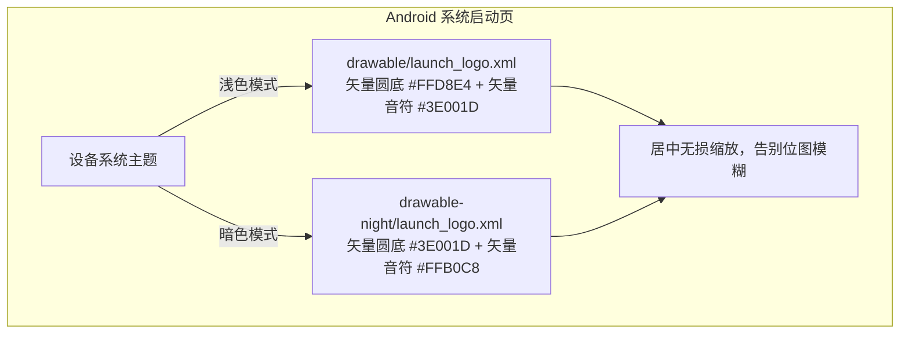
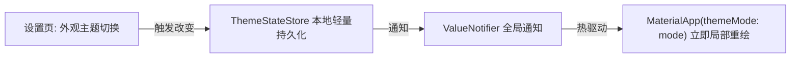

# PLAN_20：启动页矢量化改造与暗夜模式热切换方案（版本 1.1.0+124）

## 一、方案目标

本阶段聚焦于**视觉质感跃升**与**暗夜模式热切换**两大核心需求：
1. **启动页矢量化改造**：彻底替换原有位图（PNG），采用 Android 原生 **Vector Drawable（矢量 XML）**，不论何种屏幕 PPI 或分辨率均呈现 100% 锐利清晰的音符图标；并同时提供**浅色与暗色两套矢量启动图**。
2. **暗夜模式设计与热切换**：
   - 建立 Material 3 标准色彩体系（Light & Dark），精心调配暗夜模式的对比度、底色、强调色与卡片层级，确保舒适护眼、绝不刺眼；
   - 在设置中提供简洁的热切换选择（跟随系统 / 浅色模式 / 深色模式），通过全局状态秒级热更新，无需重启应用。

---

## 二、架构与视觉设计

### 1. 启动页双模矢量图架构（Vector Drawable）

- **Vector XML 设计**（画布 120dp x 120dp，视口 120x120）：
  - **第 1 层（圆底）**：直径 72dp 居中圆形矢量路径；
  - **第 2 层（音符）**：Material Icons `music_note` 经典矢量路径，保持与桌面图标相同视觉重心；
- **资源配置分布**：
  - `res/drawable/launch_logo.xml`（浅色矢量图）
  - `res/drawable-night/launch_logo.xml`（暗色矢量图）
  - `res/values/colors.xml`（浅色启动底色：`#FFF7FA`）
  - `res/values-night/colors.xml`（暗色启动底色：`#141213`）
  - `res/drawable/launch_background.xml` 与 `res/drawable-v21/`：直接引用矢量 `@drawable/launch_logo`；
  - `res/values-v31/styles.xml` 与 `values-night-v31/`：配置 `windowSplashScreenAnimatedIcon` 为 `@drawable/launch_logo`。

---

### 2. 暗夜模式色彩体系设计

遵循 Material Design 3 规范与柔和护眼原则，以余音标志性“粉紫调”为种子，精细构建深浅两套 ColorScheme：

| 语义层级 | 浅色模式（Light Theme） | 暗夜模式（Dark Theme） | 设计用意 |
|:---|:---|:---|:---|
| **Primary（主色）** | `#B81D5B` / Material Pink | `#FFB0C8`（高明度柔粉） | 暗色下提供清晰且低眩光的操作强调 |
| **Surface（主背景）** | `#FFF7FA`（微暖透白） | `#141213`（纯净深灰黑） | OLED 友好，沉浸护眼，不刺眼 |
| **SurfaceContainerHighest** | `#F3E7EA`（浅粉灰卡片） | `#231F21` / `#2B2527`（微亮深卡片） | 形成清晰的日志面板与状态卡片层级 |
| **OnSurface（主文字）** | `#201A1C`（深灰黑） | `#ECE0E2`（高对比清亮文字） | 保证极佳的长篇文本阅读清晰度 |
| **OnSurfaceVariant（副文字）** | `#514347`（中灰） | `#D4C2C6`（温和浅灰） | 消除底部标语等原本硬编码灰色的暗淡感 |

---

### 3. 热切换实现机制

- **数据层（`lib/utils/theme_store.dart`）**：
  - 提供轻量持久化存储（`theme_mode.flag`），记录当前选择（`system` / `light` / `dark`）；
- **表现层（`lib/main.dart`）**：
  - `MaterialApp` 外层包裹 `ValueListenableBuilder<ThemeMode>`，配置 `theme`、`darkTheme` 与 `themeMode`；
- **交互层（`lib/pages/settings_page.dart`）**：
  - 增加“外观设置”磁贴，副标题显示当前模式；点击弹出极简单选弹窗，选择后即刻全局热生效，无需重启应用。

---

## 三、用户审查要点（User Review Required）

> [!IMPORTANT]
> **版本号提升**：全项目版本号从 `1.1.0+123` 升级至 **`1.1.0+124`**。
> 涉及文件：`pubspec.yaml`、`lib/app_info.dart`、`README.md`、`GEMINI.md`、`CLAUDE.md`。

> [!NOTE]
> **设置项范围约束**：本次遵循用户指示“非常简单地在设置里写切换逻辑就行，下次 PLAN 会单独设计切换逻辑”，因此设置页仅提供直观轻巧的弹窗切换项，代码简洁克制。

---

## 四、具体改动清单与实现设计

### 1. Android 原生矢量启动页重构
- **[NEW] `android/app/src/main/res/drawable/launch_logo.xml`**：浅色矢量音符图（浅粉圆底 + 深红紫音符）；
- **[NEW] `android/app/src/main/res/drawable-night/launch_logo.xml`**：暗色矢量音符图（深粉紫圆底 + 明亮柔粉音符）；
- **[NEW] `android/app/src/main/res/values-night/colors.xml`**：暗色背景色定义 `#141213`；
- **[MODIFY] `android/app/src/main/res/drawable/launch_background.xml`** 及 `drawable-v21/`：将原本的 `<bitmap src="@drawable/launch_logo" />` 升级为使用 `<item android:drawable="@drawable/launch_logo" />` 矢量居中渲染；
- **[MODIFY] `android/app/src/main/res/values-night-v31/styles.xml`** 与 `values-v31/styles.xml`：统一将 `windowSplashScreenAnimatedIcon` 指定为 `@drawable/launch_logo`。

### 2. 主题持久化与色彩构建
- **[NEW] `lib/utils/theme_store.dart`**：
  - 维护 `ThemeMode` 枚举的本地持久化读取与保存；
  - 导出全局 `ValueNotifier<ThemeMode> themeModeNotifier`。
- **[MODIFY] `lib/main.dart`**：
  - 构建严谨的 `_buildLightTheme()` 与 `_buildDarkTheme()`；
  - 使用 `ValueListenableBuilder<ThemeMode>` 监听主题变化，驱动 `MaterialApp` 热切换。

### 3. 设置页热切换入口与页面细部色彩适配
- **[MODIFY] `lib/pages/settings_page.dart`**：
  - 增加“外观设置”磁贴，点击弹出“跟随系统 / 浅色模式 / 深色模式”对话框，选中即刻生效并持久化；
- **[MODIFY] `lib/pages/parse_page.dart`**：
  - 将底部标语原本硬编码的 `Colors.grey.shade600` 改为 `theme.colorScheme.onSurfaceVariant`，确保暗色下文字清晰自然。

### 4. 版本号与配置同步
- **[MODIFY] `pubspec.yaml`**、**`lib/app_info.dart`**、**`README.md`**、**`GEMINI.md`**、**`CLAUDE.md`**：同步更新为 `1.1.0+124`。

---

## 五、受影响文件清单

| 序号 | 文件路径 | 类型 | 说明 |
|:---|:---|:---|:---|
| 1 | `android/app/src/main/res/drawable/launch_logo.xml` | NEW | 浅色启动页高清矢量图 |
| 2 | `android/app/src/main/res/drawable-night/launch_logo.xml` | NEW | 暗色启动页高清矢量图 |
| 3 | `android/app/src/main/res/values-night/colors.xml` | NEW | 暗夜启动背景颜色定义 |
| 4 | `android/app/src/main/res/drawable/launch_background.xml` | MODIFY | 采用矢量 XML 居中挂载 |
| 5 | `android/app/src/main/res/drawable-v21/launch_background.xml` | MODIFY | 采用矢量 XML 居中挂载 |
| 6 | `android/app/src/main/res/values-v31/styles.xml` | MODIFY | 启动图标关联矢量图 |
| 7 | `android/app/src/main/res/values-night-v31/styles.xml` | MODIFY | 暗夜启动图标关联矢量图 |
| 8 | `lib/utils/theme_store.dart` | NEW | 主题偏好持久化与全局 ValueNotifier |
| 9 | `lib/main.dart` | MODIFY | 配置 Light/Dark Theme 与热切换响应 |
| 10 | `lib/pages/settings_page.dart` | MODIFY | 设置页添加外观切换交互 |
| 11 | `lib/pages/parse_page.dart` | MODIFY | 修正底部灰度文字暗夜模式适配 |
| 12 | `pubspec.yaml` / `lib/app_info.dart` | MODIFY | 版本号提升至 `1.1.0+124` |
| 13 | `README.md` / `GEMINI.md` / `CLAUDE.md` | MODIFY | 同步更新版本号记录与说明 |

---

## 六、验证计划

1. **静态代码分析与单元测试**：
   - 运行 `flutter analyze` 确保 0 errors / 0 warnings；
   - 运行 `flutter test` 确保所有 65 个测试用例全部通过，并补充针对主题持久化的单测。
2. **模拟器 / 真机验证**：
   - **冷启动超清矢量验证**：在深色与浅色系统下启动应用，观察启动图无论在高密度还是常规密度屏幕上边缘锐利无锯齿、完全不模糊；
   - **热切换响应验证**：在“设置 -> 外观设置”中切换至“深色模式”，解析页、历史页、设置页、调试页、选择弹窗瞬间无缝切换为深色，无需重启；
   - **持久化验证**：退出应用重新打开，保持上次选择的主题模式。

