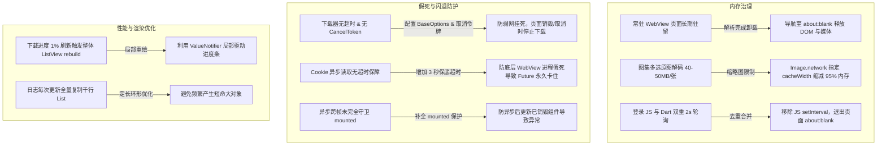

# PLAN_19：健壮性重构方案 —— 消除冗余逻辑、防止内存泄漏与防闪退假死

## 一、方案目标

针对余音（YuYin）在长期运行、连续解析、大图浏览与弱网下载场景下潜在的**内存泄漏（Memory Leaks）**、**进程被杀闪退（OOM Crash）**与**下载假死卡顿（Freeze Bug）**，开展系统性代码重构与健壮性加固。主要目标为：
1. **防止内存泄漏**：解决常驻 WebView 页面未卸载、登录页后台持续探测、大日志频繁内存拷贝问题；
2. **防止 OOM 闪退**：彻底解决图集预览时全量解码 4K 原始位图导致的内存暴涨与系统杀进程；
3. **防止运行挂起 / 假死**：为下载器补充缺失的网络连接/读取超时与取消令牌，为 Cookie 提取补充超时兜底，杜绝界面永久停留在 `处理中...` 状态；
4. **消除冗余逻辑与性能提升**：消除 Dart 与 JS 侧重复轮询探测逻辑，隔离下载进度微小变动带来的页面全量 rebuild。

---

## 二、关键问题排查与对应方案



---

## 三、用户审查要点（User Review Required）

> [!IMPORTANT]
> **版本号提升**：本项目严格遵循版本管理规范，在本次重构中将版本号从 `1.1.0+121` 提升至 `1.1.0+122`。
> 涉及文件：`pubspec.yaml`、`lib/app_info.dart`、`README.md`、`GEMINI.md`、`CLAUDE.md`。

> [!NOTE]
> **非侵入式优化**：本方案不会破坏原有的核心三路嗅探算法（桌面 JS + iesdouyin Dio API + 移动 UA 兜底），所有解析协议、登录状态检测机制保持完全兼容。

---

## 四、具体改动清单与实现设计

### 1. 组件与资源治理：`lib/widgets/image_preview_sheet.dart`（预防 OOM 闪退）
- **问题**：当前在 `_buildTile` 中，直接使用 `Image.network(item.url, fit: BoxFit.cover)`。抖音图集图片分辨率极高（例如 3024x4032），未设缓存解码尺寸时，单张解码内存可达 48MB。若图集包含 20 张图片，仅滑到底部就会占用近 1GB 内存，极易被 Android Low Memory Killer 强杀。
- **改动**：
  - 在缩略图网格中为 `Image.network` 添加 `cacheWidth: 360`（针对 3 列网格，360 物理像素足以提供视网膜级清晰度，单张内存从 ~48MB 降至 ~0.4MB，降低 99%）；
  - 全屏放大预览（`_showPreview`）才加载原图，并在全屏预览添加加载指示器与错误占位。

### 2. 下载引擎健壮性：`lib/services/video_downloader.dart`（预防假死与挂死）
- **问题**：
  1. `VideoDownloader` 初始化的 `_dio` 默认没有任何 `connectTimeout` 和 `receiveTimeout`；弱网或抖音 CDN 连接挂起时将无限期等待，导致主界面永久卡在 `正在下载...`；
  2. 批量下载不支持外部取消（缺少 `CancelToken`）；
  3. 临时文件命名为固定 `temp_$i.ext`，若并发或异常中断可能残留；
- **改动**：
  - 配置 `BaseOptions(connectTimeout: Duration(seconds: 15), receiveTimeout: Duration(seconds: 60))`；
  - 为 `downloadItems` 增加 `CancelToken? cancelToken` 支持；
  - 临时文件名引入随机时间戳后缀，下载前确保旧文件被安全清除；
  - 捕获 `GalException`，友好转化为中文提示（如权限、相册无法写入等）。

### 3. 常驻 WebView 内存卸载：`lib/services/douyin_sniffer.dart`（消除后台内存泄漏）
- **问题**：
  1. 解析成功（`_finishWithItems`）后，底层 WebView 依然保留在抖音播放页面，页面上庞大的 DOM 节点、视频流缓存与 Next.js 定时脚本长驻系统 WebView 进程；
  2. `_finishWithItems` 中先执行了 `_stopTimers()`（取消了 30 秒兜底超时），再执行 `await _controller.runJavaScriptReturningResult('document.cookie')`。若底层 WebView 在此处出现未响应，会导致 Future 永久挂起，主界面永远处于 busy 状态。
- **改动**：
  - 读取 Cookie 的操作增加 `.timeout(const Duration(seconds: 3))` 兜底；
  - 解析成功并且读取完 Cookie 后，在后台让 WebView 加载 `about:blank`，彻底卸载网页上下文；
  - `sniffVideoUrl` 新任务开始时采用 `Uri.tryParse` 防范极端非法的 URL 字符串格式。

### 4. 登录检测脚本去重：`lib/services/login_detector_script.dart` 与 `lib/pages/login_webview_page.dart`
- **问题**：
  - Dart 侧设置了 2 秒周期定时器注入脚本，脚本内部又自带 `setInterval(..., 2000)`，造成双重轮询，每分钟对抖音接口发起 60~120 次探测，极易招致网络风控；
  - 离开登录页（Pop）时，底层的 WebView 没有清理，JS 中的定时器依然在后台运行。
- **改动**：
  - 去除 `kDouyinLoginDetectJs` 内冗余的 `setInterval`，仅由 Dart 侧根据页面实际生命周期周期性触发，且登录成功后立即停止探测；
  - `LoginWebViewPage` 在 `dispose()` 时，调用 `_controller.loadRequest(Uri.parse('about:blank'))`，确保离开页面后彻底停掉所有 JS 线程与网络请求。

### 5. UI 渲染与状态优化：`lib/pages/parse_page.dart`
- **问题**：
  - 批量下载时，下载进度的微小变化（如 1%）频繁调用 `setState`，引发包括 `TextField`、按钮栏在内的整个界面树重绘；
  - 异步流程结束后缺少部分 `if (!mounted) return;` 守卫；
  - 输入框被点击“清空”按钮时，滚动条指示器的状态没有立即重置。
- **改动**：
  - 将下载进度条改为由独立的 `ValueNotifier<double?>` 局部更新，不再频繁触发外层 `setState`；
  - 补充所有 await 后的 `mounted` 校验；
  - 点击“清空”按钮时，同步重置 `_showScrollIndicator = false` 并取消隐藏定时器。

---

## 五、受影响文件清单

| 序号 | 文件路径 | 修改类型 | 说明 |
|:---|:---|:---|:---|
| 1 | `lib/widgets/image_preview_sheet.dart` | MODIFY | 添加缩略图 `cacheWidth: 360`，防止大图解码 OOM；完善全屏加载体验 |
| 2 | `lib/services/video_downloader.dart` | MODIFY | 设置网络超时，支持 `CancelToken`，规范临时文件命名与异常捕获 |
| 3 | `lib/services/douyin_sniffer.dart` | MODIFY | Cookie 读取超时保护，解析完成后及时卸载 WebView 页面内存（about:blank） |
| 4 | `lib/services/login_detector_script.dart` | MODIFY | 移除 JS 内部冗余 `setInterval`，避免双重高频请求与风控风险 |
| 5 | `lib/pages/login_webview_page.dart` | MODIFY | 销毁时主动加载 `about:blank` 终止后台网页运行 |
| 6 | `lib/pages/parse_page.dart` | MODIFY | 局部驱动下载进度条，补全 `mounted` 守卫，清空输入框时重置指示条状态 |
| 7 | `pubspec.yaml` / `lib/app_info.dart` | MODIFY | 版本号提升至 `1.1.0+122` |
| 8 | `README.md` / `GEMINI.md` / `CLAUDE.md` | MODIFY | 同步更新版本号记录与说明 |

---

## 六、验证计划

### 1. 自动化测试（Automated Tests）
- 运行代码静态分析：
  ```powershell
  flutter analyze
  ```
  预期结果：0 errors, 0 warnings。
- 运行单元测试套件：
  ```powershell
  flutter test
  ```
  预期结果：全部原有 63 个测试（及针对新逻辑补充的测试）100% 通过。

### 2. 模拟器 / 真机验证（Manual Verification）
- **多图图集内存测试**：解析包含 10 张以上高分辨率图片的图集，打开预览面板快速上下滑动，观察内存占用平稳，不发生 OOM 闪退；
- **后台常驻内存测试**：完成一次视频解析后，检查调试日志与 WebView 状态，确认完成抓取后已安全释放页面资源；
- **下载与取消测试**：开始下载，观察进度条平滑刷新，验证下载中退出或取消时能及时释放网络与文件句柄；
- **登录状态探测测试**：进入登录页，观察网络请求平稳正常，成功识别登录/退出状态，返回主页无后台残留。

