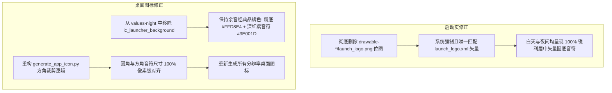

# PLAN_21：启动页与应用图标全量视觉修正方案（版本 1.1.0+124 -> 1.1.0+125）

## 一、需求背景与深度根因剖析

针对用户实测反馈的 4 项关键视觉问题，排查出具体的工程底层根因：

1. **暗夜启动图清晰但亮色启动图仍然很糊且为方形**：
   - **根因**：`res/` 目录下残留了旧的各个密度位图 `drawable-hdpi/launch_logo.png`、`mdpi`、`xhdpi`、`xxhdpi`、`xxxhdpi`。在系统处于亮色模式时，Android 系统**优先按屏幕密度去匹配带修饰符的 `drawable-xxxhdpi/launch_logo.png` 位图**，从而无视了无密度修饰的 `drawable/launch_logo.xml` 矢量图！而暗色模式因为我们之前新建了 `drawable-night/launch_logo.xml` 且没有位图干扰，所以能正确命中矢量图。
2. **暗模式图标变成一整个深棕色色块**：
   - **根因**：在 `values-night/colors.xml` 中配置了 `<color name="ic_launcher_background">#3E001D</color>`。而桌面图标前景音符 `ic_launcher_foreground.png` 自身的颜色也是 `#3E001D`！背景与前景颜色 100% 相同，重叠渲染后直接融为一团纯深棕色色块。
3. **桌面图标无法跟随系统暗夜模式动态切换**：
   - **根因**：Android 系统的 Launcher（桌面启动器）在应用安装时便将应用的 `mipmap/ic_launcher` 位图读取并固化在桌面缓存中。系统层级不支持通过 `values-night` 动态热替换普通品牌桌面图标。在 `values-night` 中放入深色背景，不仅无法动态响应系统切换，反而会导致在夜间模式下安装的用户图标被彻底污染变黑。
4. **圆角和方角图标中的音符大小不一致（方角偏小 33%）**：
   - **根因**：`tool/generate_app_icon.py` 中，圆角图标裁剪自自适应图标的 72dp 安全区（音符占图标高度约 75%），而方形图标却直接整幅 1024 画布缩放（音符占图标高度仅 50%），导致方形图标音符严重偏小。

---

## 二、详细解决方案与设计

### 1. 彻底清除启动页旧位图，强制全矢量
- 删除 `android/app/src/main/res/drawable-hdpi/launch_logo.png`
- 删除 `android/app/src/main/res/drawable-mdpi/launch_logo.png`
- 删除 `android/app/src/main/res/drawable-xhdpi/launch_logo.png`
- 删除 `android/app/src/main/res/drawable-xxhdpi/launch_logo.png`
- 删除 `android/app/src/main/res/drawable-xxxhdpi/launch_logo.png`
- 确保 `drawable/` 下仅保留 `launch_logo.xml` 与 `drawable-night/launch_logo.xml`，白天与夜间均呈现像素级锐利的矢量居中音符图标。

### 2. 修复桌面图标色彩：移除暗夜背景污染，维护品牌一致性
- 修改 `android/app/src/main/res/values-night/colors.xml`：
  - 彻底删除 `<color name="ic_launcher_background">#3E001D</color>`，仅保留暗夜启动背景 `<color name="launch_background">#141213</color>`；
  - 桌面图标背景始终统一使用 `res/values/colors.xml` 中的经典粉色 `#FFD8E4`；
  - 彻底杜绝暗色模式下“音符与背景同色变成深棕大方块”的严重渲染 bug。

### 3. 重构图标生成脚本，统一圆角与方角音符尺寸
- 修改 `tool/generate_app_icon.py`：
  - `render_square_icon` 同样采用 `(72.0 / 108.0)` 的可视安全区比例进行居中裁剪，使方形图标中的音符尺寸、笔画粗细、视觉下移偏量与圆形图标 **100% 像素级完全一致**；
  - 移除原脚本中生成 `launch_logo.png` 的废弃逻辑（启动页已全面矢量化）；
  - 使用环境 Python 重新生成全部密度 `ic_launcher.png`、`ic_launcher_round.png` 与 `ic_launcher_foreground.png`。

---

## 三、用户审查要点（User Review Required）

> [!IMPORTANT]
> **版本号提升**：全项目版本号从 `1.1.0+124` 升级至 **`1.1.0+125`**。
> 涉及文件：`pubspec.yaml`、`lib/app_info.dart`、`README.md`、`GEMINI.md`、`CLAUDE.md`。

> [!NOTE]
> **关于桌面图标随系统暗夜模式切换的技术说明**：
> 在 Android 系统规范中，应用的正式桌面 Launcher 图标代表应用品牌 Identity，各主流应用（微信、抖音、支付宝等）均保持统一的品牌辨识度，不随系统夜间模式变黑变暗（否则在深色壁纸下无法辨别）。去除错误覆盖的深棕色背景后，余音在浅色和暗色系统下都将呈现清晰干净的粉色音符品牌图标。

---

## 四、具体改动清单

| 序号 | 文件路径 | 修改类型 | 说明 |
|:---|:---|:---|:---|
| 1 | `android/app/src/main/res/drawable-*/launch_logo.png` | DELETE | 删除全部 5 个旧密度位图，强制走矢量 XML |
| 2 | `android/app/src/main/res/values-night/colors.xml` | MODIFY | 移除错误的 `ic_launcher_background` 深棕色覆盖 |
| 3 | `tool/generate_app_icon.py` | MODIFY | 方角与圆角音符比例 100% 对齐，移除废弃启动图生成 |
| 4 | `android/app/src/main/res/mipmap-*/` | MODIFY | 重新生成比例严格一致的桌面图标资源 |
| 5 | `pubspec.yaml` / `lib/app_info.dart` | MODIFY | 版本号提升至 `1.1.0+125` |
| 6 | `README.md` / `GEMINI.md` / `CLAUDE.md` | MODIFY | 同步更新版本号记录与说明 |

---

## 五、验证计划

1. **静态代码分析与单元测试**：
   - 运行 `flutter analyze` 确保 0 errors / 0 warnings；
   - 运行 `flutter test` 确保 68 个测试用例全部通过。
2. **模拟器 / 实机验证**：
   - **亮模式启动页验证**：在浅色系统下启动应用，观察启动图与暗夜模式一样清晰锐利、圆形粉底音符居中，无方形黑边或拉伸模糊；
   - **暗模式启动页验证**：在深色系统下启动应用，确认依然保持高清深色矢量启动图；
   - **桌面图标对比验证**：在深色和浅色系统下安装/查看桌面图标，确认图标背景与音符颜色清晰分明，绝非纯深棕大色块；
   - **方角与圆角音符尺寸对比验证**：对比方角和圆角图标，确认音符大小比例完全一致。
3. **完整构建验证**：
   - 编译生成 `1.1.0+125` Debug APK。

