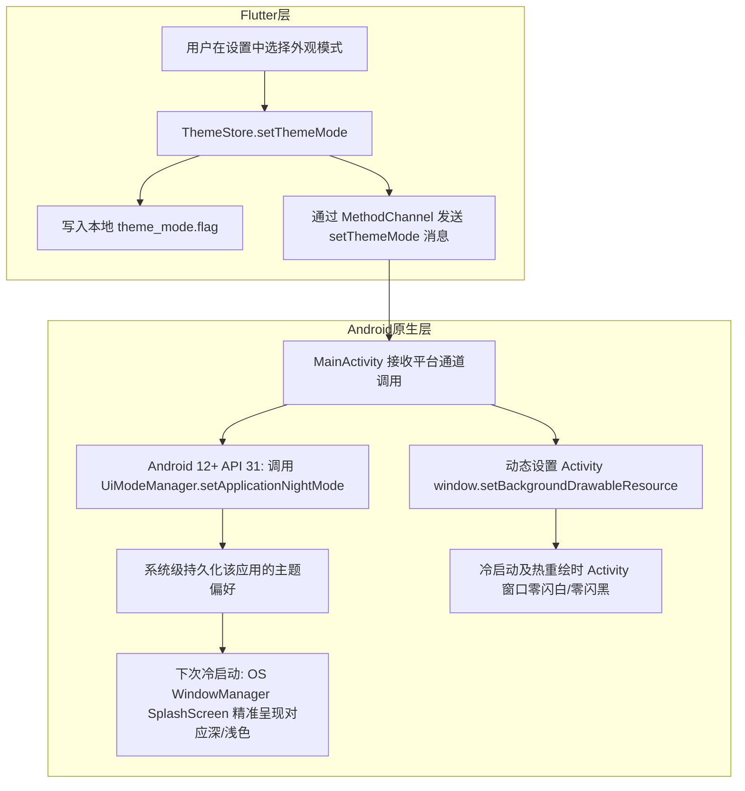

# PLAN_21：启动页与应用图标视觉修正及应用内主题深度联动方案（版本 1.1.0+125 -> 1.1.0+126）

## 一、需求背景与深度根因剖析

针对用户实测反馈的视觉与主题联动问题，排查出具体的工程底层根因：

1. **暗夜启动图清晰但亮色启动图仍然很糊且为方形**（*已于 125 解决*）：
   - **根因**：`res/` 目录下残留了旧的各个密度位图 `drawable-*/launch_logo.png`。在系统处于亮色模式时，Android 系统优先匹配带密度修饰符的位图，无视了矢量的 `drawable/launch_logo.xml`。
2. **暗模式图标变成一整个深棕色色块**（*已于 125 解决*）：
   - **根因**：在 `values-night/colors.xml` 中错误配置了 `<color name="ic_launcher_background">#3E001D</color>`，与前景音符颜色重叠渲染成纯深棕大方块。
3. **桌面图标无法跟随系统暗夜模式动态切换**（*已于 125 解决*）：
   - **根因**：Android 系统的 Launcher 在安装时缓存固化图标。品牌图标应保持一致的经典浅粉底+深红紫音符，不应在夜间模式被污染变暗。
4. **圆角和方角图标中的音符大小不一致（方角偏小 33%）**（*已于 125 解决*）：
   - **根因**：旧脚本中方形图标未按 72dp/108dp（66.7%）安全区裁剪，音符仅占画布 50%，导致相比圆角图标显著偏小。
5. **【126 核心修复】启动页亮/暗仅与系统匹配，未与应用内设置联动**：
   - **表现**：系统为亮色模式，但在软件“设置 -> 外观设置”中选择“深色模式”，冷启动应用时，启动页依然呈现白色浅色启动图，直到 Flutter 首帧渲染后才变成深色，产生刺眼的闪白。
   - **根因**：Android 原生系统启动窗口（Starting Window / SplashScreen）及 Activity 的初始 `windowBackground`，默认仅根据系统全局的 `Configuration.uiMode` 去匹配 `res/values` 或 `res/values-night`，对 Flutter 内部在沙盒中存储的主题标志（`theme_mode.flag`）毫不知情。

---

## 二、详细解决方案与架构设计

### 1. Android 12+ (API 31+) 官方应用级夜间模式持久化联动
- 利用 Android 官方推荐的 `UiModeManager.setApplicationNightMode(int mode)` API：
  - 用户选“深色模式”：同步设置 `MODE_NIGHT_YES`；
  - 用户选“浅色模式”：同步设置 `MODE_NIGHT_NO`；
  - 用户选“跟随系统”：同步设置 `MODE_NIGHT_FOLLOW_SYSTEM`；
- **核心价值**：该状态由 Android 系统服务自动按应用包名持久化存储。在下次应用冷启动（即系统创建 Activity 进程前），Android WindowManager 读取该持久化配置，**直接使用对应暗夜或浅色主题（`values-night-v31` 或 `values-v31`）渲染系统级 SplashScreen**，从根本上解决“系统亮、软件暗”时系统启动窗闪白的问题。

### 2. Activity 启动窗口背景双重保障（全版本兼容）
- 在 `MainActivity.kt` 的 `onCreate(savedInstanceState: Bundle?)` 中，于 `super.onCreate` 之前读取 `theme_mode.flag`：
  - 如果为 `dark`：显式调用 `window.setBackgroundDrawableResource(R.drawable.launch_background_dark)`；
  - 如果为 `light`：显式调用 `window.setBackgroundDrawableResource(R.drawable.launch_background_light)`；
  - 如果为 `system`：调用 `window.setBackgroundDrawableResource(R.drawable.launch_background)`；
- 并在 Android 12+ 上补位同步 `uiModeManager.applicationNightMode`；
- 新增显式资源文件：
  - `res/drawable/launch_logo_light.xml`（显式浅色矢量音符）；
  - `res/drawable/launch_logo_dark.xml`（显式暗色矢量音符）；
  - `res/drawable/launch_background_light.xml`（显式浅色背景图层）；
  - `res/drawable/launch_background_dark.xml`（显式暗夜背景图层）；
  - `res/values/colors.xml` 添加对应的独立颜色定义。

### 3. Flutter <-> Native MethodChannel 双向通信
- 建立原生通道 `MethodChannel('com.debug.yuyin/theme')`：
  - 在 `ThemeStore.init()` 启动恢复主题时触发同步；
  - 在 `ThemeStore.setThemeMode()` 用户点击切换时实时触发同步；
  - 由于 `AndroidManifest.xml` 中 `MainActivity` 已经配置了 `android:configChanges` 包含 `uiMode`，设置 `setApplicationNightMode` **不会引起 Activity 销毁重建**，Flutter 维持当前流畅运行与热重绘。

---

## 三、用户审查要点（User Review Required）

> [!IMPORTANT]
> **版本号提升**：全项目版本号从 `1.1.0+125` 升级至 **`1.1.0+126`**。
> 涉及文件：`pubspec.yaml`、`lib/app_info.dart`、`README.md`、`GEMINI.md`、`CLAUDE.md`。

> [!TIP]
> **关于系统启动页切换机制**：
> 1. 用户在软件内选择“深色模式”后，即刻生效并将应用级夜间模式注册到 Android 系统；
> 2. 当划掉应用重新打开（冷启动）时，无论系统处于亮色还是暗色，系统的启动窗口和图标都将精准对应软件内的深色/浅色偏好；
> 3. 选择“跟随系统”时，自动恢复与系统全局外观同步。

---

## 四、具体改动清单

| 序号 | 文件路径 | 修改类型 | 说明 |
|:---|:---|:---|:---|
| 1 | `android/app/src/main/res/values/colors.xml` | MODIFY | 补充 `launch_background_light` 与 `launch_background_dark` 显式色彩 |
| 2 | `android/app/src/main/res/drawable/launch_logo_light.xml` | CREATE | 显式浅色矢量音符图标资源 |
| 3 | `android/app/src/main/res/drawable/launch_logo_dark.xml` | CREATE | 显式暗夜矢量音符图标资源 |
| 4 | `android/app/src/main/res/drawable/launch_background_light.xml` | CREATE | 显式浅色启动页背景组合层（API 21+ 兼容） |
| 5 | `android/app/src/main/res/drawable/launch_background_dark.xml` | CREATE | 显式暗夜启动页背景组合层（API 21+ 兼容） |
| 6 | `android/app/src/main/kotlin/com/debug/yuyin/MainActivity.kt` | MODIFY | 实现 `onCreate` 背景预设、`UiModeManager.setApplicationNightMode` 及 MethodChannel 监听 |
| 7 | `lib/utils/theme_store.dart` | MODIFY | `setThemeMode` 与 `init` 中增加 MethodChannel 原生同步调用 |
| 8 | `pubspec.yaml` / `lib/app_info.dart` | MODIFY | 版本号提升至 `1.1.0+126` |
| 9 | `README.md` / `GEMINI.md` / `CLAUDE.md` | MODIFY | 同步更新版本号记录与说明 |

---

## 五、验证计划

1. **静态代码分析与单元测试**：
   - 运行 `flutter analyze` 确保 0 errors / 0 warnings；
   - 运行 `flutter test` 确保 68 个测试用例全部通过。
2. **模拟器 / 实机场景测试**：
   - **场景 A（系统亮，软件暗）**：系统全局开启亮色，余音外观设置选“深色模式”，划掉后台冷启动，验证启动画面背景为深黑色（#141213）且音符为粉色暗夜矢量图，无任何闪白；
   - **场景 B（系统暗，软件亮）**：系统全局开启暗色，余音外观设置选“浅色模式”，划掉后台冷启动，验证启动画面背景为浅粉白（#FFF7FA）且音符为深色矢量图，无任何闪黑；
   - **场景 C（跟随系统）**：余音选“跟随系统”，随系统深色/浅色切换，冷启动均完全跟随系统。
3. **完整构建验证**：
   - 编译生成 `1.1.0+126` Debug APK。
