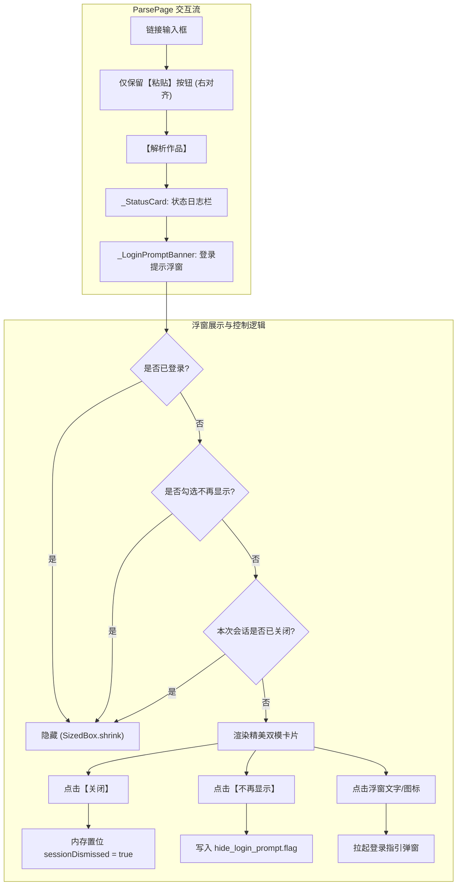

# PLAN_22：界面精细化与未登录提示浮窗方案（版本 1.2.0+126 -> 1.2.0+127）

## 一、需求背景与深度分析

针对用户在实机使用反馈的 4 项交互体验与界面视觉细节进行专项优化：

1. **移除解析页冗余的“清空”按钮**：
   - **分析**：剪贴板“粘贴”按钮读取剪贴板后直接对输入框内容进行完全重写并跳至首行，自带清除旧内容效果。并列的“清空”按钮占用视觉空间且功能重叠，故精简为单个“粘贴”按钮。
2. **暗夜模式下 SnackBar 提示底色刺眼（白底）问题**：
   - **根因**：Material 3 规范中 SnackBar 默认取用 `colorScheme.inverseSurface` 作为背景以实现高对比。在暗夜主题下，`inverseSurface` 自动生成为偏白的亮灰色，导致在深色背景下弹出的 SnackBar 呈现白色大色块，视觉割裂严重。
   - **方案**：在全局深色与浅色 ThemeData 中显式定制 `snackBarTheme`，将暗夜模式背景设为柔和深灰粉紫（`#2B2527`），文字为 `#ECE0E2`，边框为 `#3E3639`，圆角 10dp，浮动风格，保证调试页“复制日志”、“清空日志”以及关于页复制链接时的提示统一优雅。
3. **顶栏“抖音登录/提画质”与“我的主页”缺乏按钮框**：
   - **方案**：将顶栏原本的裸 `TextButton` 升级为带胶囊边框的实体操作按钮（`OutlinedButton.icon`）。
   - **视觉设计**：34dp 高度、圆角 17dp 胶囊轮廓；浅色模式下采用淡粉底色+粉红框线；暗夜模式下采用暗粉微透底色+高光柔粉框线；未登录带登录图标，已登录带个人中心图标。
4. **解析页新增未登录建议提示浮窗**：
   - **需求**：未登录抖音时，在日志栏下方展示提示浮窗，跟随日志栏在列表中上下平滑滚动。文案为“建议登录抖音，可以解析到更高画质”，右下角提供“关闭”与“不再显示”两个按钮。
   - **方案**：
     - 将 `_LoginPromptBanner` 直接放入 `ParsePage` 的 `ListView` 中，位于 `_StatusCard` 正下方，自然伴随列表滚动；
     - 浅色/暗色双模式卡片精细调色；
     - “关闭”仅在当前会话内存中标记隐藏；
     - “不再显示”调用 `LoginStateStore.setLoginPromptDismissed(true)` 进行本地持久化标记存储，冷启动后依然保持隐藏；
     - 点击浮窗正文还可直接唤起登录提示弹窗，方便快捷。

---

## 二、详细解决方案与架构设计

---

## 三、用户审查要点（User Review Required）

> [!IMPORTANT]
> **版本号提升**：全项目版本号从 `1.2.0+126` 升级至 **`1.2.0+127`**。
> 涉及文件：`pubspec.yaml`、`lib/app_info.dart`、`README.md`、`GEMINI.md`、`CLAUDE.md`。

> [!TIP]
> **关于提示浮窗的交互逻辑**：
> 1. “关闭”：仅对当前应用运行会话生效，划掉后台重新打开后仍会提示；
> 2. “不再显示”：持久化写入本地沙盒标记文件 `hide_login_prompt.flag`，后续即使完全冷启动也不会再次弹出；
> 3. 点击浮窗文本或图标可直接呼出登录流程，无需用户再去右上角寻找入口；
> 4. 用户登录成功后，无论此前是否点击过关闭，该浮窗都会自动从界面完全隐藏。

---

## 四、具体改动清单

| 序号 | 文件路径 | 修改类型 | 说明 |
|:---|:---|:---|:---|
| 1 | `lib/main.dart` | MODIFY | 在 `_buildLightTheme` 与 `_buildDarkTheme` 中添加全局 `snackBarTheme`，修复暗夜模式提示框白底问题 |
| 2 | `lib/pages/app_shell.dart` | MODIFY | 将顶栏裸文字按钮升级为带边框与图标的胶囊型 `OutlinedButton.icon`（双模适配），并透传 `onTapAccount` 回调 |
| 3 | `lib/pages/parse_page.dart` | MODIFY | 移除“清空”按钮；在 `_StatusCard` 下方新增随列表滚动的 `_LoginPromptBanner` 组件（支持双模配色、关闭、不再显示与直达登录） |
| 4 | `lib/utils/login_state_store.dart` | MODIFY | 新增 `isLoginPromptDismissed()` 与 `setLoginPromptDismissed(bool)` 本地持久化控制 |
| 5 | `pubspec.yaml` / `lib/app_info.dart` | MODIFY | 版本号提升至 `1.2.0+127` |
| 6 | `README.md` / `GEMINI.md` / `CLAUDE.md` | MODIFY | 同步更新版本号记录与说明 |

---

## 五、验证计划

1. **静态代码分析与单元测试**：
   - 运行 `flutter analyze` 确保 0 errors / 0 warnings；
   - 运行 `flutter test` 确保已有全部测试用例通过。
2. **场景实机 / 模拟器验证**：
   - **场景 1（解析页清空按钮移除）**：确认输入框下方仅有“粘贴”按钮，点击粘贴正常覆盖；
   - **场景 2（暗夜模式 SnackBar 提示验证）**：外观设为深色模式，在“设置 -> 调试”点击复制/清空日志，确认底部提示为暗夜色卡（#2B2527）与浅色字；
   - **场景 3（右上角按钮框验证）**：在浅色与深色模式下，验证右上角“抖音登录/提画质”与“我的主页”均带有实体圆角边框与半透明底色；
   - **场景 4（登录提示浮窗验证）**：未登录时展示浮窗，上下滚动列表确认自然跟随；测试点击“关闭”、“不再显示”持久化以及登录后自动隐藏。

