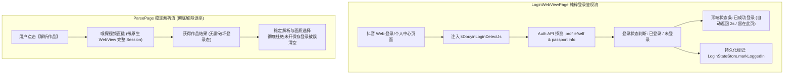

# PLAN_23：抖音登录检测彻底修复与精简冗余“保存登录”逻辑（版本 1.2.0+127 -> 1.2.0+129）

## 一、需求背景与深度根因剖析

针对用户实测反馈的核心登录校验问题，进行深层技术链路复盘与二次精炼：

### 1. 现象复现与用户实测验证
1. **首次成功登录**：在 `LoginWebViewPage` 中扫码或手机号登录后，提示“已成功登录”，返回主界面状态为已登录，判断准确；
2. **下次解析触发误判**：若用户登录后未主动开启抖音的“保存登录”选项，在随后的解析流程中，软件会**错误地判定用户已失效并强制清空登录态**；
3. **实测结论**：
   - 用户实测确认：**登录判断已彻底成功**，解除误杀后未开启“保存登录”也能完全稳定解析高画质；
   - 抖音官方的“保存登录信息”仅用于用户在退出登录后方便再次登录，对后台嗅探解析**毫无影响、完全没有必要作为前置条件**；
   - 因此，彻底移除“保存登录信息”的相关探测、状态模型及多余弹窗，保持系统纯粹敏捷。

### 2. 底层根因剖析 (Root Cause)
根本原因在于原 `ParsePage` 在每次解析完成后，拿 `result.cookie`（通过前端 JS `document.cookie` 获取）去校验是否包含 `sessionid`：
- **浏览器安全机制限制**：现代主流网站（包括抖音）中，核心登录凭证（如 `sessionid`、`sessionid_ss`）均由服务端强制设置了 `HttpOnly` 标识。**JavaScript 的 `document.cookie` 根本无法读取到带 HttpOnly 的 Cookie**；
- **“保存登录”的作用机制**：
  - 当用户**未点击**“保存登录”时：抖音仅将凭证保存在底层的 HttpOnly 会话 Cookie 中；在作品页面上，JS 的 `document.cookie` 不会暴露明文 `sessionid`；
  - 实际上，Android 原生 WebView 在发起网络请求或嗅探加载时，**会自动在 HTTP Header 中携带完整的 HttpOnly Cookie**，平台早已识别为已登录并能正常吐出高清视频；
  - 但原软件却因为 `document.cookie` 字符串里没有明文 `sessionid`，误判为“登录失效”，直接强行清空了登录态；
  - 而当用户**打开“保存登录”**时：抖音在前端写入了额外可读标记或持久化 Cookie，恰好使得 `result.cookie` 包含对应字符串，逃过了误判。

因此，软件在解析时不经意间把“保存登录”产生的明文 Cookie 差异，当成了“是否处于登录态”的硬性判定，造成了误杀。

---

## 二、详细解决方案与架构设计

### 1. 彻底修复解析页登录状态误清空
- 移除 `ParsePage` 中根据 `result.cookie` 缺失明文 session 即强制 `clearLogin()` 的脆弱逻辑；
- 登录态的判定与撤销完全交由：
  1. 用户在 `LoginWebViewPage` 中主动点击退出登录（触发 `logout_event`）；
  2. 冷启动时通过 Android 系统底层 `WebViewCookieManager` 检查真实 Cookie 库（支持 HttpOnly）；
  3. 彻底避免在未开启“保存登录”时被解析流程误踢。

### 2. 彻底精简冗余的“保存登录”逻辑与弹窗
- 经实机验证，“保存登录信息”对本应用解析无任何正面价值，彻底移除其相关逻辑：
  - 移除 `login_detector_script.dart` 中的 `SaveLoginState` 模型与 JS 侧的 `detectSaveLogin()` / `notifySaveLoginState()`；
  - 移除 `login_webview_page.dart` 中的 `_buildSaveLoginBadge` 弹窗与相关字段；
  - 保持页面与代码的高可读性与无冗余。

---

## 三、用户审查要点（User Review Required）

> [!IMPORTANT]
> **版本号提升**：全项目版本号从 `1.2.0+128` 升级至 **`1.2.0+129`**。
> 涉及文件：`pubspec.yaml`、`lib/app_info.dart`、`README.md`、`GEMINI.md`、`CLAUDE.md`。

---

## 四、具体改动清单

| 序号 | 文件路径 | 修改类型 | 说明 |
|:---|:---|:---|:---|
| 1 | `lib/pages/parse_page.dart` | MODIFY | 彻底移除基于 `result.cookie` 的错误登出判定，解除误杀（实测通过） |
| 2 | `lib/services/login_detector_script.dart` | MODIFY | 移除 `SaveLoginState` 与多余的保存登录 DOM/Storage 探测逻辑，回归纯粹权威凭证鉴权 |
| 3 | `lib/pages/login_webview_page.dart` | MODIFY | 移除保存登录状态弹窗与依据对话框，保持顶栏清爽 |
| 4 | `lib/utils/login_state_store.dart` | MODIFY | 丰富登录凭证判定集合（支持 `sid_tt`、`passport_authid` 等） |
| 5 | `pubspec.yaml` / `lib/app_info.dart` | MODIFY | 版本号提升至 `1.2.0+129` |
| 6 | `README.md` / `GEMINI.md` / `CLAUDE.md` | MODIFY | 同步更新版本号记录与说明 |

---

## 五、验证计划

1. **静态代码分析与单元测试**：
   - 运行 `flutter analyze` 确保 0 errors / 0 warnings；
   - 运行 `flutter test` 确保 68 个测试用例全部通过。
2. **场景实机验证**：
   - 用户已确认：未开启“保存登录”登录成功后，解析保持稳定，不再掉登录；
   - 登录 Web 界面顶栏干净清晰，无任何多余弹窗干扰。
