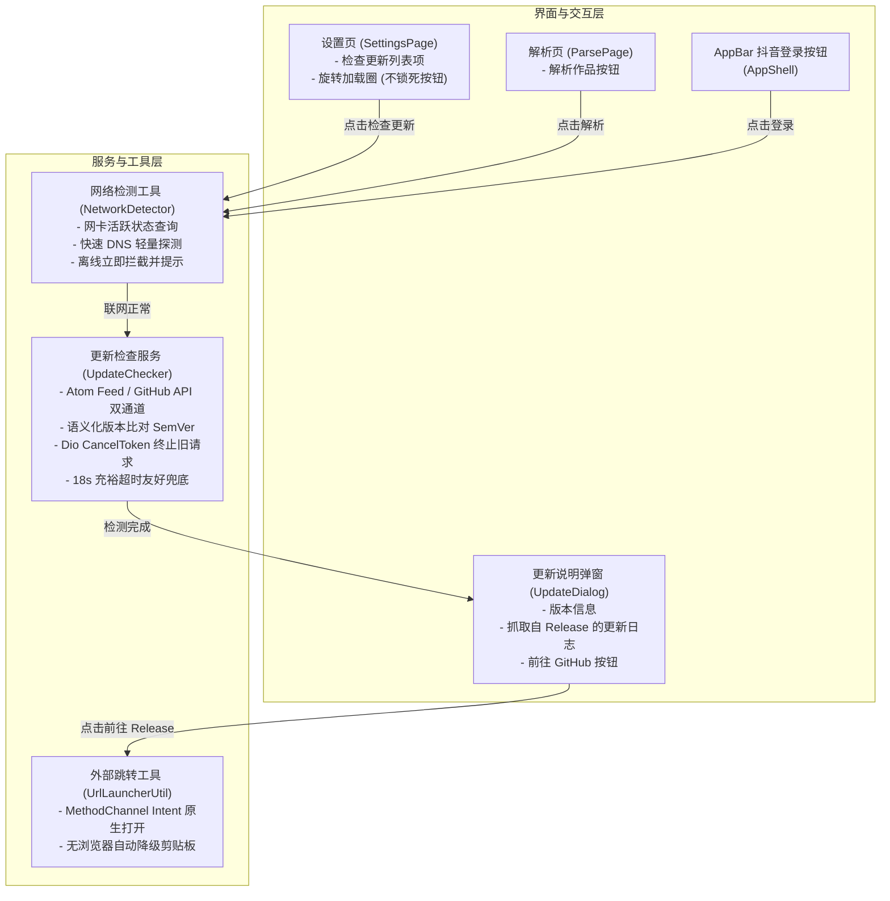

# PLAN_24：设置页检查更新、网络连接检测与外部 Release 跳转（版本 1.2.3+129 -> 1.2.4+133）

## 一、需求背景与目标

本次开发的核心目标是在设置页新增“检查更新”功能，并为关键网络操作（解析、登录、更新）增加前置网络检测与友好超时提示。

### 1. 核心需求点
1. **GitHub Release 更新检测与 Markdown 原生视觉渲染（版本 1.2.4+133 深度调优）**：
   - 对比 GitHub 发布页面的最新 tag（命名规则与版本一致，如 `1.2.3`、`1.2.0`）；
   - 抓取 Release 发布说明（Changelog）与外部发布页 URL；
   - 彻底解决文本展示形态：不再显示任何 Markdown 语法源码（如 `### ` 等标记），而是直接渲染为**层级结构化排版组件**（标题自动加粗、调优字号并以 Primary 色醒目点缀；列表缩进条目对齐；行内支持粗体、代码块等），提供原生应用级别的阅读体验，同时支持长按自由选中文本；
   - 针对国内直连环境提供充裕的超时设置（18 秒）与超时友好提示。
2. **更新日志小窗自适应伸缩与纯指示滚动条（参考 PLAN_18）**：
   - 行数较少时：日志小窗自适应内容高度对齐，不留突兀空白；
   - 行数较多时：固定最大高度为 180dp，并在右侧呼出定制滚动指示器；
   - 样式与交互逻辑完全对齐 PLAN_18（纯视觉指示、穿透点击不抢占手势、滑动时平滑显示、静止 1.2 秒后自动渐隐、防遮挡圆角边框）。
3. **前置网络状态检测**：
   - 当设备未联网时，及时给出“网络未连接，请检查网络设置”提示；
   - 覆盖三处关键入口：
     1. 设置页的“检查更新”按钮；
     2. 解析页的“解析作品”按钮；
     3. 顶部“抖音登录/提画质”账号按钮。
4. **流畅的操控逻辑与交互设计**：
   - 点一下即可后台异步检测，不阻塞设置页，允许滑动或切换至其他 Tab（解析/历史）；
   - 检查更新按钮旁显示旋转加载指示圈（Spinner）；
   - 按钮不锁定：允许重复点击，每次点击立即开启新检测并终止上一次检测（`CancelToken` 机制）；
   - 检测完成后弹出更新对话框，展示版本号、发布说明，并提供按钮跳转到 GitHub 外部发布页；若已是最新版同样给出明确提示。

---

## 二、架构设计与核心模块

### 1. 网络状态检测工具 (`NetworkDetector`)
- **文件路径**：`lib/utils/network_detector.dart`
- **实现原理**：
  1. 纯本地内核探测：调用 `NetworkInterface.list()` 检查是否有非 loopback 的有效网卡（耗时 0~2ms，零网络流量消耗）。若无有效网络接口，直接判定离线。
  2. 极速 DNS 轻量探测：若有网卡，发起超短超时（2.5 秒）的 `InternetAddress.lookup('douyin.com')` 或 `InternetAddress.lookup('baidu.com')`，捕获 `SocketException`。
  3. 提供便捷方法 `NetworkDetector.check()` 与通用提示 `NetworkDetector.showOfflineSnackbar(context)`。
- **覆盖点**：
  - `SettingsPage`: 点击“检查更新”时，未联网直接弹出 SnackBar，不发起无意义请求；
  - `ParsePage`: `_startParse()` 时前置拦截，未联网直接弹出 SnackBar 并在调试日志记录 `[解析] 网络未连接，无法解析`；
  - `AppShell`: `_onAccountTap()` 时前置拦截，未联网直接弹出 SnackBar，避免白屏加载。

### 2. 更新检测服务与防并发模型 (`UpdateChecker`)
- **文件路径**：`lib/services/update_checker.dart`
- **抓取策略（双通道保障）**：
  - **首选通道**：`https://github.com/LinXruan/YuYin/releases.atom`
    - 优势：公开 Atom Feed，**无 GitHub REST API 每小时 60 次的硬限制**，在国内直连时极其稳定；
    - 数据：包含最新发布 entry、`<title>` 标签（如 `1.2.3`）、`<link rel="alternate">` 网页链接、`<content type="html">` 完整更新日志。
  - **后备通道**：`https://api.github.com/repos/LinXruan/YuYin/releases/latest`
    - 在 Atom 异常时自动后备，确保绝对鲁棒。
- **并发与取消机制**：
  - 内部持有 `CancelToken? _cancelToken` 与自增序列号 `int _requestId`；
  - 每次用户点击：
    1. 调用 `_cancelToken?.cancel('new_request_started')`，即刻中断底层 socket 连接；
    2. 新建 `_cancelToken = CancelToken()`，自增 `_requestId`；
    3. 响应返回时，只有与当前 `_requestId` 严格一致的结果才会被采纳；
  - 按钮永不 disabled，用户随点随刷。
- **超时与错误处理**：
  - 配置 `connectTimeout: Duration(seconds: 18)`、`receiveTimeout: Duration(seconds: 18)`；
  - 捕获 `DioExceptionType.connectionTimeout` / `receiveTimeout`，生成明确提示文案：“连接 GitHub 超时，请检查网络或稍后重试”。
- **版本比对算法**：
  - 清理版本字符串前缀（去除 `v`/`V`，截取 `+` 之前的版本名）；
  - 逐段按三段数值（`major.minor.patch`）对比，严格判定是否有更新。

### 3. 原生跳转支持 (`UrlLauncherUtil` & `MainActivity.kt`)
- 在 `MainActivity.kt` 现有 MethodChannel 中新增 `openUrl` 支持：
  - 通过 Android 原生 `Intent(Intent.ACTION_VIEW, Uri.parse(url))` 调用系统默认浏览器；
  - 若设备无可用浏览器，捕获异常并降级回剪贴板复制，给出友好提示。

### 4. 设置页与更新弹窗 UI (`SettingsPage` & `UpdateDialog`)
- **设置页列表项**：
  - 新增“检查更新” ListTile，副标题展示当前状态或版本；
  - 尾部在检测中时展示微型 `CircularProgressIndicator`（尺寸 18x18，线宽 2）；
- **更新说明弹窗 (`UpdateDialog`)**：
  - 适配深色/浅色模式（遵循 Material 3 配色规范）；
  - 顶部标明版本标题（例如“发现新版本 v1.2.4”或“已是最新版本 v1.2.3”）；
  - 中间展示抓取自 Release 的更新说明，支持自适应最大高度与平滑滚动；
  - 底部操作栏：提供“稍后”与“前往 GitHub 下载”按钮。

---

## 三、文件变更清单

1. `pubspec.yaml`：版本号更新为 `1.2.4+130`；
2. `lib/app_info.dart`：`appVersion` 更新为 `1.2.4+130`；
3. `lib/utils/network_detector.dart`（**新增**）：统一网络状态检测工具类；
4. `lib/services/update_checker.dart`（**新增**）：GitHub Release 抓取、版本对比、取消令牌控制模型；
5. `lib/utils/url_launcher_util.dart`（**新增**）：原生浏览器跳转工具；
6. `lib/widgets/update_dialog.dart`（**新增**）：Material 3 风格更新说明弹窗组件；
7. `lib/pages/settings_page.dart`：集成更新检测状态、旋转指示器、重复点击与弹窗触发；
8. `lib/pages/parse_page.dart`：在“解析作品”前置加入网络检测；
9. `lib/pages/app_shell.dart`：在顶部“抖音登录/提画质”账号点击前置加入网络检测；
10. `android/app/src/main/kotlin/com/debug/yuyin/MainActivity.kt`：MethodChannel 新增 `openUrl` 原生 Intent 跳转实现；
11. `test/update_checker_test.dart`（**新增**）：版本号比对、Atom 解析、取消机制等单元测试；
12. `test/network_detector_test.dart`（**新增**）：网络检测离线/在线模型测试；
13. `CLAUDE.md` / `GEMINI.md` / `README.md`：版本号同步。

---

## 四、测试与验证计划

1. **单元测试**：
   - 验证 `UpdateChecker.compareVersion` 针对不同版本大小的判定；
   - 验证 Atom Feed XML 中 tag、title、html_url、content 提取与 HTML 清理逻辑；
   - 运行全部现有及新增单元测试，确保 100% 通过。
2. **静态代码分析**：
   - 运行 `flutter analyze` 确保 0 警告 0 报错。
3. **交互逻辑验证**：
   - 快速连续点击“检查更新”，验证旧请求被立刻取消，不发生状态竞争；
   - 点击“检查更新”后切换至“解析”与“历史”页，验证滑动流畅无卡顿、后台平稳完成；
   - 飞行模式/断网测试：验证解析、登录、检查更新三处均能立即拦截并弹出“网络未连接”提示；
   - 弹窗展示：验证 Release 说明排版美观，外部跳转按钮能正常唤起系统浏览器。

