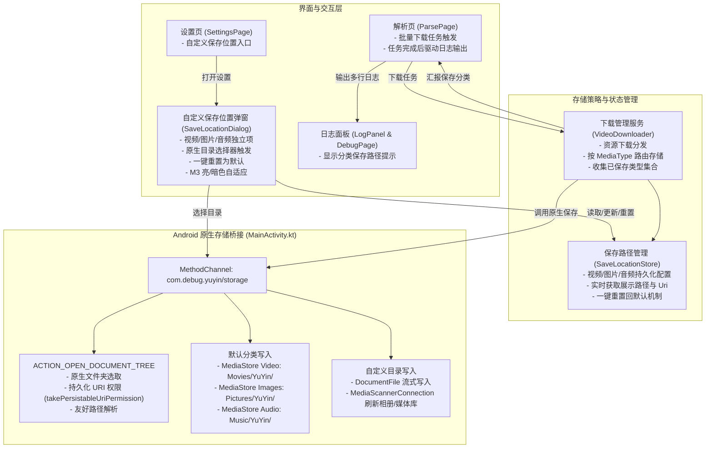

# PLAN_25：下载资源自动分类存储、原生自定义路径与日志输出（版本 1.2.4+133 -> 1.2.5+135）

## 一、需求背景与目标

本次开发的核心目标是实现下载多媒体资源的智能自动分类存储，规范视频、图片及预留音频资源的保存路径，提供基于 Android 原生目录选择器（SAF）的自定义路径配置与重置能力，并在下载完成后于日志中精准输出分类保存信息。

### 1. 核心需求点
1. **三种资源分类与接口预留**：
   - 视频（Video）：普通视频清晰度档位、实况图（LivePhoto）动态视频轨；
   - 图片（Image）：静态图集、实况图高清单帧图片；
   - 音频（Audio）：目前应用暂无独立音频解析，本次全面预留数据模型、存储契约与保存接口，方便后续直接对接。
2. **默认存储位置规范**：
   - 视频资源默认保存至：`/Movies/YuYin/`；
   - 图片资源默认保存至：`/Pictures/YuYin/`；
   - 音频资源默认保存至：`/Music/YuYin/`。
3. **完成日志精准多行输出**：
   - 每次下载任务完成后，在解析日志/运行日志输出已保存的目标位置；
   - 单一资源类型下载（例如仅下载图片）：
     ```text
     [解析] 图片已保存到/Pictures/YuYin/
     ```
   - 单次解析包含多种混合资源（如实况图集同时包含图片与视频，或后续包含音频）：按资源类型输出多行：
     ```text
     [解析] 图片已保存到/Pictures/YuYin/
     [解析] 视频已保存到/Movies/YuYin/
     [解析] 音频已保存到/Music/YuYin/
     ```
   - 若用户自定义了保存位置，日志中的提示路径必须**实时且自动同步更新**为自定义路径。
4. **设置页“自定义保存位置”功能**：
   - 在设置页新增“自定义保存位置”入口；
   - 点击弹出配置弹窗或子面板，支持分别独立配置【视频】、【图片】、【音频】的保存目录；
   - 调用 Android 原生接口（Storage Access Framework - `ACTION_OPEN_DOCUMENT_TREE`），保证合规性与无缝的文件管理器交互体验；
   - 提供显式的“重置回默认保存位置”操作，一键恢复三大默认分类路径；
   - 完美适配深色（Dark）/ 浅色（Light）模式，遵循 Material 3 设计风格。
5. **版本升级**：
   - 项目版本升级为 `1.2.5`，构建版本号升级为 `135`（`1.2.5+135`）。
   - （注意：根据需求，本阶段暂不开发文件重命名功能）。

---

## 二、架构设计与核心模块



### 1. 数据模型升级 (`MediaType` 与 `MediaItem`)
- **文件路径**：`lib/models/media_item.dart`
- **升级内容**：
  ```dart
  enum MediaType { video, image, audio }
  ```
- **职责划分**：
  - `MediaType.video`：保存至视频目录，后缀默认 `.mp4`；
  - `MediaType.image`：保存至图片目录，后缀根据 URL 自动推断 `.jpg` / `.png` / `.webp`；
  - `MediaType.audio`：预留音频类型，保存至音频目录，后缀默认 `.mp3`；
  - 增加对应中文描述、默认相对路径等属性扩展，保持类型纯粹与可扩展。

### 2. 保存位置状态管理 (`SaveLocationStore`)
- **文件路径**：`lib/utils/save_location_store.dart`
- **核心逻辑**：
  - 维护三种媒体类型的配置（展示路径 `displayPath` 与 SAF `treeUri`）：
    - 默认视频路径：`/Movies/YuYin/`，默认 Uri：`null`；
    - 默认图片路径：`/Pictures/YuYin/`，默认 Uri：`null`；
    - 默认音频路径：`/Music/YuYin/`，默认 Uri：`null`；
  - 本地轻量持久化：基于本地文件或轻量标记持久存储用户自定义的 Uri 与路径映射；
  - 提供核心方法：
    - `getDisplayPath(MediaType type)`：获取指定类型的当前展示路径（如 `/Pictures/YuYin/` 或自定义路径）；
    - `getTreeUri(MediaType type)`：获取指定类型的自定义 SAF 授权 Uri（若未自定义则返回 `null`）；
    - `setLocation(MediaType type, {required String uri, required String displayPath})`：更新指定类型的自定义目录；
    - `resetToDefault()`：一键清空全部自定义配置，恢复系统默认路径；
    - `isAllDefault()`：判断当前是否全部为默认路径。

### 3. Android 原生存储通道与 SAF 支持 (`MainActivity.kt` & 原生 Helper)
- **通道名称**：`com.debug.yuyin/storage`
- **核心 Native 方法**：
  1. `pickDirectory(type: String)`：
     - 调用 `Intent(Intent.ACTION_OPEN_DOCUMENT_TREE)` 启动 Android 原生系统目录选择器；
     - 在 `onActivityResult` 中捕获返回的 `treeUri`；
     - 关键安全权限：调用 `contentResolver.takePersistableUriPermission(treeUri, Intent.FLAG_GRANT_READ_URI_PERMISSION or Intent.FLAG_GRANT_WRITE_URI_PERMISSION)`，保证永久读写授权；
     - 解析出可读的用户路径（如 `/自定义文件夹/`），向 Flutter 返回 `{"uri": treeUri.toString(), "displayPath": displayPath}`。
  2. `saveMedia(filePath: String, mediaType: String, treeUri: String?, fileName: String)`：
     - **默认模式（`treeUri == null`）**：
       - `video`：通过 `MediaStore.Video.Media` 写入，`RELATIVE_PATH` 设置为 `Movies/YuYin/`；
       - `image`：通过 `MediaStore.Images.Media` 写入，`RELATIVE_PATH` 设置为 `Pictures/YuYin/`；
       - `audio`：通过 `MediaStore.Audio.Media` 写入，`RELATIVE_PATH` 设置为 `Music/YuYin/`；
       - 完美解决既有 `gal` 插件无法写入 `Movies/YuYin/` 与缺少音频支持的痛点。
     - **自定义目录模式（`treeUri != null`）**：
       - 利用 `androidx.documentfile.provider.DocumentFile.fromTreeUri(context, Uri.parse(treeUri))` 定位目标目录；
       - 创建对应 MIME 类型文件，流式拷贝下载的临时文件；
       - 写入完成后调用 `MediaScannerConnection.scanFile` 强制通知 Android 系统媒体库与相册索引刷新。

### 4. 下载服务改造与多行日志联动 (`VideoDownloader` & `ParsePage`)
- **文件路径**：`lib/services/video_downloader.dart`、`lib/pages/parse_page.dart`
- **执行流程**：
  1. 下载前读取各类型当前目标配置（`SaveLocationStore`）；
  2. 批量或单文件下载时，每完成一个文件，通过原生通道存储到该类型绑定的位置；
  3. 任务内部使用 `Set<MediaType>` 记录本次下载中成功包含的资源类别；
  4. 下载全部完成时，按规范顺序（图片 -> 视频 -> 音频）依次在日志中追加输出：
     - 若包含图片：`[解析] 图片已保存到${SaveLocationStore.getDisplayPath(MediaType.image)}`
     - 若包含视频：`[解析] 视频已保存到${SaveLocationStore.getDisplayPath(MediaType.video)}`
     - 若包含音频：`[解析] 音频已保存到${SaveLocationStore.getDisplayPath(MediaType.audio)}`
  5. 弹出的 SnackBar / 提示同步更新为简要成功提示，日志面板输出详尽分类路径。

### 5. 设置页 UI 与弹窗交互 (`SettingsPage` & `SaveLocationDialog`)
- **文件路径**：`lib/pages/settings_page.dart`、`lib/widgets/save_location_dialog.dart`
- **交互规范**：
  - 设置项入口：“自定义保存位置”，副标题显示“视频、图片与音频分类保存”；
  - 弹窗展示三种类别的独立卡片/列表：
    - 图标：视频（`Icons.movie_outlined`）、图片（`Icons.image_outlined`）、音频（`Icons.music_note_outlined`）；
    - 显示当前保存路径（例如 `/Movies/YuYin/` 或用户选择的自定义路径）；
    - 每项右侧提供“更改”按钮，点击拉起原生目录选择器；
    - 底部提供“重置回默认保存位置”文字/轮廓按钮，点击立即重置并刷新展示；
  - 严格遵循 Material 3，使用 `theme.colorScheme`，无缝适配深色/浅色模式。

---

## 三、文件修改清单

| 序号 | 文件路径 | 变更类型 | 说明 |
| :--- | :--- | :---: | :--- |
| 1 | `pubspec.yaml` | 修改 | 版本号升级为 `1.2.5+135` |
| 2 | `lib/app_info.dart` | 修改 | `appVersion` 升级为 `1.2.5+135` |
| 3 | `lib/models/media_item.dart` | 修改 | `MediaType` 增加 `audio` 枚举与对应属性支持 |
| 4 | `lib/utils/save_location_store.dart` | **新增** | 保存位置配置中心（默认路径、自定义 Uri 存储、重置机制） |
| 5 | `lib/services/media_saver.dart` | **新增** | 统一原生存储桥接服务（封装 MethodChannel、目录选择与分类落盘） |
| 6 | `android/app/src/main/kotlin/com/debug/yuyin/MainActivity.kt` | 修改 | 实现 `com.debug.yuyin/storage` 通道（SAF `ACTION_OPEN_DOCUMENT_TREE`、持久权限、MediaStore 分类写入与 DocumentFile 自定义目录写入） |
| 7 | `lib/services/video_downloader.dart` | 修改 | 适配分类存储流，记录成功保存的 `MediaType` 集合 |
| 8 | `lib/pages/parse_page.dart` | 修改 | 下载完成根据所含资源类型输出精准分类保存路径日志 |
| 9 | `lib/widgets/save_location_dialog.dart` | **新增** | M3 风格“自定义保存位置”弹窗（支持深浅色、分别选择、一键重置） |
| 10 | `lib/pages/settings_page.dart` | 修改 | 增加“自定义保存位置”入口及弹窗联动 |
| 11 | `test/save_location_store_test.dart` | **新增** | 单元测试：默认路径、自定义更新、一键重置与多类型查询验证 |
| 12 | `test/media_item_test.dart` | **新增/修改** | 单元测试：`MediaType.audio`、视频、图片分类与数据模型测试 |
| 13 | `GEMINI.md` / `CLAUDE.md` / `README.md` | 修改 | 同步更新版本号为 `1.2.5+135` 及新增功能说明 |

---

## 四、验证计划

1. **静态代码分析与单元测试**：
   - 运行 `flutter analyze` 确保 0 警告 0 报错；
   - 运行 `flutter test`，确保既有 80 个测试和新增测试 100% 全部通过。
2. **模拟器/真机核心功能端到端验证**：
   - **默认保存验证**：
     - 解析并下载单视频：验证保存至 `/Movies/YuYin/`，日志显示 `[解析] 视频已保存到/Movies/YuYin/`；
     - 解析并下载普通图集：验证保存至 `/Pictures/YuYin/`，日志显示 `[解析] 图片已保存到/Pictures/YuYin/`；
     - 解析并下载实况图集（含图片与实况视频）：验证分别保存至对应目录，日志多行输出：
       ```text
       [解析] 图片已保存到/Pictures/YuYin/
       [解析] 视频已保存到/Movies/YuYin/
       ```
   - **自定义保存位置验证**：
     - 进入“设置 -> 自定义保存位置”，点击选择自定义文件夹，验证系统原生 SAF 目录选择器正常呼出并授权；
     - 自定义图片目录为其他文件夹后，重新下载图片，验证日志中的保存提示随之变为自定义路径；
     - 点击“重置回默认保存位置”，验证三大路径立即恢复为 `/Movies/YuYin/`、`/Pictures/YuYin/`、`/Music/YuYin/`，后续下载日志随之还原。
   - **亮/暗模式验证**：
     - 切换浅色模式与深色模式，确认弹窗和文字对比度清晰、边框美观、符合 M3 视觉规范。


---

## 五、微调记录（版本 1.2.5+135）

### 1. 弹窗 UI 溢出（RIGHT OVERFLOWED BY 22 PIXELS）彻底修复
- **根因分析**：在 `SaveLocationDialog` 中，当媒体类型被用户自定义时，卡片内顶部标题 Row 动态显示 `[自定义]` 徽标。原标题 `Text(title)` 与 `[自定义]` 标签未设置弹性约束，在 360dp 常见手机屏幕宽度下超出内部 Column 宽度恰好 22 像素，触发 Flutter RenderFlex overflow 黄黑斑马纹。
- **修复方案**：
  1. 对标题文字包裹 `Flexible(child: Text(title, maxLines: 1, overflow: TextOverflow.ellipsis))`，从布局模型上杜绝任何物理溢出可能；
  2. 将 `AlertDialog` 的 `insetPadding` 优化为水平 16dp（原默认 40dp），为弹窗内部提供更充裕的布局空间；
  3. 优化卡片内图标边距与“更改”按钮内边距，使排版更精巧统一；
  4. 在 `test/save_location_dialog_test.dart` 中增加针对 320dp 极窄屏幕的渲染测试，确保 0 溢出。

### 2. 构建规则更新
- 后续打包验证统一默认使用 Release 构建：`flutter build apk --release`（安装包名 `com.release.yuyin`），不再构建 debug 版。
