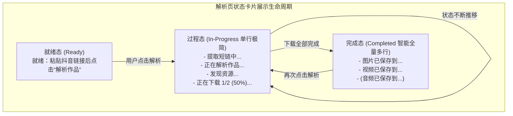

# PLAN_26：解析页日志智能分态展示（过程态单行敏捷 vs 完成态多分类多行全量）（版本 1.2.5+135 -> 1.2.6+136）

## 一、需求背景与目标

在版本 1.2.5 中，我们成功实现了多媒体资源（视频、图片、预留音频）的分类存储与多行日志输出。然而在真机使用中发现：
解析页底部的状态卡片原设计为**仅显示最新一条单行日志（`value.last`）**。当单次下载包含多种资源（如实况图集同时包含图片与实况视频，或包含音频）时，前置的保存提示被后续的保存提示瞬间覆盖，用户在解析页卡片上最终只能看到最后一条保存位置提示。

同时，用户强调：**在任务前半段（提取短链、网页嗅探、下载进度），必须保持单行展示**，以保证过程信息精炼、动态、无冗余卡片跳动；而在**下载完成时**，必须能**在状态卡片中同时完整呈现所有资源的保存位置**。

### 1. 核心需求点
1. **过程态（前半段）维持单行极简展示**：
   - 从点击“解析作品”开始，到下载过程中的各阶段状态（“提取短链中...”、“正在解析作品...”、“发现图文/实况图集...”、“正在下载 1/2 项资源 (50%)...”等）；
   - 状态卡片严格仅展示当前正在执行的最新单条状态，动态平滑刷新，确保极简阅读体验。
2. **完成态（下载结束）多分类保存结果全量呈现**：
   - 当下载任务全部完成，产生保存提示时：
     - 若仅下载单一分类（如纯视频或纯图集）：卡片展示对应的单行保存位置（如 `视频已保存到/Movies/YuYin/`）；
     - 若下载包含混合多分类（如实况图同时包含图片与实况视频）：卡片智能聚合**本次任务的所有保存提示**，同时多行展示：
       ```text
       图片已保存到/Pictures/YuYin/
       视频已保存到/Movies/YuYin/
       ```
     - 若后续增加音频同样完整展示：
       ```text
       图片已保存到/Pictures/YuYin/
       视频已保存到/Movies/YuYin/
       音频已保存到/Music/YuYin/
       ```
3. **视觉状态自适应优化**：
   - 任务成功完成时，状态卡片左侧图标自动由一般信息图示（`info_outline`）切换为绿色/主色勾选图示（`check_circle_outline`），边框与底色呈现轻量高光质感，让用户直观明确任务已圆满完成；
   - 再次点击解析新作品时，立即重置回到过程态单行展示。
4. **版本升级与 Release 构建规约**：
   - 版本号升级为 `1.2.6`，构建版本号升级为 `136`（`1.2.6+136`）；
   - 严格遵循用户要求：**默认构建 Release 版（`flutter build apk --release`，安装包名 `com.release.yuyin`）**。

---

## 二、架构设计与核心技术方案



### 1. 智能状态文本解析算法 (`resolveStatusText`)
- **文件路径**：`lib/pages/parse_page.dart`（在 `_StatusCard` 中封装为静态纯函数，便于 100% 单元测试覆盖）
- **算法逻辑**：
  ```dart
  static String resolveStatusText(List<String> logs) {
    if (logs.isEmpty) {
      return '就绪：粘贴抖音链接后点击“解析作品”';
    }
    final last = logs.last;
    // 判断尾部是否为成功落盘提示
    if (last.contains('已保存到')) {
      final savePrompts = <String>[];
      for (var i = logs.length - 1; i >= 0; i--) {
        final line = logs[i];
        if (line.contains('已保存到')) {
          savePrompts.insert(0, line);
        } else {
          break;
        }
      }
      return savePrompts.join('\n');
    }
    // 过程态：始终仅展示最新的一条状态
    return last;
  }
  ```
- **关键设计优势**：
  1. **零破坏性**：`LogController` 与完整调试日志（`LogPanel`、`DebugPage`）依然保留全部原始的逐行明细，互不干扰；
  2. **分态精准**：前置无论经历多少次状态变换与进度刷新，只要末尾不是 `已保存到`，卡片一律严格只取 `logs.last`（单行）；一旦落盘完毕，卡片自动且无缝切入多行聚合模式；
  3. **自适应高度与最大行数**：卡片内部 `Text` 设置 `maxLines: 6`，在单行时高度保持紧凑 42dp，在 2~3 行保存结果时高度自适应延展，文字行距 `height: 1.5` 清晰美观。

### 2. 状态卡片视觉层级优化 (`_StatusCard`)
- **完成态质感微调**：
  - 当展示包含 `已保存到` 时：
    - 图标：切换为 `Icons.check_circle_outline`，颜色使用 `colorScheme.primary`；
    - 背景与边框：微调带有 Primary 淡淡强调色（0.12 alpha）与边框（0.3 alpha），提示“全部下载并保存完毕”；
  - 非保存状态（进行中/就绪）：
    - 维持原有 `Icons.info_outline` 与 `surfaceContainerHighest` 中性沉浸背景。

---

## 三、文件修改清单

| 序号 | 文件路径 | 变更类型 | 说明 |
| :--- | :--- | :---: | :--- |
| 1 | `pubspec.yaml` | 修改 | 版本号升级为 `1.2.6+136` |
| 2 | `lib/app_info.dart` | 修改 | `appVersion` 升级为 `1.2.6+136` |
| 3 | `lib/pages/parse_page.dart` | 修改 | `_StatusCard` 重构：实现 `resolveStatusText` 算法、过程态单行与完成态多行分类展示、成功微调 |
| 4 | `test/parse_page_status_test.dart` | **新增** | 单元测试与 Widget 测试：就绪态、过程态单行截断、完成态多分类多行全量聚合、成功图标切换验证 |
| 5 | `GEMINI.md` / `CLAUDE.md` / `README.md` | 修改 | 同步升级版本号为 `1.2.6+136` |

---

## 四、测试与验证计划

1. **静态代码分析与单元测试**：
   - 运行 `flutter analyze` 确保 0 警告 0 报错；
   - 运行 `flutter test`，覆盖新增的 `test/parse_page_status_test.dart` 与既有全部 91 个测试，确保 100% 通过。
2. **状态卡片交互与视觉表现测试**：
   - 验证就绪态：展示提示 `就绪：粘贴抖音链接后点击“解析作品”`，图标为 `info_outline`；
   - 验证过程态：当处于“提取短链中...”、“正在解析作品...”、“发现图文/实况图集...”、“下载中 1/2 项资源 (50%)...”时，卡片始终只展示单行最新内容；
   - 验证完成态（单资源）：下载完成后，卡片展示单行 `视频已保存到/Movies/YuYin/`，图标变为 `check_circle_outline`；
   - 验证完成态（多资源）：下载实况图集（图片+视频）后，卡片同时展示：
     ```text
     图片已保存到/Pictures/YuYin/
     视频已保存到/Movies/YuYin/
     ```
   - 验证再次点击：点击新链接解析，立即重置并回归过程态单行展示。
3. **Release 打包构建**：
   - 运行 `flutter build apk --release`，确认 Release APK 构建成功（包名 `com.release.yuyin`）。

