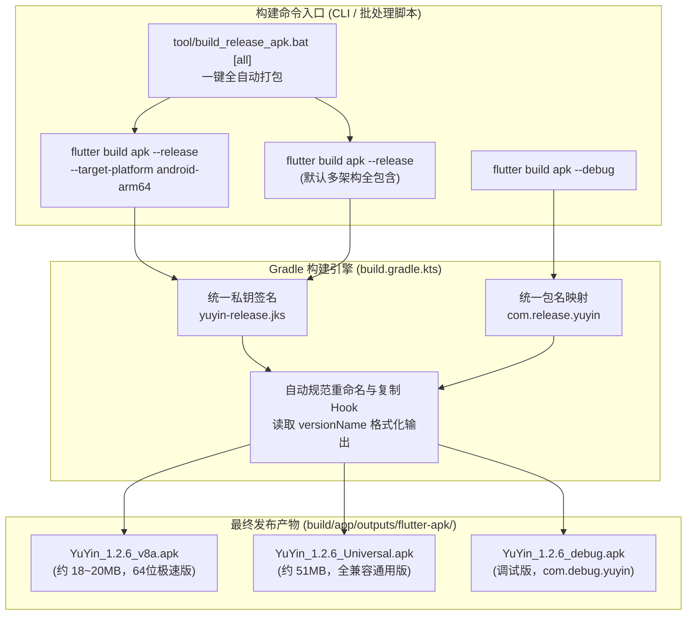

# PLAN_27：规范化构建体系改造（v8a 单架构与 Universal 全架构 Release 分流打包及规范化输出命名）

## 一、需求背景与目标

目前项目的 Release 打包默认生成 Universal 全架构安装包（`app-release.apk`，包含 `arm64-v8a`、`armeabi-v7a`、`x86_64` 三种架构原生库，体积约 51.7MB）。
之前在发布 GitHub Release 时，用户需要手动解包删除 `armeabi-v7a` 与 `x86_64` 架构库，再借助 MT 管理器用独立私钥二次重签名，操作繁琐且易出错。

本次开发不对应用内 Dart 代码和业务逻辑做任何变更，专注于**构建体系与打包工程的规范化、工程化升级**。

### 1. 核心需求点
1. **官方原生分流构建支持 `v8a`（`arm64-v8a`）Release 版**：
   - 绝大多数现代 Android 真机均为 64 位 ARM（arm64-v8a）架构；
   - 通过 Flutter 官方编译器参数 `--target-platform android-arm64`，直接剔除 v7a 与 x86_64 冗余代码库，预计安装包体积大幅削减 **60% 以上**（降至约 18~20MB）；
   - 彻底取代“手动解包删目录+第三方重签名”的非规范流程。
2. **签名与包名完全统一**：
   - `v8a` 版与 `Universal` 全架构版拥有**完全一致的包名**（`com.release.yuyin`）；
   - 使用**同一份 Release 私钥证书**（`android/app/yuyin-release.jks`）由 Gradle 自动完成严密签名；
   - 保证两版本之间可在真机上无缝覆盖安装更新，签名指纹 100% 保持一致。
3. **输出产物全自动规范化命名**：
   - 自动提取当前应用版本号（例如 `1.2.6`，以 `pubspec.yaml` 为源）；
   - 产物命名规则：
     - **Debug 版**：`YuYin_<version>_debug.apk`（例如 `YuYin_1.2.6_debug.apk`）
     - **Release v8a 版**：`YuYin_<version>_v8a.apk`（例如 `YuYin_1.2.6_v8a.apk`）
     - **Release Universal 版**：`YuYin_<version>_Universal.apk`（例如 `YuYin_1.2.6_Universal.apk`）
   - 产物输出于 `build/app/outputs/flutter-apk/` 目录下，并保留官方原名兼容软链接/备份，防止依赖固定名称的 CI 或脚本失效。
4. **编译与安装工具脚本现代化改造**：
   - 更新 `tool/build_release_apk.bat`：支持一键同时构建 `v8a` 与 `Universal`（或指定单个目标），编译完成自动展示两个版本的独立体积；
   - 更新 `tool/build_debug_apk.bat`：构建完成后自动生成规范命名的 `YuYin_<version>_debug.apk`；
   - 更新 `tool/install_release_apk.bat`：优先识别并极速安装轻量的 `YuYin_<version>_v8a.apk`（体积小，USB 传输与安装更快）。

---

## 二、架构设计与核心技术方案

### 1. 原生构建机制与体积优化原理
- **Universal 版**：包含 `lib/arm64-v8a/`、`lib/armeabi-v7a/`、`lib/x86_64/`，包含全部架构的 Flutter Engine（`libflutter.so`）与 Dart 编译产物（`libapp.so`），体积约 51.7MB；
- **v8a 版**：传参 `--target-platform android-arm64` 时，Flutter AOT 编译器仅编译 AArch64 指令集，并仅打包 `lib/arm64-v8a/`，直接剥离了 32 位 ARM 及 x86 库，包体大幅降低至 18~20MB 左右；
- 两者均由 Gradle 的 `signingConfigs.getByName("release")` 注入相同的密钥库配置，保证 SHA-256 签名完全相同。

### 2. Gradle 构建生命周期中的规范重命名机制
- **文件路径**：`android/app/build.gradle.kts`
- **核心逻辑**：
  在 `build.gradle.kts` 中注册后置拷贝任务（或在任务执行 `doLast` 注入）：
  - 自动获取 `versionName`（去除 `+` 号后的纯版本号，如 `1.2.6`）；
  - 检测当前构建目标平台（`target-platform` 属性）：
    - 若包含 `android-arm64` 且为单架构构建：生成 `YuYin_${versionName}_v8a.apk`；
    - 若为全架构 Release：生成 `YuYin_${versionName}_Universal.apk`；
    - 若为 Debug：生成 `YuYin_${versionName}_debug.apk`；
  - 既保留原 `app-release.apk` 保证 Flutter 工具链自身完整性，又即刻生成人类友好命名的目标 APK。

### 3. 工具脚本增强 (`tool/`)
1. **`tool/build_release_apk.bat`**：
   - 语法：`build_release_apk.bat [all | v8a | universal]`（默认 `all`）；
   - 当执行 `all` 时：
     1. 第一步执行 `flutter build apk --release --target-platform android-arm64` 并生成 `YuYin_<version>_v8a.apk`；
     2. 第二步执行 `flutter build apk --release` 并生成 `YuYin_<version>_Universal.apk`；
     3. 终端清晰打印两个 APK 的文件名、绝对路径、体积与编译用时。
2. **`tool/build_debug_apk.bat`**：
   - 执行 `flutter build apk --debug` 并自动产出 `YuYin_<version>_debug.apk`。
3. **`tool/install_release_apk.bat`**：
   - 自动搜索：优先匹配 `YuYin_*_v8a.apk` -> 其次 `YuYin_*_Universal.apk` -> 最后 `app-release.apk`；
   - 自动安装到连接的真机。

---

## 三、文件修改清单

| 序号 | 文件路径 | 变更类型 | 说明 |
| :--- | :--- | :---: | :--- |
| 1 | `android/app/build.gradle.kts` | 修改 | 增加 APK 自动提取版本规范命名的 Gradle 自动处理逻辑 |
| 2 | `tool/build_release_apk.bat` | 修改 | 支持 `v8a` 与 `Universal` 分流与批量打包，规范产物输出 |
| 3 | `tool/build_debug_apk.bat` | 修改 | 支持自动产出 `YuYin_<version>_debug.apk` 规范名称 |
| 4 | `tool/install_release_apk.bat` | 修改 | 适配新命名规则，优先安装体积精简的 v8a 版 |
| 5 | `PLAN/PLAN_21~30/PLAN_27.md` | **新增** | 本规划文档 |
| 6 | `GEMINI.md` / `CLAUDE.md` / `README.md` | 修改 | 记录新的构建命令与产物命名规则 |

---

## 四、验证计划

1. **静态检查与既有测试验证**：
   - `flutter analyze` 保持 0 警告 0 报错；
   - `flutter test` 全量 98 个单元/组件测试 100% 通过（确保构建改动完全不影响 Dart 代码）。
2. **单架构 v8a 编译验证**：
   - 执行 `flutter build apk --release --target-platform android-arm64`；
   - 检查产物 `YuYin_1.2.6_v8a.apk` 是否生成；
   - 检查文件大小是否从 51.7MB 下降至 18~20MB 左右；
   - 使用 7-Zip/解包命令检查 APK 内 `lib/` 目录，确认仅包含 `arm64-v8a`，无 `armeabi-v7a` 与 `x86_64`。
3. **全架构 Universal 编译验证**：
   - 执行 `flutter build apk --release`；
   - 检查产物 `YuYin_1.2.6_Universal.apk` 是否生成；
   - 检查文件大小是否约为 51.7MB；
   - 检查 APK 内 `lib/` 目录，确认包含三架构全量原生库。
4. **Debug 编译验证**：
   - 执行 `flutter build apk --debug`；
   - 检查产物 `YuYin_1.2.6_debug.apk` 是否生成。
5. **签名一致性校验**：
   - 验证 `YuYin_1.2.6_v8a.apk` 与 `YuYin_1.2.6_Universal.apk` 的签名信息，确保完全一致且包名均为 `com.release.yuyin`。
6. **真机安装验证**：
   - 运行 `tool/install_release_apk.bat` 安装 `v8a` 版到真机 `b83d79d9`，验证安装成功且打开运行正常。

