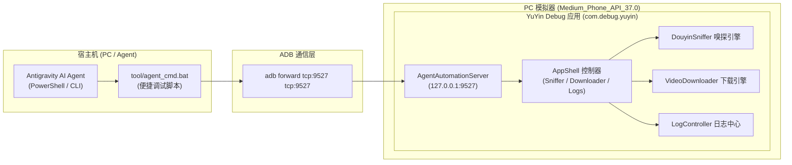

# PLAN_29：Agent 自动化测试与无头操控体系构建（Debug 版本地 HTTP 控制台、结构化指令接口与实时日志流）

## 一、需求背景与可行性评估

### 1. 为什么“接口式无头操控”远优于“UI 截图与坐标点击”？
在之前的测试中，我们通过 `uiautomator dump`、提取 XML 节点坐标（如 `input tap 540 793`）、等待固定延时来驱动应用。
这种传统 UI 自动化方式存在显著弊端：
1. **坐标脆弱**：换个分辨率或屏幕尺寸（例如平板、折叠屏、不同 AVD），坐标偏移即失效；
2. **状态盲跑**：点击按钮后无法即时获知是否完成、耗时多久，只能靠盲猜 `sleep` 轮询；
3. **复杂交互成本高**：处理图集勾选、清晰度弹窗、多选取消等需要频繁 dump XML，耗时极长。

**用户提出的“为 Agent 开发专属调试接口”方案完全可行，且是现代化大模型 Agent 与移动端 App 协同测试的最佳实践（Headless Agent Bridge）！**

### 2. 核心架构与隔离机制
- **Debug 版专属（零侵入、零污染）**：
  所有自动化操控逻辑仅在 `kDebugMode == true`（即 Debug 包 `com.debug.yuyin`）下启动；
  在生产 Release 包（`com.release.yuyin`）中，编译器通过死代码消除（Tree-shaking）彻底剔除，**没有任何网络端口监听与安全风险**。
- **纯原生 Dart HTTP 服务（零三方依赖）**：
  直接使用 Dart SDK 自带的 `dart:io` 的 `HttpServer`，在模拟器内部绑定 `127.0.0.1:9527`；
  通过标准 `adb forward tcp:9527 tcp:9527` 建立端口映射，宿主机（Agent）可通过 HTTP 毫秒级直接调用。

---

## 二、架构设计与系统拓扑

---

## 三、接口设计规范 (REST API on Port 9527)

| 路径 | 方法 | 功能描述 | 请求参数示例 | 返回数据示例 |
| :--- | :--- | :--- | :--- | :--- |
| `/api/status` | `GET` | 查询应用运行状态、登录态、上次解析结果 | 无 | `{"app":"YuYin","version":"1.2.7+137","busy":false,"loggedIn":false,"parsed":true}` |
| `/api/parse` | `POST` | 触发解析抖音口令或链接 | `{"text":"7.12 复制打开抖音... https://v.douyin.com/xxx/"}` | `{"success":true,"title":"...","desc":"...","isImagePost":true,"items":[{"type":"image","url":"...","resolution":"1080x1920"}]}` |
| `/api/download` | `POST` | 触发下载已解析的资源 | `{"indices":"all"}` 或 `{"indices":[0, 1]}` | `{"success":true,"savedCount":2,"savedTypes":["image"],"files":["CS2现役..._1.jpg","CS2现役..._2.jpg"]}` |
| `/api/logs` | `GET` | 获取当前会话的全部结构化日志 | 无 | `{"count":15,"logs":["正在提取短链...","解析完成: 共 1 个资源","图片已保存到..."]}` |
| `/api/logs/clear` | `POST` | 清空日志中心 | 无 | `{"success":true}` |
| `/api/cancel` | `POST` | 取消正在执行的解析或下载 | 无 | `{"success":true}` |

---

## 四、待修改与新增文件清单

1. **`lib/services/agent_automation_server.dart`** [新增]：
   - 封装轻量 HTTP 服务；
   - 绑定 `DouyinSniffer`、`VideoDownloader`、`LogController`、`busy`、`loggedIn`；
   - 仅在 `kDebugMode` 下运行，提供 `/api/status`、`/api/parse`、`/api/download`、`/api/logs` 等端点。
2. **`lib/pages/app_shell.dart`** [修改]：
   - 在 `initState` 中若为 `kDebugMode`，启动 `AgentAutomationServer`；在 `dispose` 中安全关闭。
3. **`tool/agent_bridge.ps1` & `tool/agent_cmd.bat`** [新增]：
   - 提供给 Agent 和开发者的一键快捷指令（无需记忆 curl 或 adb forward）：
     - `.\tool\agent_cmd.bat setup`（一键映射端口）
     - `.\tool\agent_cmd.bat status`
     - `.\tool\agent_cmd.bat parse "<口令>"`
     - `.\tool\agent_cmd.bat download all`
     - `.\tool\agent_cmd.bat logs`
4. **`test/agent_automation_server_test.dart`** [新增]：
   - 针对各接口请求响应与 JSON 序列化的单元测试。

---

## 五、验证计划与实施记录

1. **自动化单元测试**：
   - [x] `flutter test`，全部 118 项测试（113 项现有测试 + 5 项接口测试）100% 绿灯。
2. **编译 Debug APK**：
   - [x] 运行 `tool\build_debug_apk.bat` 产出 `YuYin_1.2.7_debug.apk`。
3. **模拟器端到端接口验证**：
   - [x] 安装 Debug 包到 `emulator-5554` 并启动应用；
   - [x] 运行 `tool\agent_cmd.bat setup`，成功映射端口并连通 `[在线] 应用控制台已连接: 余音 v1.2.7+137`；
   - [x] 调用 `agent_cmd.bat parse` 传入 `sources/138_抖音口令/单图.txt` 里的链接，成功解析并下载生成 `CS2现役狙击手你不得....jpg`；
   - [x] 调用 `agent_cmd.bat parse` 传入 `sources/138_抖音口令/多图.txt` 里的链接，成功发现 8 张 4K 图片，调用 `agent_cmd.bat download 0,1` 成功生成 `Scan QR code to down..._1.jpg`、`Scan QR code to down..._2.jpg`；
   - [x] 调用 `agent_cmd.bat logs` 与 `clear-logs`，成功拉取应用内运行日志与清空。

   - 观察毫秒级返回的结构化 JSON（标题、图片列表、分辨率）；
   - 调用 `agent_cmd.bat download all` 触发下载；
   - 调用 `agent_cmd.bat logs` 获取完整日志，验证与应用内日志 100% 一致。

