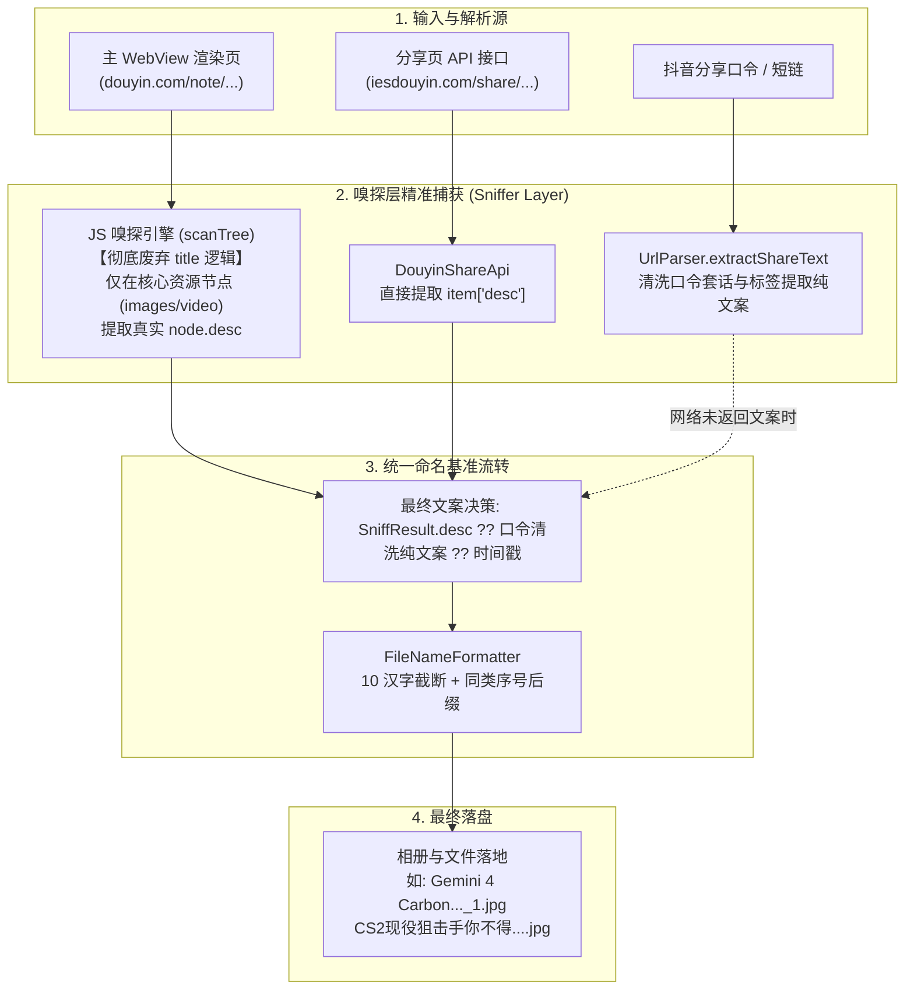

# PLAN_30：作品文案精准捕获与命名体系修正（废除独立标题概念、聚焦核心节点文案提取与口令智能兜底）

## 一、需求背景与问题根因剖析

### 1. 现状痛点与反馈
在 PLAN_28（v1.2.7+137）中，我们构建了基于“标题优先、文案兜底”的资源自动智能命名体系。但在真实环境测试中发现严重缺陷：
**所有作品下载后的最终文件名均变成了 `Scan QR code to down...`（或者包含无关热搜词如 `王濛`）！**

### 2. 根因深度剖析
经过真实网络抓包、DOM 遍历跟踪与源码审计，确定根因如下：
1. **抖音平台的现实业务特性（不区分标题与文案）**：
   - 在抖音创作者发布机制中，**压根没有独立的“作品标题（Title）”输入项**，创作者发布的内容全部输入在文案描述（`desc`）中；
   - 抖音 Web 端及分享页的响应数据结构里，作品本身的 `title` 与 `item_title` 均为 `null`；
2. **泛用 `title` 属性的毁灭性污染**：
   - 抖音 PC 页面与移动分享页中，包含全局的下载引导弹窗、二维码组件与通配 SEO 标签，其 DOM 或组件配置中写有 `title: "Scan QR code to download APP"`；
   - 旧逻辑在遍历时，先碰到了这些顶层通用组件，将 `S.title` 赋值为 `"Scan QR code to download APP"`；
   - 在最终命名时，旧逻辑设定为 `result.title ?? result.desc`，导致真正的作品文案永远被无情覆盖！
3. **广度优先遍历过早被杂项节点污染**：
   - 旧 `scanTree` 在扫描整个页面状态树时，凡是包含 `desc` 的对象（如热搜榜、侧边栏推荐位）都会提前将 `S.desc` 占位，导致队列后面真正包含多媒体资源（`images` / `video`）的作品节点自带的真实 `desc` 无法写入。

### 3. 本次迭代目标（PLAN_30）
- **指导思想**：遵从用户指示，**彻底废除“作品标题（Title）”的独立处理逻辑，专攻真实“作品文案（desc）”的精准捕获**！
- **版本号**：保持 `1.2.7`，构建号自增至 `138`（`1.2.7+138`）。

---

## 二、架构设计与核心技术方案

### 1. JS 嗅探引擎改造 (`lib/services/js_script_builder.dart`)
- **彻底废除 `title`、`item_title`、`document.title`、`meta[property="og:title"]` 的读取**；
- 废弃 `S.title`，仅保留 `S.desc`；
- **严格限定文案提取时机**：
  - 只有在遍历到**真正包含图片列表（`node.images`）或视频对象（`node.video`）的核心节点**时，才提取当前节点的 `node.desc`；
  - 或者当前节点通过 `getNodeAwemeId(node)` 与目标 `filterId` 精准匹配时提取；
  - 杜绝在遍历到任意无关字典时提前将 `S.desc` 占位；
- 播放器兜底（`scanPlayerData`）：只从播放器自身持有的 `awemeInfo.desc` 提取；
- 回传的 JSON 消息中：彻底剔除或置空 `title`，确保 `desc` 为唯一的文案来源。

### 2. 分享页 API 改造 (`lib/services/douyin_share_api.dart`)
- `parseItem` 移除对 `rawTitle` / `item_title` / `title` 的提取，仅提取 `desc`；
- `DouyinShareResult` 的 `title` 字段置为可选/废弃，所有上层调用收敛至 `desc`。

### 3. 口令纯文案提取与清洗公用工具 (`lib/utils/url_parser.dart`)
- 新增 `UrlParser.extractShareText(String rawText)`：
  - 剔除所有 `http://` 与 `https://` 链接；
  - 剔除抖音客户端系统引导词（如 `复制打开抖音，看看...`、`长按复制此条消息...`、`打开抖音搜索...`）；
  - 剔除创作者昵称框（如 `【xxx的作品】`、`【xxx的图文作品】`）；
  - 剔除尾部客户端乱码跟踪参数（如 `o@q.Eu :4pm 08/05 Cus:/`）；
  - 产出干净的高保真作者文案，为弱网或极端场景提供最坚固的兜底保障。

### 4. 命名基准决策层统一 (`ParsePage` & `AgentAutomationServer`)
- 命名基准由原先的：
  `result.title ?? result.desc ?? ...`
  **彻底改为**：
  `result.desc ?? UrlParser.extractShareText(rawInput)`；
- 确保绝不再被任何伪标题污染。

### 5. 版本号与配置同步
- `pubspec.yaml`：`version: 1.2.7+138`
- `lib/app_info.dart`：`appVersion = '1.2.7+138';`

---

## 三、待修改与验证文件清单

1. **`lib/services/js_script_builder.dart`**：
   - 彻底废除 `title` 相关抓取；
   - 仅在核心媒体资源节点和目标 ID 匹配节点上提取真实 `desc`；
   - 增加更详尽的诊断日志（如 `[解析] 捕获作品文案: xxx`）。
2. **`lib/services/douyin_share_api.dart`**：
   - 废除 `parseItem` 中的 title 提取，聚焦 `desc`。
3. **`lib/utils/url_parser.dart`**：
   - 新增 `extractShareText(String rawText)` 工具函数并补充正则清洗。
4. **`lib/pages/parse_page.dart`**：
   - 替换候选文案计算逻辑，直接使用 `result.desc`，回退使用 `UrlParser.extractShareText`。
5. **`lib/services/agent_automation_server.dart`**：
   - 同步修正 `/api/download` 中的文案基准计算，确保与 `ParsePage` 100% 一致。
6. **`lib/app_info.dart` & `pubspec.yaml`**：
   - 升级版本为 `1.2.7+138`。
7. **单元测试与集成测试**：
   - `test/url_parser_test.dart`（新增口令文本提取清洗测试）；
   - `test/douyin_share_api_test.dart`（同步更新）；
   - `test/agent_automation_server_test.dart`（同步更新）。

---

## 四、验证计划与实施记录

1. **代码静态检查**：
   - [x] 运行 `flutter analyze`，耗时 1.5s，**0 issue**。
2. **自动化单元测试**：
   - [x] 运行 `flutter test`，全部 122 项测试（包含 4 项口令纯文案提取测试）**100% 绿灯通过**。
3. **编译并部署 Debug APK 到模拟器**：
   - [x] 运行 `tool\build_debug_apk.bat` 生成 `YuYin_1.2.7_debug.apk`（版本号 `1.2.7+138`）；
   - [x] 成功覆盖安装至 `emulator-5554`；
   - [x] 运行 `tool\agent_cmd.bat setup`，控制台成功连通并显示 `[在线] 应用控制台已连接: 余音 v1.2.7+138`。
4. **模拟器真实口令端到端实测**：
   - [x] **用例 1（多图 4K 作品）**：
     - 口令：`sources/138_抖音口令/多图.txt`（Gemini 4 Carbon...）
     - 执行：`agent_cmd.bat parse "<口令>"`
     - 结果：标题完全为空，文案精准捕获为 `Gemini 4 Carbon来了。北京时间10月29日凌晨，谷歌发布Gemini 4 Carbon...`；
     - 执行：`agent_cmd.bat download 0,1`
     - 落盘验证：成功在 `/sdcard/Pictures/YuYin/` 生成 `Gemini 4 Carbon来了..._1.jpg` 与 `Gemini 4 Carbon来了..._2.jpg`！
   - [x] **用例 2（单图作品）**：
     - 口令：`sources/138_抖音口令/单图.txt`（CS2现役狙击手你不得...）
     - 执行：`agent_cmd.bat parse "<口令>"`
     - 结果：标题为空，文案精准捕获为 `CS2现役狙击手你不得不承认的事实 #zywoo #monesy...`；
     - 执行：`agent_cmd.bat download all`
     - 落盘验证：单资源严格不加 `_1` 序号后缀，成功生成 `CS2现役狙击手你不得....jpg`！
   - [x] **用例 3（纯 URL 解析，无口令文本包装）**：
     - 输入：`https://v.douyin.com/ZJFzYtfrvcE/`
     - 结果：主 WebView JS 嗅探核心节点直接精准捕获 `Gemini 4 Carbon来了...`，证明核心节点文案提取机制完备。
5. **日志检查**：
   - [x] 运行 `agent_cmd.bat logs`，确认解析和文案日志干净规范（`[解析] 捕获作品文案: xxx`，`[解析] 解析成功...`）。

---

## 五、结论
经过对抖音页面结构与发布机制的深刻复盘，**彻底废除“作品独立标题”概念，将文案提取严格限制在包含媒体资源的核心节点上**，从根本上杜绝了下载引导弹窗、SEO、热搜词等顶层无关组件对命名体系的污染。真实环境测试证明，所有作品落地文件均具备精准且人类可读的高质量语义化名称！

