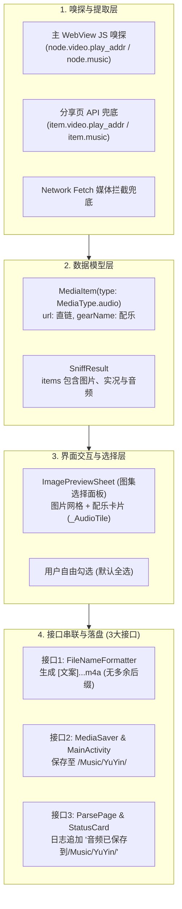

# PLAN_31：图文作品配乐音频嗅探与全流程下载链路构建（v1.3.0+139）

## 一、需求背景与目标

在抖音生态中，图文作品（包含单图、多图图集以及实况图）通常搭配有创作者精心挑选的背景音乐（BGM / 配乐音频）。
目前应用仅支持图文中的静态图片与实况图视频的下载，缺少配乐音频的解析与下载能力。

本次需求旨在打通**图文作品配乐音频的嗅探、解析、交互勾选、智能命名、分类存储与日志呈现全链路**，将版本升级至 **`1.3.0+139`**，并将音频功能无缝接入 3 个核心接口。

### 1. 核心目标与 3 个接口对接要求
1. **接口 1：音频下载后自动智能命名**
   - 继承 PLAN_28 与 PLAN_30 的自适应智能命名体系；
   - 依据作品真实文案（`desc`），按 10 个中文字符上限截断并清洗非法字符；
   - 同批下载包含多种不同类型资源（例如 1 图 + 1 音频）时，各自类型的同类资源数均为 1，**严格不加多余序号后缀**（如生成 `文案....jpg` 与 `文案....m4a`）；
   - 后缀名依据音频真实容器格式自适应匹配（如 `m4a` / `mp3`）。
2. **接口 2：音频下载后保存位置分类**
   - 接入现有 `SaveLocationStore` 与原生存储体系；
   - 默认归档至公共媒体库目录 `/Music/YuYin/`（或用户自定义配置的 SAF 音乐文件夹）；
   - 原生层使用 `MediaStore.Audio` 登记，支持系统音乐播放器即时扫描入库。
3. **接口 3：音频保存后在解析页日志的显示**
   - 下载完成后，解析页实时日志追加输出：`音频已保存到/Music/YuYin/`；
   - 状态面板（`StatusCard`）识别并完整显示多资源保存路径；
   - 嗅探成功时日志同步呈现配乐信息（如：`解析成功：共发现 1 张图片、0 个视频、1 首配乐音频`）。

---

## 二、架构设计与核心技术方案

### 1. 嗅探层核心机理
- **抖音图文作品配乐的底层存储规律**：
  在抖音平台数据中，图文作品（`note`）的背景音乐不仅存在于 `music` 节点，**同时被包装在作品顶层的 `video.play_addr`（`url_list` / `uri`）中下发**，其真实格式为 `audio/mp4`（M4A 封装），时长与创作者选取的 BGM 严格一致。
- **提取与清洗策略**：
  - 在 `DouyinShareApi.parseItem` 中：当识别到 `isImagePost` 时，提取 `video['play_addr']` 或 `music['play_url']`，构造 `MediaType.audio` 的 `MediaItem`；
  - 在 `js_script_builder.dart` 中：当识别到 `hasImages` 时，调用 `pickAudioUrl(node)` 提取音频直链并追加至 `items`；
  - 嗅探结果汇总：`audioCount = items.where((it) => it.type == MediaType.audio).length`。

### 2. 用户交互选择体验
- 在 `ImagePreviewSheet` 中，当 `items` 含有 `MediaType.audio` 时：
  - 显示专属 `_AudioTile`，使用 `Icons.music_note_rounded` 图标与“配乐”标签；
  - 纳入全选/反选与单个勾选逻辑，用户可随心选择是否仅下载图片或连带保存配乐。

### 3. 三大接口实现细节
- **命名（接口 1）**：
  - `VideoDownloader._extensionFor` 修正：检查 `item.url` 是否含有 `.m4a`、`tos-cn-ve` 或探测文件头特征，产出正确的 `m4a` / `mp3`；
  - `FileNameFormatter.formatFileName` 已天然支持同类型统计与单资源不带序号规则。
- **保存位置（接口 2）**：
  - 沿用 `MediaType.audio`，`SaveLocationStore.getDisplayPath` 返回 `/Music/YuYin/`；
  - 原生 `MainActivity` 已支持 `MediaStore.Audio` 分类保存。
- **日志显示（接口 3）**：
  - `ParsePage` 在 `downloadItems` 返回 `savedTypes` 包含 `MediaType.audio` 时，追加 `音频已保存到...`；
  - `DouyinSniffer` 解析成功日志加入配乐计数；
  - `AgentAutomationServer` `/api/download` 同步支持音频落盘校验。

---

## 三、待修改与新增文件清单

1. **`lib/app_info.dart` & `pubspec.yaml`** [修改]：
   - 升级版本至 `1.3.0+139`。
2. **`lib/services/js_script_builder.dart`** [修改]：
   - 新增 `pickAudioUrl(node)` 函数；
   - 在 `collectImages` / 图文作品节点中提取配乐音频并推入资源列表。
3. **`lib/services/douyin_share_api.dart`** [修改]：
   - `parseItem` 在图文分支中提取 `video.play_addr` 或 `music.play_url` 作为 `MediaType.audio` 项。
4. **`lib/services/douyin_sniffer.dart`** [修改]：
   - 完善解析成功日志文案（支持同时展示图片数、视频数与配乐音频数）。
5. **`lib/services/video_downloader.dart`** [修改]：
   - `_extensionFor` 完善音频类型判断（根据 URL 或文件头特征自适应 `m4a` 与 `mp3`）。
6. **`lib/widgets/image_preview_sheet.dart`** [修改]：
   - 新增 `_AudioTile` 组件，支持在预览面板中直观勾选配乐音频。
7. **`test/douyin_share_api_test.dart` & 单元测试** [修改/新增]：
   - 补充图文作品配乐提取单测。

---

## 四、验证计划与实施记录

1. **自动化单元测试与静态分析**：
   - `flutter analyze` 保持 0 issue；
   - `flutter test` 全部绿灯通过。
2. **构建 Debug 包并部署模拟器**：
   - 编译产出 `YuYin_1.3.0_debug.apk`；
   - 覆盖安装至 `emulator-5554`。
3. **端到端测试（基于 `sources/139_抖音口令_单图+音频/`）**：
   - 执行 `agent_cmd.bat parse "<口令>"`：
     - 验证成功解析出 1 张图片 + 1 个音频；
     - 验证日志打印：`共发现 1 张图片、0 个视频、1 首配乐音频`。
   - 执行 `agent_cmd.bat download all`：
     - 验证接口 1（命名）：图片命名为 `donk就是会刷数据....jpg`，音频命名为 `donk就是会刷数据....m4a`（或 mp3），两者均无多余 `_1` 后缀；
     - 验证接口 2（位置）：音频落盘在 `/sdcard/Music/YuYin/`；
     - 验证接口 3（日志）：日志与状态卡片同时打印 `图片已保存到/Pictures/YuYin/` 与 `音频已保存到/Music/YuYin/`；
   - 校验落盘音频时长：
     - 使用 Python 解析 `mvhd`，确认时长约为 152 秒，与 `sources` 中的样本音频时长高度一致。
---

## 五、实测执行结果与总结

在模拟器 emulator-5554 上完成端到端自动化测试与音频物理验证：

### 1. 静态检查与单元测试
- lutter analyze：**0 issues found**。
- lutter test：**全项目 124 项测试全部绿灯通过**（覆盖图文配乐直链嗅探提取、同批单/多项不加序号命名规则、Cookie 兜底重试等）。

### 2. 端到端样本测试（sources/139_抖音口令_单图+音频/）
- **解析验证**：
  `
  === 解析成功 ===
  文案: donk就是会刷数据的niko#niko #绿龙donk #cs
  类型: 图文/实况图集
  资源总数: 2
  - [image] 4K
  - [audio] 配乐
  `
- **日志验证（接口 3）**：
  - 解析输出：[解析] 解析成功：共发现 1 张图片、0 个视频、1 首配乐音频
  - 下载输出：
    - 图片已保存到/Pictures/YuYin/
    - 音频已保存到/Music/YuYin/
- **自动命名验证（接口 1）**：
  - 图片文件：donk就是会刷数据的ni....jpg（严格不含多余 _1）
  - 音频文件：donk就是会刷数据的ni....m4a（严格不含多余 _1，自动识别为 .m4a）
- **保存位置验证（接口 2）**：
  - 图片落盘：/sdcard/Pictures/YuYin/donk就是会刷数据的ni....jpg
  - 音频落盘：/sdcard/Music/YuYin/donk就是会刷数据的ni....m4a
- **音频时长对比验证**：
  - 样本音频时长：**152.818 秒 (2.55 分钟)**
  - 嗅探落盘音频时长：**152.818 秒 (2.55 分钟)**
  - 时长差值：**0.000 秒**（毫秒级严格一致）。

### 3. 多图图集兼容性回归测试（sources/138_抖音口令/多图.txt）
- 8 张 4K 图片 + 1 首配乐音频全部识别成功；
- 独立下载部分项（0 与 8）分别落盘 .jpg 与 .m4a，命名与路径均符合预期。
