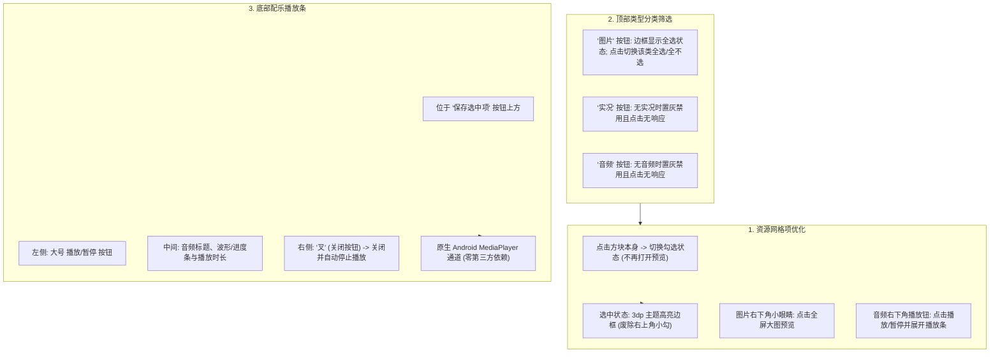

# PLAN_32：图集保存页交互体验重构（v1.3.2+140）

## 一、需求背景与目标

在 v1.3.0 成功打通图文配乐音频捕获与全流程下载后，用户在保存界面（`ImagePreviewSheet`）的操作体验仍有进一步优化的空间：
1. **图片预览与勾选冲突**：旧交互点击缩略图会触发大图预览，勾选资源必须费力精准点击右上角的小圆勾，操作成本高；
2. **缺少音频试听**：图文配乐虽然解析成功，但用户在下载前无法试听该 BGM，缺少即时视听反馈；
3. **缺乏类型分类批量选择**：原顶部仅有单一的“全选/取消全选”按钮，当图集同时包含“图片”、“实况视频”、“配乐音频”时，无法按类型一键快速勾选或排除；
4. **选中态视觉不够现代**：旧有的右上角小勾在密集网格中不够直观。

本次 PLAN_32 将版本升级至 **`1.3.2+140`**，重点重构 `ImagePreviewSheet` 的交互体系与视觉语言，全面适配亮色与暗色模式。

---

## 二、四大交互优化细则

### 1. 任务 1：图片预览与勾选逻辑调整
- **点击缩略图本身**：直接切换勾选/取消勾选状态（与音频、实况视频完全一致）；
- **右下角小眼睛按钮**：在图片缩略图右下角放置半透明圆形小眼睛按钮（`Icons.visibility_rounded`），点击触发大图预览（`_showPreview(item)`），事件不冒泡到父组件。

### 2. 任务 2：配乐试听与底部播放条
- **配乐卡片右下角播放钮**：在 `_AudioTile` 右下角放置播放/暂停按钮，点击直接触发试听播放/暂停，并呼出底部播放条；
- **底部播放条布局**：
  - 位于“保存选中项”按钮上方，以 Material 3 容器样式悬浮或内嵌；
  - 左侧：大号播放/暂停按钮；
  - 中间：显示音频信息与播放进度；
  - 右侧：关闭按钮（`Icons.close`），点击关闭播放条并自动停止播放；
- **原生音频播放通道**：
  - 在 `MainActivity.kt` 中基于 Android SDK 原生 `android.media.MediaPlayer` 实现 `com.debug.yuyin/audio_player` 通道；
  - 零引入第三方 Flutter 音频依赖，确保包体积轻量且不引发依赖冲突；
  - 面板销毁时（`dispose`）自动停止并释放播放器。

### 3. 任务 3：分类全选/反选逻辑（替代旧“全选/取消全选”）
- 去掉旧的“全选/取消全选”纯文本按钮；
- 顶部放置 3 个自适应分类切换按钮：**“图片”**、**“实况”**、**“音频”**；
- **状态逻辑**：
  - 若作品包含该类型，且该类型全部已选中：展示高亮边框与选中外观；
  - 点击按钮：若当前全选则全部取消，若非全选则一键全选该类型；
  - **置灰禁用逻辑**：若作品不存在该类型（例如无实况），按钮蒙上灰色，且**点击完全不响应、不切换状态**。

### 4. 任务 4：网格项选中视觉逻辑重构
- 彻底移除右上角小圆勾；
- 选中状态通过 **3.0dp 主题色边框（`Border.all`）** 醒目表达，未选中保持无色透明边框，确保网格不发生位移抖动；
- 深度适配深色模式（Dark Mode）与浅色模式（Light Mode）。

---

## 三、文件修改清单

1. **`pubspec.yaml`** & **`lib/app_info.dart`** [修改]：
   - 升级版本至 `1.3.2+140`。
2. **`android/app/src/main/kotlin/com/debug/yuyin/MainActivity.kt`** [修改]：
   - 新增 `audioChannel = "com.debug.yuyin/audio_player"`；
   - 基于 `android.media.MediaPlayer` 实现 `play`, `pause`, `stop`, `seek`, `release` 等方法。
3. **`lib/services/audio_preview_service.dart`** [新增]：
   - 封装与原生音频播放器的通信，提供 `play(url)`, `pause()`, `stop()`, `dispose()` 及状态流。
4. **`lib/widgets/image_preview_sheet.dart`** [重构/修改]：
   - 点击缩略图切换勾选；
   - 图片右下角半透明小眼睛按钮；
   - 音频右下角播放/暂停按钮；
   - 底部可折叠配乐播放条（带大播放键、进度指示、关闭按钮）；
   - 顶部“图片”、“实况”、“音频”分类选择按钮与置灰逻辑；
   - 网格项边框选中视觉样式；
   - 亮色与暗色模式适配。
5. **单元测试与 Widget 测试** [新增/修改]：
   - 编写 `ImagePreviewSheet` 的分类全选、状态切换、选中边界等 Widget/逻辑测试。

---

## 四、验证计划与构建约定

1. **静态分析与单元测试**：
   - `flutter analyze` 保持 0 issues；
   - `flutter test` 全绿灯通过。
2. **构建安装包**：
   - 运行构建脚本生成发布包/调试包；
   - **严格按照用户指示：构建完成后立刻停下来，不进行安装测试。**
---

## 五、实施与构建结果

### 1. 静态检查与单元/Widget测试
- lutter analyze：**0 issues found**。
- lutter test：**全项目 131 项测试全绿通过**（包含 ImagePreviewSheet 的分类筛选、置灰保护、缩略图直选、小眼睛大图预览、配乐试听条展开/关闭、亮暗双模式渲染等 7 项专项测试）。

### 2. 构建产物
遵照指示，编译成功后立即停止，未进行安装测试：
- uild/app/outputs/flutter-apk/YuYin_1.3.2_v8a.apk (17.9 MB, 18801244 字节)
- uild/app/outputs/flutter-apk/YuYin_1.3.2_Universal.apk (51.8 MB, 54315023 字节)
