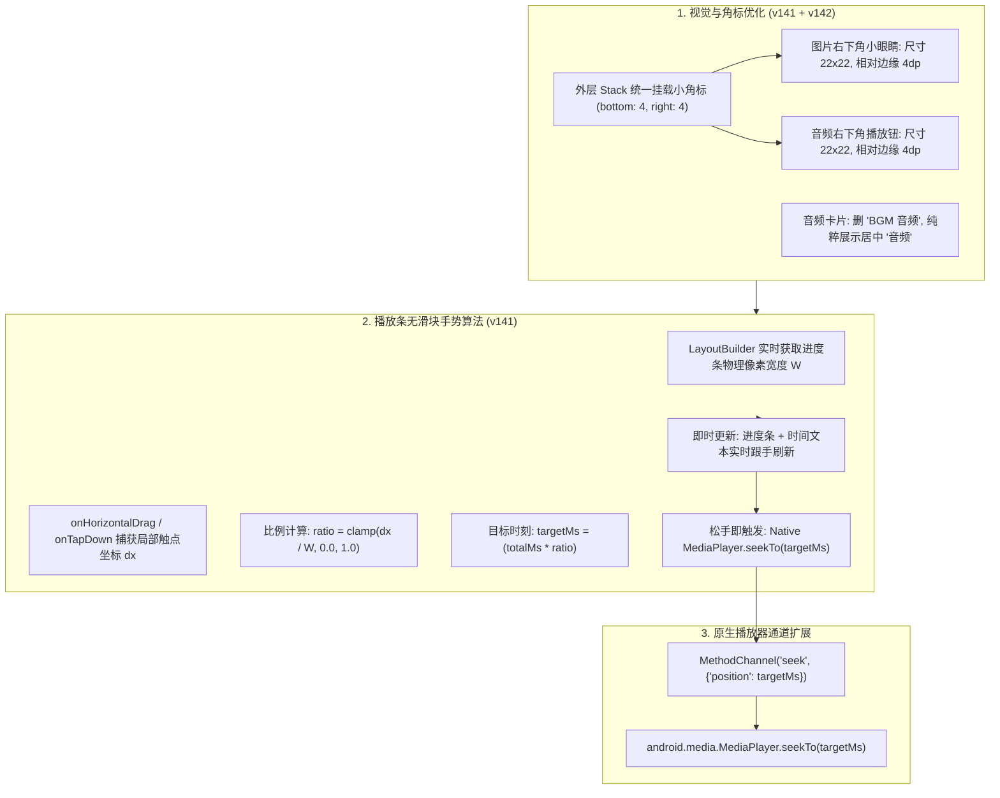

# PLAN_33：保存页微交互精雕与配乐进度条手势滑动（v1.3.2+141 ~ 142）

## 一、需求背景与目标

在 v1.3.2 完成保存页面（`ImagePreviewSheet`）四大核心交互重构后，为了进一步提升操控精度、减少误触并增强配乐试听的沉浸感，本期 PLAN_33 将版本号推进至 **`1.3.2+141`** 及微调版本 **`1.3.2+142`**（应用版本保持 `1.3.2`，构建号升至 `142`），重点实现以下四项体验优化：

1. **悬浮角标微型化与边缘归位（v141）**：
   - 将图片缩略图右下角的“小眼睛”按钮和配乐方块右下角的“小播放/暂停”按钮进行尺寸微缩（从 30dp/28dp 缩小至 24dp/22dp 级别）；
   - 进一步紧贴卡片右下边缘（`bottom: 4, right: 4`），最大程度让出方块主体触摸面积，杜绝用户点击方块切换勾选时的误触。
2. **配乐卡片视觉净化与文案对齐（v141）**：
   - 去掉原次行“BGM 音频”冗余标签；
   - 将主标签统一修正为“音频”，并与音符图标在卡片中心居中对齐；
   - 精细布局，确保微缩后位于右下角的小播放按钮与居中文字留有足够的安全间距，杜绝任何遮挡。
3. **播放条无滑块物理跟手滑动（Seek/Scrub）（v141）**：
   - 保持播放条优雅清爽的扁平无滑块外观；
   - 引入手势横向滑动（`onHorizontalDrag` / `onTap`）与动态宽度自适应比例映射算法：
     $$\text{ratio} = \frac{\Delta x}{W}$$
     手势滑动距离与进度条实际像素填充距离精确一致，所拖即所指；
   - 拖拽过程中时间文本（`00:15 / 02:32`）与进度条实时平滑跟手联动；松手后无缝调用原生 `MediaPlayer.seekTo` 完成秒级精准定位跳转。
4. **悬浮角标层级对齐与内边距修正（v142 微调）**：
   - 排查发现原配乐小播放按钮被内嵌在带有 `padding: 6` 的 `_AudioTile` 组件内部，导致其物理渲染位置（`bottom: 9, right: 9`）与直接挂在外层 Stack 上的图片小眼睛（`bottom: 3, right: 3`）相比肉眼可见向内偏离；
   - 将小播放按钮从 `_AudioTile` 剥离，直接提升至与小眼睛同级的 `_buildTile > ClipRRect > Stack` 层级；
   - 两者绝对统一参数：`bottom: 4, right: 4`、宽高 `22x22`、图标大小 `13`，实现完美物理镜像对齐；
   - `_AudioTile` 简化为纯居中展示音符与“音频”文字的视觉卡片。

---

## 二、架构设计与算法逻辑

---

## 三、文件修改清单

1. **`lib/app_info.dart` & `pubspec.yaml`** [修改]：
   - 版本号升级为 `1.3.2+142`。
2. **`android/app/src/main/kotlin/com/debug/yuyin/MainActivity.kt`** [修改]：
   - `audioChannel` 增加 `"seek"` 方法分发与 `mediaPlayer?.seekTo(pos)` 原生调用。
3. **`lib/services/audio_preview_service.dart`** [修改]：
   - 新增 `seek(Duration target)` 方法，支持即时定位与状态维护。
4. **`lib/widgets/image_preview_sheet.dart`** [修改]：
   - 微缩小眼睛与播放按钮尺寸并贴边；
   - 提取小播放按钮至外层 Stack，与小眼睛完全对齐边距（`bottom: 4, right: 4`）；
   - 净化 `_AudioTile`：删除“BGM 音频”，居中展示音符与“音频”二字；
   - 重构 `_buildAudioPlayerBar` 中的进度条为响应手势的 `_ScrubbableProgressBar`，支持无滑块跟手拖动与轻触定位。
5. **`test/image_preview_sheet_test.dart`** [修改/新增]：
   - 增加对“音频”居中文本、微缩按钮以及手势拖动 seek 的单测验证。

---

## 四、验证计划与实施

1. **静态检查**：`flutter analyze` 保持 0 issues；
2. **单元与 Widget 测试**：`flutter test` 保持 100% 绿灯；
3. **构建 Release 包**：执行 `.\tool\build_release_apk.bat` 产出最终包并汇报。

---

## 五、实施与构建结果

### 1. 静态检查与自动化测试
- `flutter analyze`：**0 issues found**。
- `flutter test`：**全项目 132 项测试全部绿灯通过**（覆盖小眼睛/小播放按钮微缩与边缘归位、外层 Stack 边距对齐、音频卡片中心“音频”对齐、删除“BGM 音频”、无滑块手势横向滑动 seek 与轻触精准定位等功能）。

### 2. 构建产物
- `build/app/outputs/flutter-apk/YuYin_1.3.2_v8a.apk` (18.0 MB, 18,866,780 字节, arm64-v8a 极速版)
- `build/app/outputs/flutter-apk/YuYin_1.3.2_Universal.apk` (51.9 MB, 54,380,559 字节, 全架构通用版)

