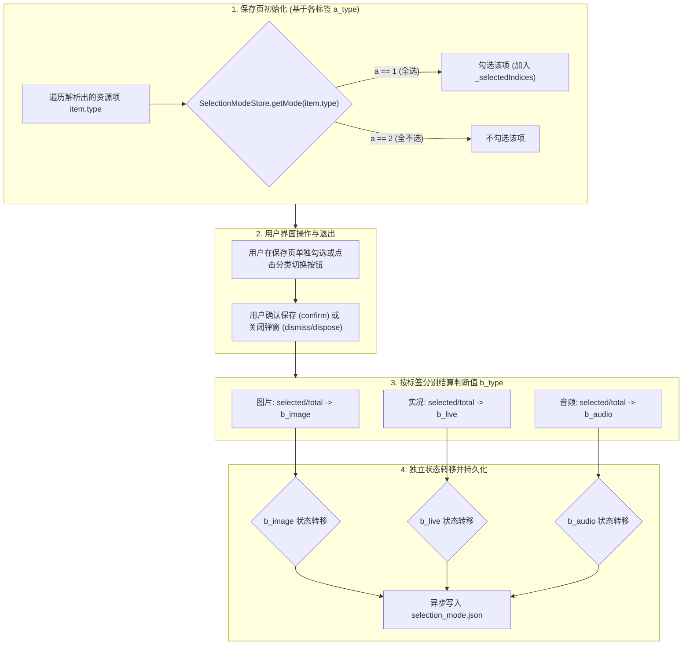

# PLAN_34：保存页标签级选择状态记忆（v1.3.3+142 ~ 143）

## 一、需求背景与目标

目前图文/实况多资源保存页（`ImagePreviewSheet`）在每次解析弹出时，默认全选所有资源。用户可能经常仅需要保存图片而不需要配乐音频，或者仅需要保存实况视频。

本次 PLAN_34 版本号推进至 **`1.3.3+143`**（应用版本保持 `1.3.3`，构建版本号升至 `143`），实现**标签级（图片、实况、音频）选择状态记忆**：

1. **标签独立状态机模型**：
   - 设 $a_{\text{type}}$ 为**对应媒体标签用于下次解析的判断值**（即下次打开保存页时该标签下资源的默认选择偏好）；
   - 设 $b_{\text{type}}$ 为**对应媒体标签在当前解析中的最终判断值**；
   - 状态定义：
     - `1`：全选（All selected，该标签下全部资源被勾选）
     - `2`：全不选（None selected，该标签下没有资源被勾选）
     - `3`：半选（Partially selected，该标签下资源仅勾选了一部分）
   - 初值设定：对所有标签（图片、实况、音频），初始 $a_{\text{type}} = 1$（默认全选）；
   - 状态转移规则（对每个标签分别独立应用）：
     - 若 $b_{\text{type}} = 1$（本次该标签全选）$\implies a_{\text{type}} = 1$（下次该标签默认全选）；
     - 若 $b_{\text{type}} = 2$（本次该标签全不选）$\implies a_{\text{type}} = 2$（下次该标签默认全不选）；
     - 若 $b_{\text{type}} = 3$（本次该标签半选）$\implies a_{\text{type}}$ 保持不变（维持该标签上次的选择偏好）；
   - 若作品中不含有某标签资源（例如无实况或无音频），则不更新该标签的 $a_{\text{type}}$，保留既往记忆。
2. **UI 纯净与解耦原则**：
   - 全不选与半选的 UI 样式与交互逻辑完全沿用现有组件机制，无需额外设计复杂的中间态（如半选横杠），业务后端纯粹基于各标签集合大小计算判断值并自动流转。

---

## 二、架构设计与算法逻辑

---

## 三、文件修改清单

1. **`pubspec.yaml` & `lib/app_info.dart`** [修改]：
   - 版本升级为 `1.3.3+143`。
2. **`lib/utils/selection_mode_store.dart`** [修改]：
   - 升级为按 `MediaType`（图片、实况、音频）分别独立维护 $a$ 映射与 JSON 持久化；
   - 提供 `getMode(MediaType)`、`recordCategorySelection(type, b)` 与批量结算 `updateFromSheetItems(allItems, selectedIndices)`。
3. **`lib/main.dart`** [保持]：
   - 应用启动时调用 `await SelectionModeStore.init()` 恢复各标签记忆。
4. **`lib/widgets/image_preview_sheet.dart`** [修改]：
   - `initState` 中依据各资源项的 `SelectionModeStore.getMode(type)` 初始化勾选；
   - 在弹窗确认（`_confirm`）与销毁（`dispose`）时调用 `updateFromSheetItems` 分标签结算更新。
5. **`test/selection_mode_store_test.dart`** [修改]：
   - 覆盖单标签独立流转、跨标签互不干扰、多类型综合演练等单测。
6. **`test/image_preview_sheet_test.dart`** [修改]：
   - 验证标签级默认记忆（例如全选图片但取消音频后，下次仅图片默认选中而音频不选）。

---

## 四、验证计划与实施

1. **静态检查**：`flutter analyze` 确保 0 issues；
2. **单元与集成测试**：`flutter test` 确保 100% 绿灯；
3. **Release 打包**：执行 `.\tool\build_release_apk.bat` 产出安装包。

---

## 五、实施与构建结果

### 1. 静态检查与自动化测试
- `flutter analyze`：**0 issues found**。
- `flutter test`：**全项目 138 项测试全部绿灯通过**：
  - `test/selection_mode_store_test.dart`（覆盖标签级独立流转矩阵与结算演练）；
  - `test/image_preview_sheet_test.dart`（覆盖标签级状态联动演练与生命周期记忆）。

### 2. 构建产物
- 正在执行流水线编译 v1.3.3+143 Release APK。
