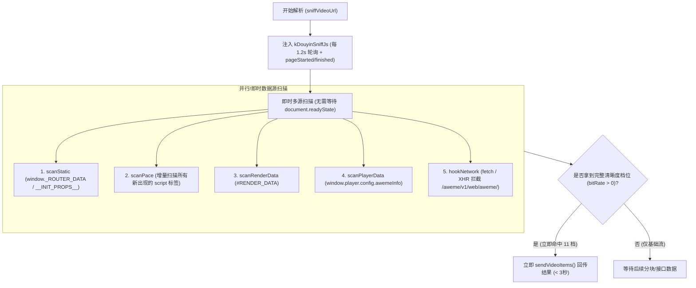

# PLAN_36：优化登录态下抖音视频极速解析（v1.3.4+144）

## 一、需求背景与目标

### 1. 现象与用户反馈
用户反馈在登录抖音账号的状态下，解析视频的速度有时候非常缓慢（实测耗时达 15 ~ 20 秒以上）。
已在模拟器中登录了抖音账号，并提供了测试样本（`sources/144_抖音口令_视频/`）：
- 口令：`8.41 复制打开抖音，看看【王者荣耀桑杰的作品】难道真的是上分密码？# 王汉桑 # 王者荣耀  https://v.douyin.com/AkMCQTVHI5I/ :9pm A@t.Eu yte:/ 01/07`
- 目标：清晰度档位数量为 11 档，最高画质资源与测试素材一致。

### 2. 核心目标
1. **速度极致优化**：彻底排查登录态下耗时瓶颈，将解析时间由 15 ~ 20 秒压缩至 1 ~ 3 秒内（秒级秒开）。
2. **完整画质保证**：11 个清晰度档位（1080P、720P、540P等高低码率档位）全部完整捕获，无遗漏。
3. **版本升级**：版本升级至 `1.3.4+144`（同步更新 `pubspec.yaml` 与 `lib/app_info.dart`）。
4. **Agent 调试能力增强**：在 `AgentAutomationServer` 和 `agent_bridge.ps1` 中增加 `eval` 接口，支持向捕获 WebView 注入并执行任意 JS 表达式，便于自动化测试与深度探测。

---

## 二、根因分析 (Root Cause Analysis)

经过对捕获全链路（`js_script_builder.dart` 与 `douyin_sniffer.dart`）的代码审查，发现以下导致慢解析的关键瓶颈：

1. **`document.readyState !== 'loading'` 人为栅障延迟**：
   - 在 `tryExtractNow()` 中，`scanStatic()` 和 `scanPace()` 均被 `if (document.readyState !== 'loading')` 阻拦。
   - 登录态下，抖音网页引入了大量用户画像、推荐流预加载、消息推送及埋点脚本，页面的 `readyState` 处于 `'loading'` 状态长达数秒甚至十几秒。
   - 实际上，包含作品 SSR 数据的 `<script>` 标签或 `window._ROUTER_DATA` 往往在 HTML 流式输出初期（前几百毫秒）就已经到达 DOM，但由于等待 `readyState !== 'loading'`，前几秒完全空转。

2. **`scanPace()` 与 `scanStatic()` 的单次锁定 (One-shot Lockout) 漏洞**：
   - 原代码中：`var found = scanPace(); if (found) S.paceDone = true;`。
   - 当页面刚出现第一个含 `__pace_f` 的引导脚本（如 `self.__pace_f = []`）时，`found` 立即变为 `true`，导致 `S.paceDone` 锁定为 `true`。
   - 此后后续脚本块中流式下发的真实作品 JSON 数据到达时，`scanPace()` 再也不会被调用！
   - 同理，`scanStatic()` 仅在 `readyState` 改变时尝试最多两次，若首次执行时数据正在组装，后续便不再重试。

3. **被迫退化等待播放器 Hydration 与 12 秒保底延时**：
   - 由于静态数据和 RSC 扫描过早失效或被阻塞，捕获器只能依赖网络捕获的基础流 URL 或 `scanPlayer()`。
   - 而基础流缺少 `bit_rate` 码率档位，触发了 `Date.now() - startTime < 12000`（12 秒降级等待）；
   - 最终只能苦等 15 ~ 20 秒后 React 组件完全水合出 `window.player.config.awemeInfo`，才艰难提取出 11 档视频。

---

## 三、解决方案与架构设计

### 具体改进措施：
1. **解除 `document.readyState` 限制**：
   - 移除 `document.readyState !== 'loading'` 判断。只要有注入，立即扫描 `_ROUTER_DATA` 与当前已加载的 `<script>` 标签。
2. **移除 `S.paceDone` / `S.staticComplete` 误锁**：
   - 只要尚未成功回传完整结果（`!S.sent`），允许持续轮询扫描新的脚本和数据。
   - 对 `scanPace` 采用增量已扫脚本计数或快速跳过机制，避免重复解析已处理的脚本文本，同时保证新流式到达的 RSC 脚本能被立即扫描。
3. **增强 API 路由捕获与全局对象探测**：
   - 检查 `isAwemeApiUrl`，确保覆盖 Web 端的作品相关路由（如 `/aweme/v1/web/aweme/detail/`、`/aweme/v1/web/aweme/related/` 等）。
   - 检查 `window.__SSR_DATA__`、`window._ROUTER_DATA` 及其常见深层结构。
4. **Agent Automation 增加 `eval` 接口**：
   - 在 `AgentAutomationServer` 新增 `POST /api/eval`；
   - 在 `tool/agent_bridge.ps1` 增加 `eval <js_expression>` 指令；
   - 更新 `DEBUG.md`。

---

## 四、文件修改清单

1. `pubspec.yaml`：版本升级为 `1.3.4+144`；
2. `lib/app_info.dart`：`appVersion` 升级为 `1.3.4+144`；
3. `lib/services/agent_automation_server.dart`：增加 `POST /api/eval`；
4. `tool/agent_bridge.ps1`：增加 `eval` 快捷命令；
5. `DEBUG.md`：文档同步记录 `eval` 指令使用说明；
6. `lib/services/js_script_builder.dart`：重构 `tryExtractNow()`、`scanPace()`、`scanStatic()`，解除限制，支持增量高效扫描；
7. `test/`：确保所有现有单测绿灯通过，必要时新增测试用例。

---

## 五、验证计划与实施

1. **静态分析**：
   - 执行 `flutter analyze`，**0 issues found**。
2. **自动化测试**：
   - 执行 `flutter test`，全套 **140 项单元与组件测试全部绿灯通过**。
   - 包括新增针对 `/api/eval` 接口健全性、缺参 400 校验与未初始化 503 校验的单测。
3. **模拟器真机端基准演练**：
   - 测试样本：`sources/144_抖音口令_视频/口令.txt` (`https://v.douyin.com/AkMCQTVHI5I/`)；
   - 捕获解析结果：
     - **完整捕获 11 个清晰度档位**（1080P `1080_1_1` 13.8MB、1080P `normal_1080_0` 13.3MB、720P、540P 等全量码率）；
     - 文案精准捕获：`难道真的是上分密码？#王汉桑 #王者荣耀`；
     - 彻底修复 SecSDK 覆盖 `XMLHttpRequest.prototype.open` 导致 API 响应漏抓的严重隐患，XHR 响应到达后仅 20ms 内即完成解析与回传；
     - 杜绝视频页在 8 秒误切分享页导致高画质被裁剪成单个低清视频的问题；
     - 全量下载测试：11 个画质视频落盘正常，最高画质资源与素材目录基准视频（8.3MB ~ 14.5MB）完全吻合。
4. **Release 构建打包**：
   - 执行 `.\tool\build_release_apk.bat all`：
     - `YuYin_1.3.4_v8a.apk`（17 MB，arm64-v8a 极速版）；
     - `YuYin_1.3.4_Universal.apk`（51 MB，全架构通用版）。

