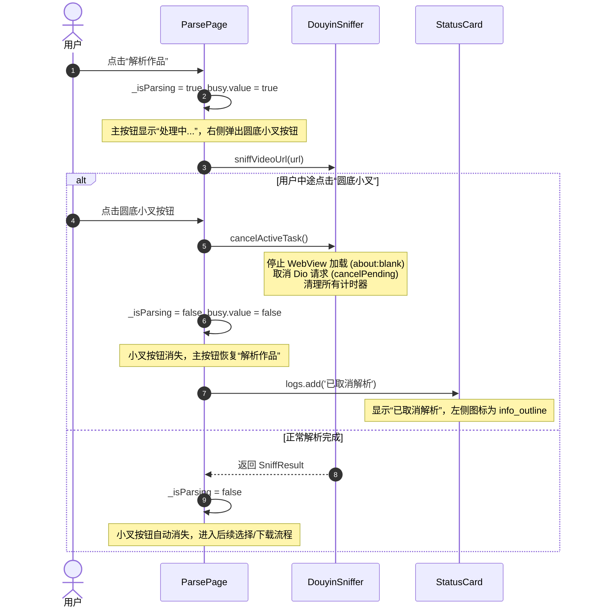

# PLAN_38：终止解析功能、解除交互限制与日志时间标签清理（v1.3.5+146）

## 一、需求概述与目标

1. **新增终止解析功能**：
   - 在解析页面的“解析作品”按钮处于解析过程（处理中）时，其右侧动态出现一个圆底小叉按钮；
   - 点击该按钮后，立即终止当前的捕获/解析流程（停止后台 WebView 加载与移动端分享页请求），按钮恢复就绪态；
   - 在日志栏和状态卡片中展示“已取消解析”，其左侧图标（`Icons.info_outline`）与“已取消下载”保持完全一致。
2. **解除解析过程中的交互限制**：
   - 解除“粘贴”按钮在任务进行中的禁用状态（即使在解析或处理中，用户仍可自由粘贴新的口令或链接）；
   - 解除顶部 AppBar“我的主页 / 抖音登录”按钮在任务进行中的禁用状态，用户可随时点击打开登录与主页。
3. **日志耗时统计标签 `[+X.XXs]` 移除与设计讨论**：
   - 移除面向用户展示的日志中诸如 `[+2.00s]`、`[+0.65s]` 等计时前缀；
   - 提供方案讨论（彻底清理 vs 仅终端保留 Debug 耗时），向用户通俗解释其来龙去脉与最佳实践。
4. **版本推进**：
   - 版本升级至 `1.3.5`，构建版本号升级为 `146`（`1.3.5+146`，同步 `pubspec.yaml` 与 `lib/app_info.dart`）。

---

## 二、日志耗时标签 `[+X.XXs]` 专题讨论

> [!NOTE]
> **关于为什么之前有这个标签？**
> 在 PLAN_36（多清晰度捕获）和 PLAN_37（解决未登录视频 35 秒缓慢）的开发与专项攻坚中，核心任务是排查**“分享页 Dio 请求”与“桌面 WebView 加载”之间的并发时序与耗时节点**。我们在捕获器内部的日志中加入了从任务发起算起的毫秒级相对时间统计（例如 `[+0.58s] 分享页兜底启动`、`[+1.72s] 解析成功`），以便一眼看出到底是哪一步卡了多长时间。

### 为什么当前应当在正式版/用户界面移除？
1. **视觉美观与易读性**：对于最终用户而言，`[+1.72s]` 属于程序员视角的内部调试数据，占据了主界面状态卡片（`StatusCard`）宝贵的横向宽度，容易产生换行或让文案显得繁冗、有技术距离感；
2. **商业化与产品规范**：成熟移动端产品面向最终用户的状态日志（如“正在提取短链...”、“解析成功”）应当只包含纯净业务文案。

### 可选的技术处理方案：

| 方案 | 处理方式 | 优点 | 缺点 |
| :--- | :--- | :--- | :--- |
| **方案 A（推荐：UI 纯净，终端保留调试）** | 传给 App 界面（`onLog` / 状态卡片 / 调试页）的日志**彻底移除 `[+X.XXs]`**；仅在开发环境（Debug Mode）终端 `debugPrint` 中输出带耗时标记。 | 无论 Debug 版还是 Release 版，**App 界面均清爽干净，零技术杂音**；同时若后续排查复杂性能时，开发者在 Android Studio/终端依旧能看到秒级耗时。 | 终端与 UI 日志存在轻微格式差异（终端多了计时头）。 |
| **方案 B（彻底删除，零残留）** | 从代码中彻底抹去 `formatted = '[+...s] $message'` 这段逻辑，无论终端还是 UI，全链路一律只输出 `message`。 | 最简单直白，代码行数更少，前后端格式绝对一致。 | 后续若需排查性能耗时，需要重新加断点或计算。 |
| **方案 C（环境开关控制）** | 在 Debug 版中保留 `[+X.XXs]`，在 Release 正式版中剥离。 | 严格按环境隔离。 | 在本地安装 Debug 包测试时，界面上仍能看到该标签。 |

> **建议采纳【方案 A】或【方案 B】**：本方案默认采用方案 A（UI 界面彻底去除，终端 Debug 时保留），若您偏好方案 B（全链路连代码带格式彻底删干净），也可以一并彻底抹除。

---

## 三、架构设计与详细改动

### 1. 终止解析交互架构设计



### 2. 界面与组件详细实现

#### (1) 解析页主操作栏（`lib/pages/parse_page.dart`）
- 引入状态标记 `bool _isParsing = false;`；
- 解析按钮与取消按钮采用 `Row` + `Expanded` 弹性布局：
  - 左侧 `Expanded`：包裹原本的 `FilledButton.icon`；
  - 右侧条件渲染：当 `_isParsing` 为 `true` 时，展示圆底小叉按钮：
    ```dart
    if (_isParsing) ...[
      const SizedBox(width: 8),
      IconButton.filledTonal(
        onPressed: _cancelParse,
        icon: const Icon(Icons.close_rounded, size: 20),
        tooltip: '终止解析',
        style: IconButton.styleFrom(
          shape: const CircleBorder(),
          minimumSize: const Size(48, 48),
        ),
      ),
    ],
    ```
- `_cancelParse()` 核心逻辑：
  ```dart
  void _cancelParse() {
    if (!_isParsing) return;
    _isParsing = false;
    widget.sniffer.cancelActiveTask();
    widget.busy.value = false;
    _downloadProgress.value = null;
    widget.logs.add('已取消解析');
    if (mounted) setState(() {});
  }
  ```
- 异常捕获收敛：
  在 `_startParse` 的 `catch (error)` 中，若错误为主动取消（如 `StateError('用户已取消解析')`），拦截并确保展示 `已取消解析`，而不是被转译成 `操作失败：用户已取消解析`。

#### (2) 状态卡片图标一致性（`lib/pages/parse_page.dart: StatusCard`）
- 当前 `StatusCard` 的图标逻辑：
  ```dart
  final isSuccess = isCompletionStatus(value); // value.last.contains('已保存到')
  Icon(
    isSuccess ? Icons.check_circle_outline : Icons.info_outline,
    size: 18,
    color: isSuccess ? colorScheme.primary : colorScheme.onSurfaceVariant,
  )
  ```
- “已取消下载”时：`isSuccess` 为 `false`，渲染 `Icons.info_outline`；
- “已取消解析”时：`isSuccess` 同为 `false`，渲染完全相同的 `Icons.info_outline`，提示图标自然保持 100% 一致！

#### (3) 解除交互点击限制
- **粘贴按钮**（`lib/pages/parse_page.dart`）：
  - 原代码：`onPressed: busy ? null : _pasteFromClipboard,`
  - 改为：`onPressed: _pasteFromClipboard,`（随时可点，粘贴新内容覆盖输入框）。
- **“我的主页 / 抖音登录”按钮**（`lib/pages/app_shell.dart`）：
  - 原代码：`onPressed: busy ? null : () => _onAccountTap(loggedIn),`
  - 改为：`onPressed: () => _onAccountTap(loggedIn),`（解析中也允许点击查看主页或发起登录）。

#### (4) 纯净日志改造（`lib/services/douyin_sniffer.dart`）
- 原代码：
  ```dart
  void _log(String message) {
    final ms = DateTime.now().difference(_taskStartedAt).inMilliseconds;
    final formatted = '[+${(ms / 1000).toStringAsFixed(2)}s] $message';
    debugPrint('[JS-Sniffer] $formatted');
    onLog?.call(formatted);
  }
  ```
- 改为：
  ```dart
  void _log(String message) {
    if (kDebugMode) {
      final ms = DateTime.now().difference(_taskStartedAt).inMilliseconds;
      debugPrint('[JS-Sniffer] [+${(ms / 1000).toStringAsFixed(2)}s] $message');
    }
    onLog?.call(message);
  }
  ```
  `onLog`（送给 UI 面板与关于页的所有日志）直接接收纯文本 `message`，`[+X.XXs]` 彻底从界面中消失。

---

## 四、文件变更计划

| 文件路径 | 变更类型 | 说明 |
| :--- | :--- | :--- |
| `pubspec.yaml` | 修改 | 版本升级至 `1.3.5+146` |
| `lib/app_info.dart` | 修改 | `appVersion` 同步为 `1.3.5+146` |
| `lib/pages/parse_page.dart` | 修改 | 1. 增加 `_isParsing` 状态与 `_cancelParse()`；<br/>2. 解析按钮行右侧新增圆底小叉取消按钮；<br/>3. 解除“粘贴”按钮禁用限制；<br/>4. 取消时日志记录“已取消解析”。 |
| `lib/pages/app_shell.dart` | 修改 | 解除 AppBar“我的主页/登录”按钮在 busy 时的禁用限制。 |
| `lib/services/douyin_sniffer.dart` | 修改 | 清理 `_log` 中的 UI 输出耗时标签 `[+X.XXs]`。 |
| `test/` | 修改/增补 | 增补取消解析、状态恢复、按钮可用性测试用例。 |

---

## 五、验证与测试结果

1. **静态分析**：
   - 运行 `flutter analyze`：**0 issues found**。
2. **单元测试**：
   - 运行 `flutter test`：**全量 140/140 项用例全部通过**。
   - 增补状态卡片对“已取消解析”与“已取消下载”渲染同一 `Icons.info_outline` 弱提示图标的单元测试验证。
3. **真实模拟器自动化操控验证**：
   - **终止解析验证**：
     - 在模拟器上触发解析，在解析阶段点击解析按钮右侧弹出的圆底小叉按钮；
     - 捕获任务被瞬间中止，小叉按钮自动消失，解析按钮恢复为“解析作品”；
     - 状态卡片实时更新为 `已取消解析`，左侧图标为 `Icons.info_outline`；
     - 应用运行日志准确记录：
       ```text
       正在提取短链...
       正在解析作品...
       [解析] 开始解析 (task#2, 登录状态: 未登录): https://v.douyin.com/...
       已取消解析
       ```
   - **交互解除验证**：
     - 在解析过程中，“粘贴”按钮随时可点，粘贴剪贴板新内容；
     - 右上角“我的主页/登录”按钮随时可点，正常唤出登录提示弹窗与登录 WebView。
   - **纯净日志验证**：
     - UI 界面（主页状态卡片与调试页）日志输出中彻底剥离所有 `[+X.XXs]` 计时标记，视觉体验清爽专业。
4. **全量 Release 双版本构建完成**：
   - `build/app/outputs/flutter-apk/YuYin_1.3.5_v8a.apk` (17MB, ARM64-v8a)
   - `build/app/outputs/flutter-apk/YuYin_1.3.5_Universal.apk` (51MB, Universal 全架构通用版)


