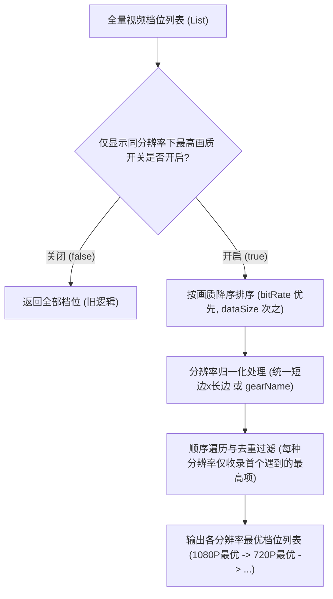

# PLAN_40：纯视频画质选项去重优化与“下载设置”二级界面设计（v1.3.6+147）

## 一、需求背景与目标

1. **画质选项冗余痛点**：
   - 之前在解析普通视频时，程序会将嗅探到的所有画质档位按码率/大小从高到低排列展示；
   - 抖音接口经常会针对同一分辨率（例如 `1080x1920`）返回多套不同码率的编码流（例如 5Mbps 高码率与 2Mbps 低码率），导致画质选择弹窗中堆叠了多个相同分辨率的选项；
   - 用户反馈：同一分辨率下只需展示最高码率/最大体积的最优选项，以便界面简洁直观、避免误选低画质。
2. **兼顾多人群需求的开关设计**：
   - 引入“**仅显示同分辨率下最高画质**”配置项，默认处于开启（`true`）状态；
   - 开启时：自动过滤同分辨率下的次级码率，各分辨率（如 1080P、720P、540P）仅呈现各自的最优画质选项；
   - 关闭时：保留旧逻辑，向用户列出全部检测到的码率档位。
3. **设置层级重构（收敛至二级次界面）**：
   - 将主设置页中的“**自定义保存位置**”与新增的“**仅显示同分辨率下最高画质**”统一收敛并沉淀到“**设置 → 下载设置**”二级页面中；
   - 一级设置页保持“外观设置”、“下载设置”、“检查更新”、“调试”、“关于”的结构清晰度。
4. **版本推进**：
   - 版本升级至 `1.3.6`，构建版本号升级为 `147`（`1.3.6+147`，同步更新 `pubspec.yaml` 与 `lib/app_info.dart`）。

---

## 二、架构设计与核心算法

### 1. 核心过滤去重算法：`filterHighestQualityPerResolution`

#### 分辨率归一化规则：
- 解析 `item.resolution`（如 `"1080x1920"` 或 `"1920x1080"`），提取数值 `w` 与 `h`；
- 取 `min(w, h) x max(w, h)`（如 `1080x1920`），抹除横竖屏顺序差异；
- 若 resolution 缺失，则回退使用 `gearName`（如 `"1080p"`）或 `resolutionLabel`。

### 2. 持久化存储设计：`DownloadSettingsStore`
- 存储文件：`download_settings.json`（保存在应用私有目录下）；
- 核心字段：
  - `onlyHighestQualityPerResolution`: `bool`（默认 `true`）；
- 响应式通知：`onlyHighestQualityNotifier`（`ValueNotifier<bool>`）；
- 过滤辅助方法：`filterQualities(List<MediaItem> items)`。

### 3. 设置界面架构调整

- **一级界面 `SettingsPage` (`lib/pages/settings_page.dart`)**：
  - 原“自定义保存位置”入口改造为“**下载设置**”（图标：`download_for_offline_outlined`，副标题：“保存位置、视频画质选项过滤”）；
  - 点击跳转至二级页面 `DownloadSettingsPage`。
- **二级界面 `DownloadSettingsPage` (`lib/pages/download_settings_page.dart`)**：
  - 顶部 AppBar：`下载设置`；
  - 模块一【文件保存】：
    - `自定义保存位置`：点击弹出 `SaveLocationDialog`，副标题实时反映当前路径配置；
  - 模块二【画质偏好】：
    - `仅显示同分辨率下最高画质`：`SwitchListTile`，开关绑定 `DownloadSettingsStore`。

---

## 三、文件改动规划

1. **[NEW] `lib/utils/download_settings_store.dart`**：
   - 实现持久化存储、`ValueNotifier`、分辨率标准化与最高画质过滤逻辑；
2. **[NEW] `lib/pages/download_settings_page.dart`**：
   - 下载设置二级次界面，合并自定义保存位置与画质选项开关；
3. **[MODIFY] `lib/main.dart`**：
   - 挂载 `await DownloadSettingsStore.init();`；
4. **[MODIFY] `lib/pages/settings_page.dart`**：
   - 替换自定义保存位置为“下载设置”二级界面入口；
5. **[MODIFY] `lib/widgets/video_quality_sheet.dart`**：
   - 在展示时调用 `DownloadSettingsStore.filterQualities(...)`，并动态更新弹窗标题档位数与列表项；
6. **[MODIFY] `lib/services/agent_automation_server.dart`**：
   - 在状态元数据中暴露 `downloadSettings`，并新增切换画质过滤配置的 REST 接口；
7. **[MODIFY] `pubspec.yaml` & `lib/app_info.dart`**：
   - 版本升级为 `1.3.6+147`；
8. **[NEW] `test/download_settings_store_test.dart`**：
   - 编写针对同分辨率最高画质去重算法、持久化状态与边界情况的完备单元测试；
9. **[NEW] `test/download_settings_page_test.dart`**：
   - 编写针对下载设置二级页面的 Widget 测试。

---

## 四、验证计划

1. **单元与组件测试**：
   - 针对 `filterHighestQualityPerResolution` 进行不同码率、相同分辨率、横竖屏、缺失分辨率等场景的全面测试；
   - 运行 `flutter analyze` 确保 0 warning；
   - 运行 `flutter test` 确保所有测试通过；
2. **真机/自动化桥梁验证**：
   - 使用 `agent_cmd.bat` 或自动化测试用例，校验开关开启/关闭下的画质列表返回；
   - 验证设置页与下载设置二级页面的交互流转正常。

