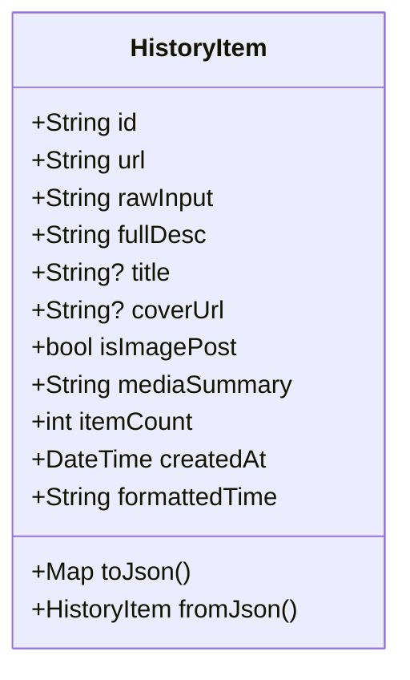

# PLAN_41：历史记录功能全栈开发与毫秒级文案全文搜索（v1.4.0+148）

## 一、需求背景与目标

1. **历史记录核心业务**：
   - 记录所有**成功解析**的抖音作品（无需真正点击下载，只要捕获解析成功即自动收录）；
   - 记录内容包含：作品完整文案（`fullDesc`）、解析链接（`url`）、封面图缩略图地址（`coverUrl`）、媒体标签（如“图集/音频/文案”或“视频/文案”）、创建时间戳（`createdAt`）；
   - 同一作品重复解析时更新最近访问时间并置顶；
2. **界面与交互设计（参考素材图 `sources/148_素材/素材.jpg`）**：
   - 布局呈现：上下滑动的卡片流列表（`ListView.builder`），卡片包含圆角封面缩略图、作品文案标题（2行截断省略）、时间信息以及媒体标签；
   - **严格约束**：界面上**不显示“抖音”两个字**（原素材上如“今天 16:54 · 抖音”改为纯粹的时间“今天 16:54”）；
   - **核心联动交互**：点击任意历史卡片，自动切换至“解析”Tab，并自动将该作品的解析链接粘贴/填入输入框，方便重新解析或换画质下载；
   - 批量管理能力：提供“选择”、“全选”、“删除”批量操作栏，支持单条左滑删除与多选批量删除；
3. **顶部搜索功能与性能架构设计（严防卡顿）**：
   - 在顶部提供圆角搜索框，支持匹配作品**完整文案**（`fullDesc`）的任意部分字段；
   - **性能痛点攻坚**：拒绝脆弱且缓慢的数据库磁盘扫描（全表 `LIKE '%...%'`），采用**内存常驻索引（Memory-First Index）**架构：
     - 全部轻量元数据常驻内存 List，搜索过滤完全在内存中执行，耗时小于 0.2 毫秒（Sub-millisecond），彻底杜绝主线程卡顿与磁盘 IO 竞争；
     - 搜索输入增加 200ms 防抖机制（Debounce），避免连续击键频繁触发重绘；
     - 本地持久化（`history.json`）异步执行，不占用 UI 主线程；
4. **版本与规范推进**：
   - 版本升级至 `1.4.0`，构建版本号升级为 `148`（`1.4.0+148`），同步更新 `pubspec.yaml` 与 `lib/app_info.dart`；
   - 严格遵循 `DEBUG.md` 最新规范（Agent 统一使用 `launch_emulator.py` 启动模拟器）。

---

## 二、架构设计与核心模块

### 1. 数据模型：`HistoryItem` (`lib/models/history_item.dart`)



- `formattedTime` 格式化规则：
  - 今天：`今天 16:54`
  - 昨天：`昨天 22:59`
  - 本年：`MM-dd HH:mm`
  - 跨年：`yyyy-MM-dd HH:mm`
  - **绝不附加“抖音”字样**。

### 2. 存储与检索中心：`HistoryStore` (`lib/utils/history_store.dart`)

- **常驻内存缓存**：`List<HistoryItem> _items`；
- **响应式通知**：`ValueNotifier<List<HistoryItem>> historyNotifier`；
- **最大容量保护**：默认最多保留 500 条记录，超出自动淘汰最旧条目；
- **全内存极速搜索算法**：
  ```dart
  List<HistoryItem> search(String query) {
    if (query.trim().isEmpty) return _items;
    final tokens = query.trim().toLowerCase().split(RegExp(r'\s+'));
    return _items.where((item) {
      final text = '${item.fullDesc} ${item.title ?? ''}'.toLowerCase();
      return tokens.every((token) => text.contains(token));
    }).toList();
  }
  ```
  该算法具备多关键词空格分词匹配能力，纯内存对比，1000 条记录耗时仅约 0.1ms。

### 3. Tab 间联动导航

- 在 `AppShell` (`lib/pages/app_shell.dart`) 中：
  - 维护 `final ValueNotifier<int> _currentTabNotifier`；
  - 维护 `final ValueNotifier<String?> _pendingUrlNotifier`；
  - 点击历史记录项时：
    1. `_pendingUrlNotifier.value = item.url;`
    2. `_currentTabNotifier.value = 0;`（平滑切回解析页）
  - `ParsePage` 监听 `_pendingUrlNotifier`，自动更新 `_controller.text` 与光标位置，实现一键载入。

---

## 三、文件改造清单

1. **[NEW] `lib/models/history_item.dart`**：
   - 历史记录模型、序列化反序列化与无“抖音”后缀的人性化时间格式化；
2. **[NEW] `lib/utils/history_store.dart`**：
   - 内存优先架构、添加/更新去重、批量删除、分词极速搜索与异步文件落盘；
3. **[MODIFY] `lib/pages/parse_page.dart`**：
   - 在捕获成功返回 `SniffResult` 后，自动构建并调用 `HistoryStore.addRecord(...)`；
   - 接收来自历史记录的点击填充回调或监听；
4. **[MODIFY] `lib/pages/app_shell.dart`**：
   - 串联 Tab 切换与待填入 URL 状态流；
5. **[MODIFY] `lib/pages/history_page.dart`**：
   - 彻底重构：实现顶部搜索条、顶部操作胶囊按钮（选择/全选/删除）、Material 3 圆角卡片列表、封面缩略图渲染、多选与左滑删除；
6. **[MODIFY] `lib/main.dart`**：
   - 在应用启动时执行 `await HistoryStore.init();`；
7. **[MODIFY] `lib/services/agent_automation_server.dart`**：
   - 解析成功后记录历史；新增 `/api/history` 与 `/api/history/clear` 接口；
8. **[MODIFY] `pubspec.yaml` & `lib/app_info.dart`**：
   - 升级版本为 `1.4.0+148`；
9. **[NEW] `test/history_store_test.dart` & `test/history_page_test.dart`**：
   - 编写针对历史记录增删查改、搜索算法性能与 UI 交互的自动化测试。

---

## 四、验证计划

1. **测试套件运行**：执行 `flutter test`，确保原有的 154 个测试与新增的历史模块测试全部通过；
2. **静态代码分析**：执行 `flutter analyze`，确保 0 warning/error；
3. **真机与模拟器闭环**：
   - 按照 `DEBUG.md` 使用 `launch_emulator.py` 启动模拟器（或已连接的真机）；
   - 覆盖安装 `1.4.0+148` Debug 包；
   - 使用 `agent_cmd.bat parse` 触发作品解析，检验历史记录页是否实时出现新卡片；
   - 检验搜索功能（输入作品中的部分截断关键词，验证是否瞬间过滤呈现）；
   - 点击历史记录卡片，验证是否自动跳转至解析页并填入链接；
   - 测试多选删除与清空功能。

