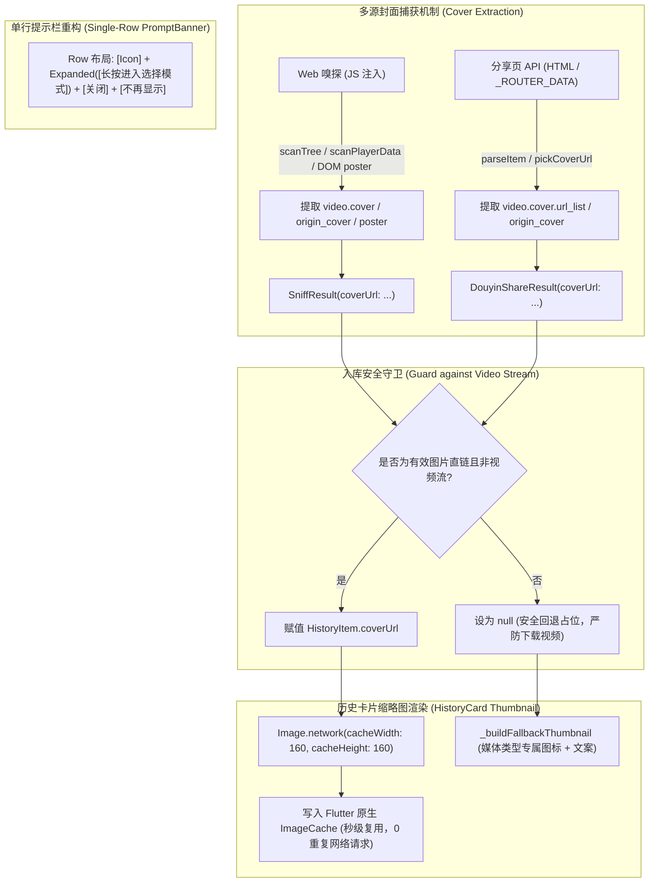

# PLAN_43：历史记录提示栏单行化与视频封面捕获优化 (版本 1.4.1+151)

## 一、需求背景与目标

在 PLAN_42 完成历史记录操控逻辑与长按多选规范后，针对实机交互反馈与资源加载性能进行两项核心升级：

1. **提示栏单行化对齐**：
   - 历史记录页搜索框下方的“长按进入选择模式”提示条，原先为多行垂直排列（上方文案，下方右侧为【关闭】与【不再显示】按钮）；
   - 升级为**同单行水平紧凑排布**（左侧灯泡图标 + 中间“长按进入选择模式”提示语 + 右侧【关闭】与【不再显示】文本按钮），减少纵向空间占用，视觉更加轻盈精致。

2. **解决视频类资源严重重复下载与加载异常问题，引入全平台封面抓取**：
   - **痛点根因分析**：
     - 在旧逻辑中，若作品为纯视频，由于没有图片资源，解析模块误将视频文件的播放/直链地址（`result.items.first.url` 即 `.mp4` / `aweme/v1/play`）赋值给了历史记录的 `coverUrl`；
     - 历史页卡片在渲染缩略图时使用 `Image.network(item.coverUrl)`，Flutter 尝试将几 MB 到几十 MB 的完整 MP4 视频流作为图片解码，必然解码失败触发 `errorBuilder` 回退到文字黑框；
     - 更严重的是：用户每次点击卡片或长按进入“选择模式”时，`setState` 重绘触发，由于视频流链接无法被图片缓存（ImageCache）有效命中，导致**列表中所有视频的历史卡片同时再次发起 HTTP GET 重新下载完整视频流**，造成严重带宽浪费、界面卡顿与发热。
   - **重构目标**：
     - 在 Web 嗅探脚本（`js_script_builder.dart`）与分享页解析（`douyin_share_api.dart`）中全面提取作品的**真实封面图（Cover URL）**（无论是视频还是图文）；
     - `SniffResult` 与 `DouyinShareResult` 统一注入 `coverUrl` 字段；
     - 历史记录入库与历史卡片构建时，严格拦截并清除视频流地址，确保 `coverUrl` 仅存放合法图片直链；
     - 升级历史缩略图组件：配置 `cacheWidth / cacheHeight` 限制显存，配置网络图片加载器与类型标识微标，无封面时使用优雅的媒体类型占位替代。

---

## 二、系统架构与技术设计

### 1. 提示条单行排布规范 (`_buildPromptBanner`)
- 将外层 `Column` 改造为单行 `Row`；
- 左侧放置 `Icons.tips_and_updates_outlined` 高光图标；
- 中间使用 `Expanded` 包裹 `Text('长按进入选择模式')`，`maxLines: 1`，保证自适应宽度并防止小屏溢出；
- 右侧紧凑排列【关闭】与【不再显示】两个 `TextButton`，设置 `visualDensity: VisualDensity.compact` 与 `MaterialTapTargetSize.shrinkWrap`。

### 2. 封面图提取算法设计
- **分享页 API (`DouyinShareApi.pickCoverUrl`)**：
  1. 依次查找 `item.video.cover.url_list`、`item.video.origin_cover.url_list`、`item.video.dynamic_cover.url_list`；
  2. 查找 `item.cover.url_list`；
  3. 过滤并返回清洗后的首个合法图片 URL（以 `.jpeg` / `.jpg` / `.webp` / `.png` 优先或包含 `tos-cn-p-` 资源路径）；
  4. 对于图文作品，优先取首张图片的直链。
- **Web 嗅探 JS (`js_script_builder.dart`)**：
  1. 在 `scanTree` 中解析 `node.video` 时提取 `cover` / `origin_cover` / `dynamic_cover`；
  2. 在 `scanPlayerData` 中从 `window.player.config.awemeInfo.video.cover` 或 `config.poster` 提取；
  3. 从 `<video poster="...">` DOM 节点提取；
  4. 在 `DouyinChannel.postMessage` 消息中新增 `coverUrl` 字段传递给 Flutter 侧。

### 3. 防重复下载与历史数据安全清洗
- 在 `HistoryItem` 中增加 `isVideoUrl(String? url)` 检测方法（匹配 `.mp4`、`video_id`、`/aweme/v1/play` 等特征）；
- 在 `HistoryItem.fromJson` 中自动对历史持久化中的脏数据（误存为视频直链的 `coverUrl`）执行清洗置空；
- 在 `parse_page.dart` 与 `agent_automation_server.dart` 中彻底删除原先由 `result.items.first.url` 兜底导致将视频填入 `coverUrl` 的逻辑。

### 4. 缩略图渲染性能优化
- `Image.network` 增加 `cacheWidth: 160` 和 `cacheHeight: 160`，防止大图解码爆显存；
- 使用内存级 `ImageCache`，卡片状态切换（进入/退出多选模式）时纯内存即时重绘，杜绝发起任何网络请求；
- 对于无封面的条目，回退展示精致的半透明卡片，配以视频/图文对应的高品质矢量图标与文案。

---

## 三、文件修改清单

| 序号 | 文件路径 | 修改类型 | 说明 |
| :--- | :--- | :--- | :--- |
| 1 | `pubspec.yaml` | MODIFY | 版本号提升至 `1.4.1+151` |
| 2 | `lib/app_info.dart` | MODIFY | 常量更新为 `1.4.1+151` |
| 3 | `GEMINI.md` / `CLAUDE.md` | MODIFY | 维护守则版本同步更新为 `1.4.1+151` |
| 4 | `lib/models/media_item.dart` | MODIFY | `SniffResult` 增加 `coverUrl` 字段 |
| 5 | `lib/services/douyin_share_api.dart` | MODIFY | `DouyinShareResult` 增加 `coverUrl` 字段，实现 `pickCoverUrl` 提取算法 |
| 6 | `lib/services/js_script_builder.dart` | MODIFY | Web 嗅探脚本注入封面与 poster 捕获，回传 `coverUrl` |
| 7 | `lib/services/douyin_sniffer.dart` | MODIFY | 嗅探器接收 JS `coverUrl` 并向结果注入 |
| 8 | `lib/models/history_item.dart` | MODIFY | 增加视频链接安全过滤，`fromJson` 自动清洗脏数据 |
| 9 | `lib/pages/parse_page.dart` | MODIFY | 废除视频流兜底封面漏洞，安全注入作品真实封面 |
| 10 | `lib/services/agent_automation_server.dart` | MODIFY | 自动化控制台安全注入封面 |
| 11 | `lib/pages/history_page.dart` | MODIFY | 提示栏重构为单行水平布局；缩略图优化 `cacheWidth` 与视频占位渲染 |
| 12 | `test/douyin_share_api_test.dart` | MODIFY | 新增视频与图文封面提取测试用例 |
| 13 | `test/history_page_test.dart` | MODIFY | 适配单行提示条与安全缩略图加载用例 |
| 14 | `test/history_store_test.dart` | MODIFY | 测试历史记录视频 URL 过滤与脏数据兼容 |

---

## 四、验证计划

1. **静态检查**：`flutter analyze` 保持 0 issues；
2. **单元与组件测试**：`flutter test` 确保工程内全部测试全绿，重点覆盖封面提取与防误存逻辑；
3. **模拟器实机功能验证**：
   - 验证历史记录页搜索框下方的提示栏与文字、双按钮严格处于同一行，无截断无溢出；
   - 验证解析纯视频作品后，封面缩略图是否正确显示作品真实画面；
   - 验证长按进入多选模式以及切换卡片勾选时，左侧卡片缩略图不再重复发起网络请求或重复加载，交互极其流畅。

