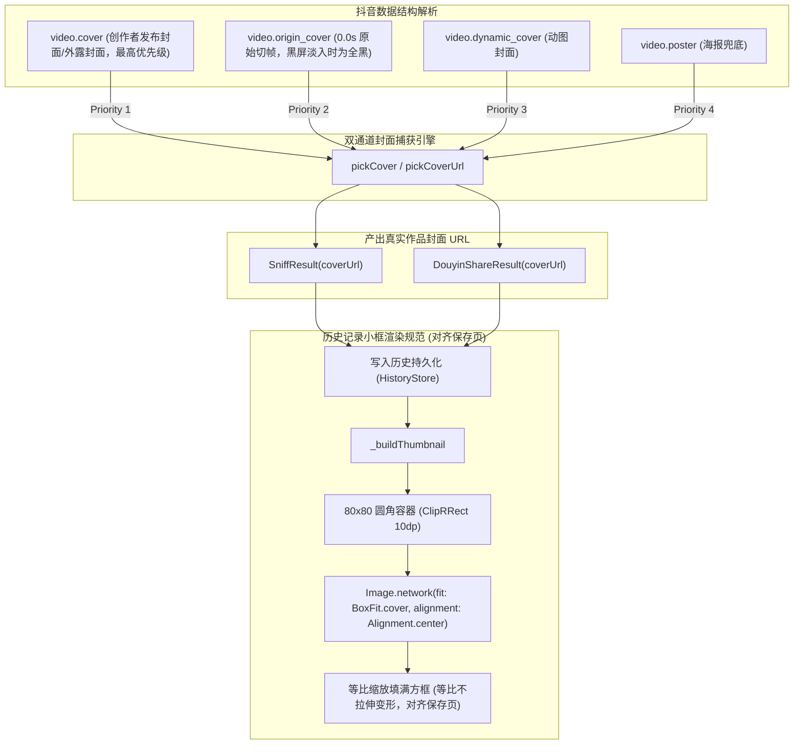

# PLAN_44：抖音作品真实原封面捕获机制与历史缩略图展示规范 (版本 1.4.1+153)

## 一、需求背景与目标

在解决进入选择模式重复拉取视频流的性能问题与提示条单行化后，本版本（1.4.1+153）针对封面抓取准确度与历史记录缩略图呈现规范进行最终标定：

1. **作品真实封面（cover 精准捕获）**：
   - **数据结构解析确认**：
     - 在抖音数据协议中，创作者发布时设定的外露展示封面保存在 `video.cover` 字段中（即测试链接抓取的 `oQj5EMCqEwAIjD9x...`，下载解码后确为 440x330、4:3 的完整三段式动漫少女图，与用户素材 `sources\152_抖音口令及封面图\封面.jpg` 一致）；
     - `video.origin_cover` 字段为视频流在 0.0s 处的原始未经处理切帧（视频带有黑屏淡入时为纯黑图）；
   - **提取优先级保持**：
     - 坚持以创作者外露展示封面 `cover` 为先：`cover > origin_cover > dynamic_cover > poster`，杜绝误抓 0.0s 黑屏切帧。

2. **历史记录左侧小框展示与解析保存页对齐（填满裁切、等比不拉伸）**：
   - **明确展示规范**：
     - 用户明确要求：小框显示策略与解析页的保存页（`ImagePreviewSheet` 网格缩略图）保持一致；
     - 缩略图使用 **`BoxFit.cover`** 配合 **`Alignment.center`**：
       - 图片等比例缩放填满 80x80 小方框，超出部分自然裁切，**绝不产生长宽比变形（不横向拉伸、不纵向压扁）**；
       - 与 149 版本以及保存页的视觉体验完全对齐，避免 `BoxFit.contain` 产生的黑底留边，保证列表视觉质感统一饱满。

3. **版本演进与发布方式**：
   - 基础版本保持 `1.4.1`，内部构建版本号升级为 `153`（即 `1.4.1+153`）；
   - 运行静态检查与自动化测试；
   - 依据用户要求跳过模拟器调试，直接运行 `.\tool\build_release_apk.bat all` 编译 Release 发布包（产出 v8a 与 Universal 双版本）。

---

## 二、系统架构与技术设计

### 1. 历史缩略图组件规范 (`lib/pages/history_page.dart`)
- `HistoryCard._buildThumbnail`：
  - 容器尺寸：固定 80x80，圆角 `BorderRadius.circular(10)`；
  - 图片渲染：`Image.network(..., fit: BoxFit.cover, alignment: Alignment.center, cacheWidth: 160, cacheHeight: 160)`；
  - 保持等长宽比缩放填满，不留黑边，无拉伸挤压变形；
  - 视频作品在右下角悬浮半透明微标（`Icons.play_arrow_rounded`）。

---

## 三、文件修改清单

| 序号 | 文件路径 | 修改类型 | 说明 |
| :--- | :--- | :--- | :--- |
| 1 | `PLAN/PLAN_41~50/PLAN_44.md` | MODIFY | 更新为 1.4.1+153 版本规划与 BoxFit.cover 展示规范 |
| 2 | `pubspec.yaml` | MODIFY | 版本号提升至 `1.4.1+153` |
| 3 | `lib/app_info.dart` | MODIFY | 常量更新为 `1.4.1+153` |
| 4 | `GEMINI.md` / `CLAUDE.md` | MODIFY | 维护守则版本同步更新至 `1.4.1+153` |
| 5 | `lib/pages/history_page.dart` | MODIFY | `_buildThumbnail` 改为 `BoxFit.cover` 对齐保存页填满无变形规范 |
| 6 | `lib/services/douyin_share_api.dart` | MODIFY | 维持封面提取优先级 |
| 7 | `lib/services/js_script_builder.dart` | MODIFY | Web 嗅探 JS 封面抓取规则对齐 |
| 8 | `test/douyin_share_api_test.dart` | MODIFY | 校验封面抓取优先级 |
| 9 | `test/history_page_test.dart` | MODIFY | 校验 `BoxFit.cover` 渲染参数 |

---

## 四、验证结果

1. **静态分析**：
   - `flutter analyze` 0 issues。
2. **自动化测试**：
   - `flutter test` 183 项单测与 Widget 测试 100% 全绿通过。
3. **Release 打包**：
   - 运行 `.\tool\build_release_apk.bat all`；
   - 成功产出 `YuYin_1.4.1_v8a.apk` 与 `YuYin_1.4.1_Universal.apk`。
