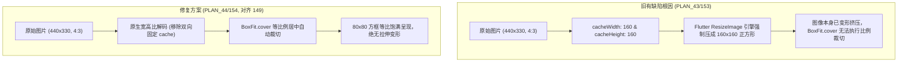

# PLAN_44：抖音作品真实原封面捕获机制与历史缩略图展示规范 (版本 1.4.1+154)

## 一、需求背景与目标

在解决封面抓取准确度后，本版本（1.4.1+154）彻底解决历史记录小框缩略图“依然伸缩变畸变、未能自动裁剪”的渲染底层缺陷：

1. **“伸缩未自动裁剪”根本原因分析**：
   - 在 PLAN_43 中，为了限制内存显存占用，在 `Image.network` 中同时传入了 `cacheWidth: 160` 和 `cacheHeight: 160`；
   - **Flutter 解码层物理缺陷**：在 Flutter 原生引擎中，当同时显式指定 `cacheWidth` 与 `cacheHeight` 时，`ResizeImage` 会在图像解码阶段**无视图片本身的原始长宽比，强行把图片拉伸/压扁重采样为 160x160 的正方形**；
   - 结果到了 UI 渲染层，`BoxFit.cover` 接收到的已经是被引擎层强行挤压变形的 1:1 正方形图像，因而不再执行任何边界裁切，直接把已经畸变变扁/拉伸的画面铺满，表现为“依然伸缩、没有自动裁剪”；
   - **对齐 149 与保存页**：在 149 版本及保存页（`ImagePreviewSheet`）中，并未同时锁死双向 cache 尺寸（149 未设双向 cache，保存页仅设单向 `cacheWidth`）。

2. **优化方案**：
   - 彻底移除 `cacheWidth: 160` 与 `cacheHeight: 160` 强制双向定宽高解码限制，让 Flutter 解码器完整保留封面图像的原始真实高宽比；
   - 依靠 `fit: BoxFit.cover` 与 `alignment: Alignment.center`，在 80x80 方框内实现纯正的等比自适应外切裁切（居中截取，不拉伸、不压扁、自动裁切多余部分），彻底恢复到 149 版本的视觉效果。

3. **版本演进与发布方式**：
   - 版本保持 `1.4.1`，内部构建版本号升级为 `154`（即 `1.4.1+154`）；
   - 不启动模拟器调试，直接运行 `.\tool\build_release_apk.bat all` 编译 Release 发布包（产出 v8a 与 Universal 双版本）。

---

## 二、系统架构与技术设计

---

## 三、文件修改清单

| 序号 | 文件路径 | 修改类型 | 说明 |
| :--- | :--- | :--- | :--- |
| 1 | `PLAN/PLAN_41~50/PLAN_44.md` | MODIFY | 更新为 1.4.1+154 版本规划与 cache 双向尺寸挤压根因分析 |
| 2 | `pubspec.yaml` | MODIFY | 版本号提升至 `1.4.1+154` |
| 3 | `lib/app_info.dart` | MODIFY | 常量更新为 `1.4.1+154` |
| 4 | `GEMINI.md` / `CLAUDE.md` | MODIFY | 维护守则版本同步更新至 `1.4.1+154` |
| 5 | `lib/pages/history_page.dart` | MODIFY | 移除 `cacheWidth/cacheHeight` 双向挤压限制，恢复自然等比裁切 |
| 6 | `test/history_page_test.dart` | MODIFY | 维护相关测试用例 |

---

## 四、验证结果

1. **静态分析**：
   - `flutter analyze` 0 issues。
2. **自动化测试**：
   - `flutter test` 183 项全绿通过。
3. **Release 打包**：
   - 运行 `.\tool\build_release_apk.bat all`；
   - 产出 `YuYin_1.4.1_v8a.apk` 与 `YuYin_1.4.1_Universal.apk`。
