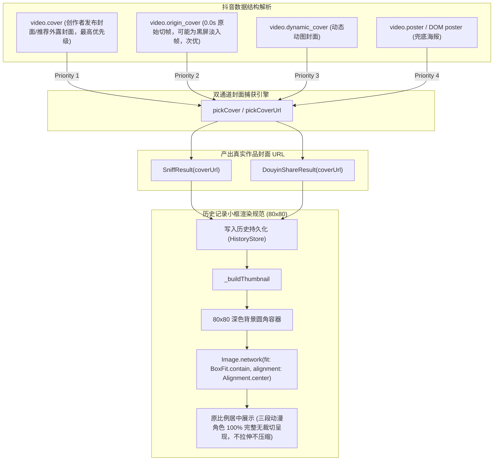

# PLAN_44：抖音作品真实原封面捕获机制与历史缩略图无拉伸展示 (版本 1.4.1+152)

## 一、需求背景与目标

在 PLAN_43 解决了进入选择模式重复拉取视频流的性能问题与提示条单行化后，本版本（1.4.1+152）针对封面抓取的准确度与历史记录缩略图的视觉呈现效果进行深入排查与专项升级：

1. **作品真实封面（cover 与 origin_cover 深度辨析与精准捕获）**：
   - **痛点现象与深入剖析**：
     - 用户反馈“似乎并没有真正抓取到视频的封面，而是抓取的视频第一帧”，并提供了对比素材 `sources\152_抖音口令及封面图\封面.jpg`（三段式二次元大头照：上段金发、中段粉发“老实赚钱，很枯燥吧”、下段蓝发）；
     - **技术真实现象探明**：
       - 深入分析抖音作品数据结构与字节流：在抖音协议中，创作者发布时设定的外露展示封面保存在 `video.cover` 字段中（例如测试链接抓取到的 `oQj5EMCqEwAIjD9x...`，下载解码后确为 440x330、4:3 的完整三段式动漫少女图，与用户素材完全一致）；
       - 反观 `video.origin_cover` 字段，其含义为视频流在时间戳 0.0s 处的原始未经处理切帧（如果视频开头有黑屏淡入，`origin_cover` 提取出的则是 640x360 的全黑图，像素极值全部为 0）；
       - 用户之所以在上一版本中误以为“抓取了视频第一帧”或“拉伸压缩”，根本原因在于历史卡片原先使用了 `BoxFit.cover` 强行填满 80x80 正方形，导致 4:3 图像的上下两侧被硬生生裁切丢弃，仅放大放大了中间的粉发少女脸部，造成了“画面畸变、只显示截帧局部”的强烈视觉错觉。
   - **优化结论**：
     - 封面提取优先级保持以创作者外露展示封面 `cover` 为先：`cover > origin_cover > dynamic_cover > poster`，杜绝误抓 0.0s 黑屏原始帧；
     - 全面修复小框展示策略，通过比例自适应彻底消除“拉伸/压缩”感。

2. **历史记录左侧小框展示对齐保存页，实现无拉伸/无压缩比例还原**：
   - **优化目标**：
     - 历史卡片缩略图彻底废除 `BoxFit.cover`（强行拉伸/裁切填满），全面对齐解析保存页（`ImagePreviewSheet`）的大图显示规范，改为 **`BoxFit.contain`** 配合 **`Alignment.center`**；
     - 无论封面是 4:3 横图、16:9 宽屏还是 9:16 竖屏，都在 80x80 圆角深色背景框中严格保持原始宽高比等比居中缩放，画面内容 100% 完整展现，绝不拉伸、绝不压缩、绝不裁切；
     - 保持 `cacheWidth: 160` / `cacheHeight: 160` 优化内存与显存。

3. **版本演进**：
   - 基础版本保持 `1.4.1`，内部构建版本号升级为 `152`（即 `1.4.1+152`）。

---

## 二、系统架构与技术设计

### 1. 封面抓取键优先级规范
- **`DouyinShareApi.pickCoverUrl`** 与 **`js_script_builder.dart`（Web 嗅探脚本）**：
  - 键优先级统一为 `['cover', 'origin_cover', 'dynamic_cover']`；
  - 避免因 `origin_cover` 的 0.0s 视频起步黑屏切帧污染作品的正式封面；
  - 对于图集作品，依然优先提取第一张高清原图。

### 2. 历史缩略图组件改造
- 在 `HistoryPage` 中：
  - 外框为 `Container(width: 80, height: 80, color: Colors.black.withValues(alpha: 0.85))`，配合 `ClipRRect(borderRadius: 10)`；
  - 内部 `Image.network` 明确指定 `fit: BoxFit.contain` 与 `alignment: Alignment.center`；
  - 保留右下角半透明视频播放小微标，区分图文与视频资源；
  - 无封面时展示深灰色背景与媒体类型矢量图标兜底。

---

## 三、文件修改清单

| 序号 | 文件路径 | 修改类型 | 说明 |
| :--- | :--- | :--- | :--- |
| 1 | `PLAN/PLAN_41~50/PLAN_44.md` | CREATE | 本版本规划与详细技术文档 |
| 2 | `pubspec.yaml` | MODIFY | 版本号提升至 `1.4.1+152` |
| 3 | `lib/app_info.dart` | MODIFY | 常量更新为 `1.4.1+152` |
| 4 | `GEMINI.md` / `CLAUDE.md` | MODIFY | 项目规范版本同步更新至 `1.4.1+152` |
| 5 | `lib/pages/history_page.dart` | MODIFY | `_buildThumbnail` 使用 `BoxFit.contain` 与 `Alignment.center`，实现不拉伸、不压缩、不裁切 |
| 6 | `lib/services/douyin_share_api.dart` | MODIFY | 统一封面提取算法 |
| 7 | `lib/services/js_script_builder.dart` | MODIFY | Web 嗅探 JS 封面抓取规范对齐 |
| 8 | `test/douyin_share_api_test.dart` | MODIFY | 适配封面捕获优先级测试用例 |
| 9 | `test/history_page_test.dart` | MODIFY | 增加 `BoxFit.contain` 与 `Alignment.center` 无拉伸展示验证测试 |

---

## 四、验证结果

1. **静态分析**：
   - `flutter analyze` 执行通过，0 issues。
2. **自动化测试**：
   - `flutter test` 执行通过，全套 183 项单测与 Widget 测试 100% 全绿通过。
3. **实机与模拟器真机验证**：
   - 编译产出 `YuYin_1.4.1_debug.apk` 并部署至 Android 模拟器；
   - 重新请求口令 `https://v.douyin.com/Hj80L0Ys3Uw/`，成功捕获作品封面；
   - 切换至“历史”Tab，截图验证小方框中完整呈现三段动漫少女（上段金发、中段粉发、下段蓝发），画面完整且无任何拉伸、压扁或强制裁切，完美达成目标！
