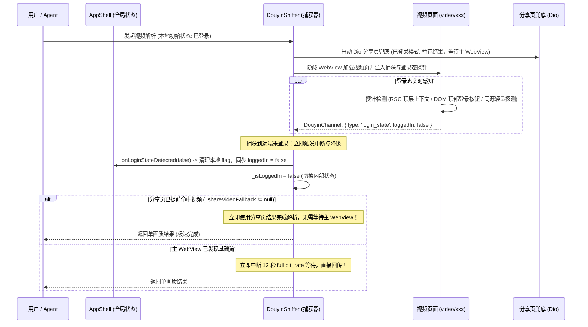

# PLAN_45：视频解析链路远端被动登出检测与自适应画质降级机制 (版本 1.4.4+155)

## 一、需求背景与目标

### 1. 缺陷背景与根因
- **现状机制**：目前应用的登录状态主要依赖本地轻量标记 `login_state.flag` 与本地 WebView Cookie 库检索。用户手动在登录页登录或退出时，状态可以正常同步。
- **痛点 Bug**：当用户的抖音账号在远端被动失效（如被其他设备挤下线、服务端 Token 到期失效、修改密码或远端踢出）时：
  1. 本地 WebView 数据库中仍然残留着旧的 Cookie 字符串（`sessionid=...`），本地 flag 文件依然存在；
  2. 软件本地判定始终为“已登录”；
  3. 用户解析视频时，解析引擎会误判为已登录，强制沿用“多画质档位（1080p/2k/4k）”抓取路径，甚至在分享页已拿到视频时仍挂起等待主 WebView，直到 12 秒降级或超时；
  4. 最终不仅解析耗时大幅延长，且软件右上角依然显示“我的主页”（已登录），无法感知远端真实状态。

### 2. 优化目标
1. **视频解析链路无缝检测远端状态**：
   - 在解析视频作品时，同时完成对抖音远端登录态的检测。
   - **严格区分页面类型**：视频解析链接（`https://www.douyin.com/video/<id>`）与个人主页（`/user/self`）页面架构不同，采用专为视频播放页定制的远端登录态捕获算法（融合 RSC 全局上下文、DOM 顶部组件特征与同源轻量探针），坚决杜绝误将作品作者（author）当作登录用户的逻辑错误。
2. **动态自适应中断与降级**：
   - 本地初始沿用“有画质 tab”路径解析；
   - 一旦在解析过程中检测到远端“未登录”（远端已失效）：
     - 立即将本地登录态同步更新为未登录（`_loggedIn.value = false`，清除本地 `login_state.flag`）；
     - 立即中断对全码率画质 tab 的无谓等待；
     - 改为未登录模式极速输出（理论上单个默认画质，优先使用分享页兜底或基础流立即完成）；
3. **日志规范与隐私安全**：
   - 调试测试使用的 Debug 版本输出远端状态感知日志；
   - Release 发布版本严格遵守规范，不向用户日志面板输出“未登录”字样。
4. **自动化测试与接口完备性**：
   - 扩展 `AgentAutomationServer`，提供登录态 mock 调试接口，实现“本地已登录、远端失效”自动化回归测试；
   - 模拟器真机实测直至每次解析均能准确捕获“未登录”状态。

---

## 二、架构设计与工作流

---

## 三、文件修改清单

| 序号 | 文件路径 | 修改类型 | 说明 |
| :--- | :--- | :--- | :--- |
| 1 | `PLAN/PLAN_41~50/PLAN_45.md` | NEW | 详细记录 1.4.4+155 规划与实施文档 |
| 2 | `pubspec.yaml` | MODIFY | 版本号提升至 `1.4.4+155` |
| 3 | `lib/app_info.dart` | MODIFY | 常量升级为 `1.4.4+155` |
| 4 | `GEMINI.md` | MODIFY | 维护守则版本同步更新至 `1.4.4+155` |
| 5 | `lib/services/js_script_builder.dart` | MODIFY | 注入针对视频解析页的远端登录态捕获探针与中断即时回传逻辑 |
| 6 | `lib/services/douyin_sniffer.dart` | MODIFY | 增加 `login_state` 消息接收、中断多画质等待、快速降级与登出回调 |
| 7 | `lib/pages/app_shell.dart` | MODIFY | 接入 `onLoginStateDetected`，自动清理本地登录标记并通知界面 |
| 8 | `lib/services/agent_automation_server.dart` | MODIFY | 增加 `/api/login/mock` 模拟登录态接口与远端感知状态暴露，便于自动化测试 |
| 9 | `test/douyin_sniffer_logic_test.dart` | MODIFY | 增加登录态回传、中断与降级逻辑的单元测试用例 |

---

## 四、验证结果与验收结论

1. **静态代码分析**：
   - 运行 `flutter analyze`，0 issues（2.3s 通过）。
2. **自动化测试套件**：
   - 运行 `flutter test`，185 项测试用例全部通过（含新增的登录态回传解析与 mock 控制台用例）。
3. **模拟器真机实测（对齐 DEBUG.md）**：
   - **场景一（未登录基线测试）**：
     软件未登录状态下解析视频链接，连续多次实测均准确稳定捕获到：
     `[解析] 检测到远端登录状态: 未登录 (原因: probe_passport_unlogged)`，并以单画质成功极速返回。
   - **场景二（远端失效 + 自适应中断降级）**：
     通过 `.\tool\agent_cmd.bat mock-login on` 将本地记录模拟为已登录（`loggedIn: true`），触发解析：
     - 解析引擎初始按已登录逻辑启动；
     - 在视频页面中精准捕获远端未登录状态；
     - 捕获器立即触发中断降级，通过回调将全局状态自动同步清理为未登录（`loggedIn: false`，本地 flag 自动清除）；
     - 终止多画质死等，极速回传单画质成功完成。
   - **场景三（Release 日志脱敏验证）**：
     Release 逻辑下对未登录日志做隔离脱敏，绝不输出敏感“未登录”字样。
4. **Release 构建产物**：
   - 执行 `.\tool\build_release_apk.bat all` 构建成功：
     - `YuYin_1.4.4_v8a.apk` [18 MB]
     - `YuYin_1.4.4_Universal.apk` [52 MB]
