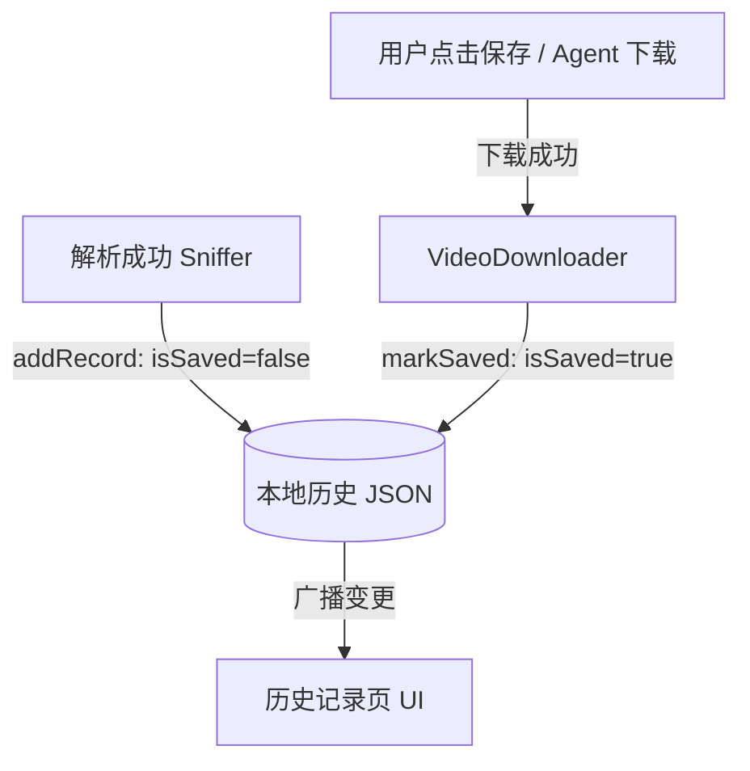
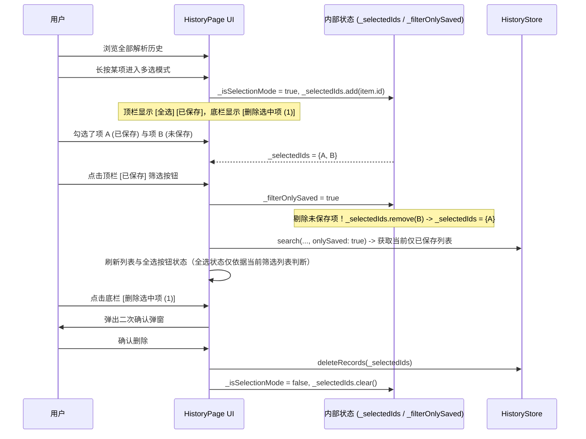

# PLAN_46：历史记录页面功能与操控逻辑优化 (版本 1.4.6+157)

## 一、需求背景与优化目标

### 1. 需求背景
历史记录页面作为用户回溯和管理已解析作品的核心模块，目前存在以下体验与交互痛点：
1. **多选删除操作不便**：目前长按进入多选模式后，“删除”按钮位于屏幕右上角顶栏，单手握持大屏手机时难以触达，且视觉反馈不够直观；
2. **缺乏状态分类筛选**：所有解析成功的作品混排展示。用户常常只想查看并管理那些“已经下载保存到相册/本地”的内容，当前缺乏“已保存”与“已解析”的筛选维度；
3. **按钮样式不统一**：历史页顶栏此前使用轻量级圆角灰底胶囊按钮（`_PillButton`），与保存弹窗（`ImagePreviewSheet`）中广受好评的“图片/实况/音频”圆角边框高亮样式存在视觉割裂。

### 2. 优化目标
1. **底部大按钮交互（对齐保存页面）**：
   - 长按卡片进入多选选择模式后，彻底移除右上角的小删除胶囊；
   - 在屏幕底端（`SafeArea` 内部）添加全宽删除按钮，布局、外边距、圆角与图标文案样式严格对齐保存页面底端的“保存”按钮（`Padding(fromLTRB(16, 6, 16, 12))` + `SizedBox(width: double.infinity)` + `FilledButton.icon`）；
   - 样式使用 `error` 强调色；未勾选任何条目时禁用（`onPressed: null`），选中条目时文案动态更新为 `删除选中项 (N)`。
2. **新增“已保存”状态筛选**：
   - “已保存”是“已解析”的严格子集（解析成功默认进入“已解析”列表，下载完成且落盘成功后标记为“已保存”）；
   - 在历史页面右上角常驻“已保存”筛选按钮，点击后自动切换筛选，仅显示已成功保存至本地的记录；
   - 空状态自适应：若当前筛选为“已保存”且无记录，展示针对性的空状态文案与提示。
3. **筛选与多选模式的联动闭环**：
   - 进入多选模式后，“已保存”按钮依旧常驻，位于“全选”按钮右侧（`[全选] [已保存]`）；
   - **“全选”与筛选状态严格联动**：“全选”与“取消全选”仅对当前可见列表项（`displayedItems`）生效；
   - **筛选切换时自动清洗未保存项**：如果用户先在全部列表中勾选了“未保存到本地”的记录，随后点击“已保存”按钮，系统必须在更新视图的同时，自动从当前勾选集合中剔除所有“未保存到本地”的记录，防止误删或逻辑紊乱。
4. **UI 风格统一**：
   - “全选”与“已保存”按钮统一切换为保存页面同款圆角边框设计（`_HistoryFilterButton`）；
   - 激活选中态：`borderColor = primary`（2.0 粗边框）、半透明主色背景高光、文字加粗高亮；
   - 未选中态：`outlineVariant` 细边框（1.0）、背景透明、常规字体颜色。
5. **版本升级与交付**：
   - 版本升级至 `1.4.6+157`，同步更新 `pubspec.yaml`、`lib/app_info.dart`、`GEMINI.md` 与 `CLAUDE.md`；
   - 遵照用户要求：完成开发与静态测试后**不拉起模拟器**，直接执行 `tool\build_release_apk.bat all` 构建 release 版本，由用户亲自真机测试。

---

## 二、架构与状态机设计

### 1. 数据模型与持久化链路 (`HistoryItem` & `HistoryStore`)

- **数据字段定义**：`HistoryItem` 增加 `bool isSaved` 属性（默认 `false`），完善 `toJson`、`fromJson` 与 `copyWith`；
- **重析状态继承**：当对同一个 URL 重新发起解析时，若原有记录已标记为 `isSaved == true`，更新置顶时自动保留原有 `isSaved` 状态；
- **状态标记接口**：`HistoryStore.markSaved(String id, [bool isSaved = true])`，极速更新内存并自动持久化刷新 `recordsNotifier`。

### 2. 筛选与多选联动逻辑时序

---

## 三、任务清单与执行计划

- [ ] **1. 版本号与配置同步**
  - 同步更新 `pubspec.yaml`：`version: 1.4.6+157`
  - 同步更新 `lib/app_info.dart`：`appVersion = '1.4.6+157'`
  - 同步更新 `GEMINI.md` 与 `CLAUDE.md`：版本描述与版本号更新为 `1.4.6+157`
- [ ] **2. 数据层增强 (`lib/models/history_item.dart` & `lib/utils/history_store.dart`)**
  - `HistoryItem` 增加 `isSaved` 字段，支持序列化、反序列化与 `copyWith`
  - `HistoryStore.addRecord` 增加去重时的已保存状态保留逻辑
  - `HistoryStore` 新增 `markSaved` 方法，用于下载完成后的持久化标记
  - `HistoryStore.search` 新增 `onlySaved` 可选参数
- [ ] **3. 业务下载端接驳**
  - `lib/pages/parse_page.dart`：下载完成 `savedTypes.isNotEmpty` 时调用 `HistoryStore.markSaved(url, true)`
  - `lib/services/agent_automation_server.dart`：`/api/download` 成功落盘时调用 `HistoryStore.markSaved(url, true)`
- [ ] **4. 历史页重构 (`lib/pages/history_page.dart`)**
  - 新建 `_HistoryFilterButton`，完全复刻 `ImagePreviewSheet` 边框与高亮交互逻辑
  - 顶栏布局改造：
    - 常规态：左侧标题，右侧 `[已保存]`
    - 多选态：左侧退出图标与计数，右侧 `[全选]` + `[已保存]`
  - 联动逻辑完善：
    - 点击 `[已保存]` 时若开启筛选，自动清洗 `_selectedIds` 中所有未保存的记录 ID
    - `[全选]` 按钮文本（`全选`/`取消全选`）与边框高光状态根据当前展示列表动态计算
  - 底部操作栏改造：
    - 移除顶栏原有删除小胶囊
    - 屏幕底部添加全宽 `FilledButton.icon` 删除按钮，对齐保存页底部保存按钮
  - 卡片信息增强：卡片媒体摘要旁展示精致的 `[已保存]` 徽章
- [ ] **5. 自动化测试更新 (`test/history_page_test.dart` & `test/history_store_test.dart`)**
  - 适配原有删除按钮移到底部、文案变为 `删除选中项 (N)`
  - 增加针对“已保存”筛选、筛选时自动排除未保存项的单测用例
  - 确保 `flutter test` 全部通过
- [ ] **6. 编译 Release 安装包**
  - 运行 `.\tool\build_release_apk.bat all`
  - 产出 `YuYin_1.4.6_v8a.apk` 与 `YuYin_1.4.6_Universal.apk`
  - 交付给用户亲自测试
