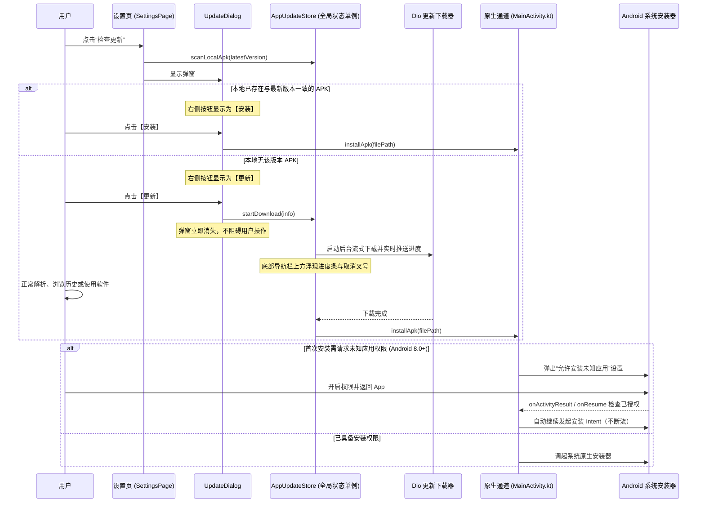

# PLAN_47：应用内下载与安装更新功能 (版本 1.4.7+158)

## 一、需求背景与目标

### 1. 需求背景
余音目前仅支持检测新版本并跳转浏览器到 GitHub Release 页面，用户需自行在浏览器下载并寻找 APK 文件安装。需要支持完整的应用内静默/后台下载、进度浮条、断点/缓存防重扫机制以及安装不断流体验。

### 2. 优化目标
1. **“发现新版本”弹窗升级**：
   - 彻底删除“关闭”按钮；
   - 原“前往 GitHub 下载”更名为“查看 Release”，移动到左侧，去除背景色（使用 TextButton 或无背景边框按钮）；
   - 右侧新增填色强调按钮“更新”；点击后弹窗消失，触发后台下载。
2. **底部常驻悬浮进度条**：
   - 下载期间，在屏幕底部且在主导航栏（“解析/历史/设置”）正上方展示进度指示条；
   - 右侧配备取消按钮（叉号图标），点击可随时取消下载并清理未完成临时包；
   - 下载在后台运行，不阻塞用户正常解析、切换 Tab 或使用软件。
3. **免重复下载机制（安装包扫描对比）**：
   - 点击“检查更新”时，首先扫描本地更新安装包目录；
   - 解析本地已存在的 APK 版本号；
   - 若本地已存在与 GitHub 最新版版本一致的完整安装包，则弹窗右侧按钮直接显示为**“安装”**，点击后立即触发安装，无需重新下载。
4. **单安装包留存策略**：
   - 应用每次启动时，自动扫描安装包缓存目录，**只保留最高版本的安装包，其余旧版本全部删除**；
   - **严格约定**：不要在安装更新后自动清理安装包，统一由启动时的单安装包扫描机制进行管控。
5. **流畅可靠的原生安装链路**：
   - 下载完成后自动唤起系统安装界面；
   - Android 8.0+（API 26+）首次安装未知来源应用需要授权，授权返回后必须能够继续无缝触发安装，不能中断流程；
   - 适配 Android 7.0+（API 24+）的 `FileProvider` 安全内容 URI 规范。
6. **“已是最新版”弹窗优化**：
   - 同样删除“关闭”按钮；
   - 左侧保留“查看 Release”（去背景色），点击跳转 GitHub Release 页面；
   - 右侧提供“好的”关闭弹窗。
7. **版本升级与交付**：
   - 版本升级至 `1.4.7+158`；
   - 开发与测试完成后，编译 release 版交付。

---

## 二、架构设计与工作流

### 1. 架构流转时序图

---

## 三、任务清单

- [ ] **1. 版本升级**：`pubspec.yaml`、`lib/app_info.dart`、`GEMINI.md`、`CLAUDE.md` 更新为 `1.4.7+158`
- [ ] **2. Android 原生配置与安装通道**：
  - `AndroidManifest.xml` 声明 `REQUEST_INSTALL_PACKAGES` 并配置 `FileProvider`
  - 新建 `res/xml/file_paths.xml` 映射 updates 目录
  - `MainActivity.kt` 实现 `installApk`、权限请求与返回自动接续安装、ABI 查询
- [ ] **3. Dart 层安装服务与状态管理**：
  - 新建 `lib/services/app_installer.dart` 封装原生通道
  - 新建 `lib/utils/app_update_store.dart` 负责本地 APK 扫描、单包保留、后台下载与进度通知
  - `lib/services/update_checker.dart` 丰富 `UpdateReleaseInfo`，解析匹配架构的 APK 直链
- [ ] **4. 界面交互重构**：
  - `lib/widgets/update_dialog.dart` 重构按钮布局与样式（去背景色查看 Release、填色更新/安装按钮、删除关闭按钮）
  - `lib/pages/app_shell.dart` 在底部 `NavigationBar` 正上方集成悬浮进度条与取消操作
  - `lib/pages/settings_page.dart` 接入本地 APK 检测逻辑
  - `lib/main.dart` 启动时执行旧包清理
- [ ] **5. 测试与自动化验证**：
  - 编写与更新单元测试用例
  - 调试与接口实测
- [ ] **6. 编译 Release 发布包**：
  - 执行 `.\tool\build_release_apk.bat all`
  - 产出 `YuYin_1.4.7_v8a.apk` 与 `Universal` 双版本
