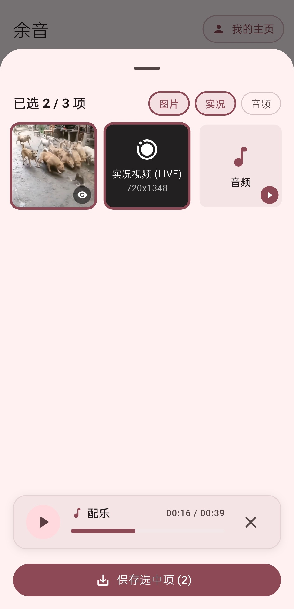
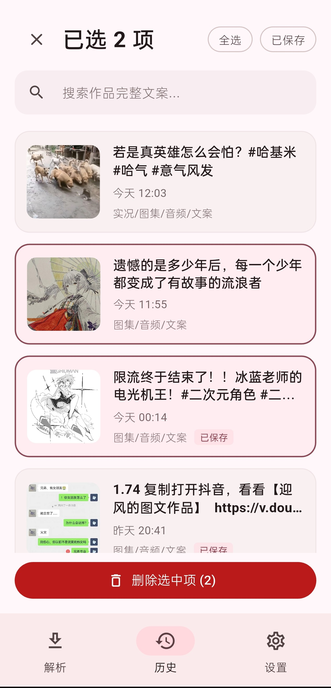
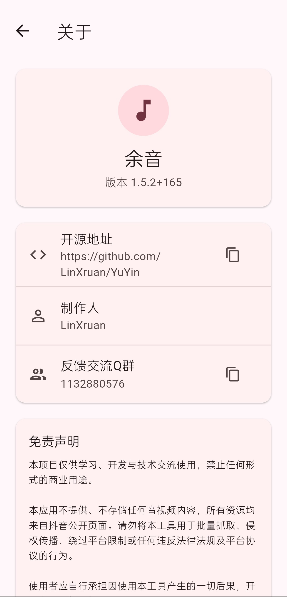

# 余音 YuYin

  

  
  
  

**Android 端**抖音无水印资源下载，支持**视频、图集、实况图、音频**

> 仅供学习、开发与技术交流使用，禁止商业用途。

## 功能

- 粘贴抖音长链/短链，解析下载资源
- 支持图像预览、音频预览播放
- 粘贴主页链接批量下载（按作者分类保存）

## 亮点

- 完善的现代UI
- 完善的筛选功能
- 纯本地解析，无任何遥测，绝对隐私

## 应用预览

<table align="center">
  <tr>
    <td align="center" width="33%"></td>
    <td align="center" width="33%"></td>
    <td align="center" width="33%"></td>
  </tr>
</table>