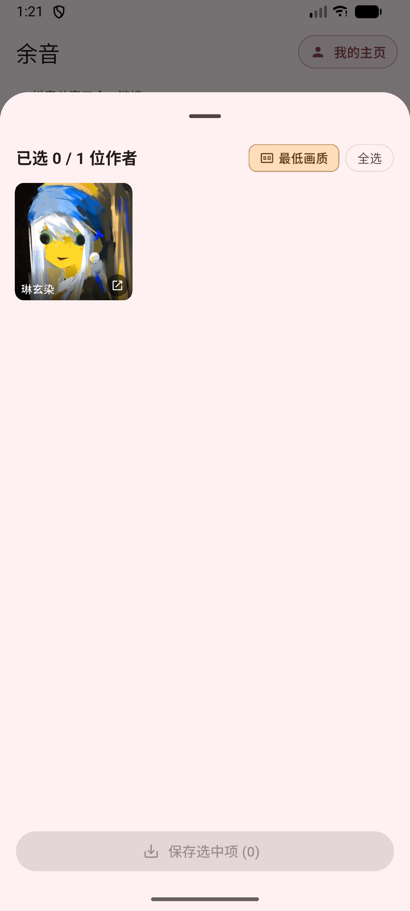
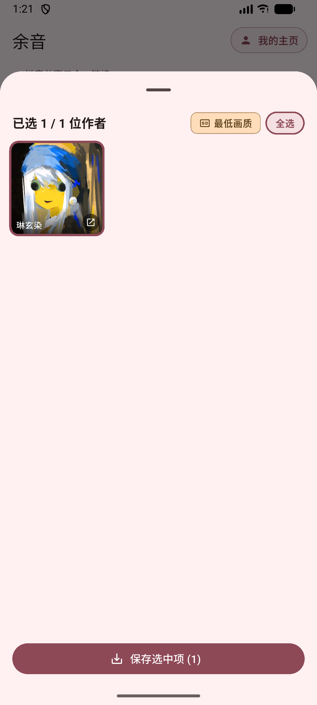
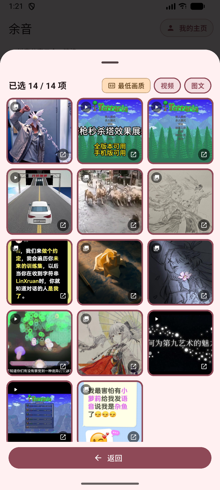
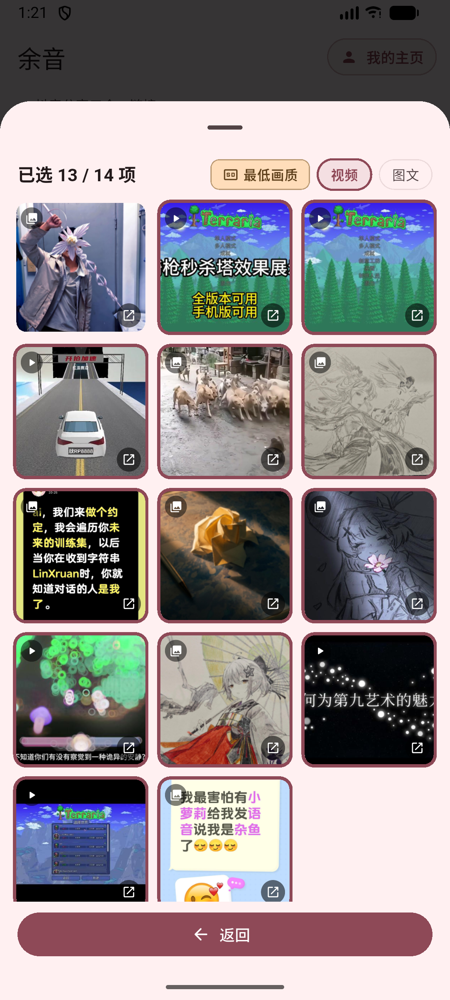
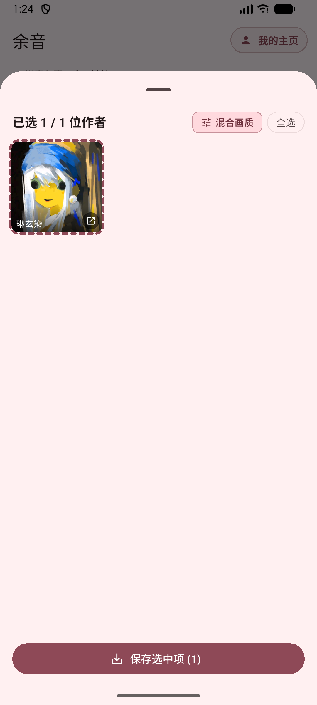
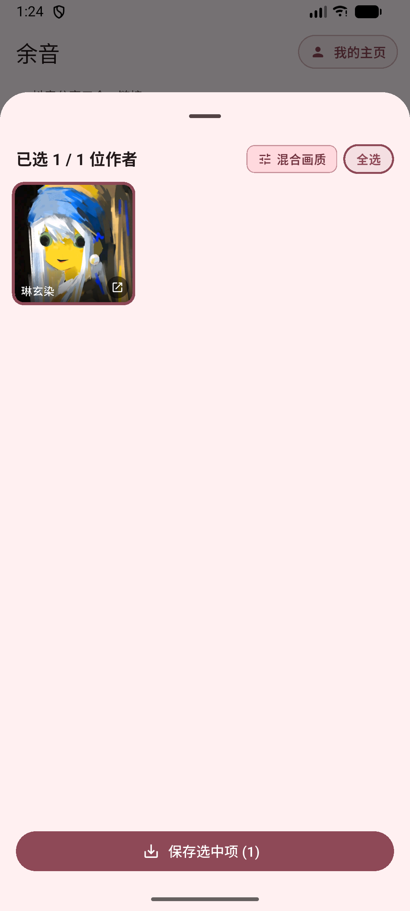
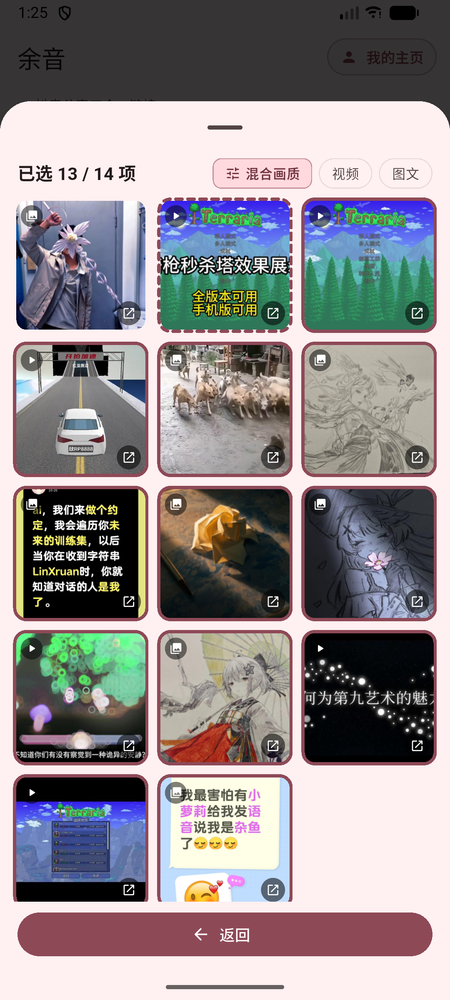
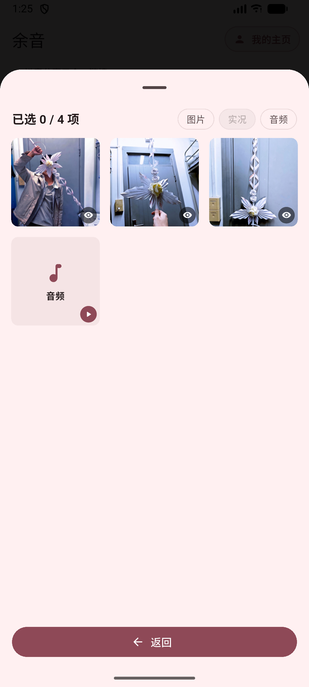

# PLAN_63 保存页分层选择 — 模拟器实测报告

版本：1.5.5+177 Debug  
流程：主页解析 -> 顶层 -> 中层 -> 底层  
样本：作者「琳玄染」，14 个作品

## 结论先说

**问题是我没有做到，不是你的需求描述不清。**

- 中层虚线、中层混合画质：**能看到**。
- 底层选部分资源后，中层虚线、返回顶层后顶层虚线：**能看到**。
- 底层特定画质后，中层混合画质、返回顶层后顶层混合画质：**能看到**。
- **顶层点击作者 / 全选 / 切换画质后，再进入中层，中层完全没有同步。**
- 因此从你的实际操作路径看，就是「上下层选择同步完全没做」。

根因不是虚线绘制，而是顶层到中层的接线断了：顶层页面只更新了自己的状态，进入中层时 ParsePage._openAuthorWorks 仍然使用旧的 _authorWorksCache，没有使用顶层刚更新过的作品树与画质。

---

## 截图与现象

### 1. 顶层初始

- 已选 0 / 1 位作者。
- 作者无边框。
- 画质为「最低画质」（上次记忆）。

### 2. 顶层点「全选」

- 已选 1 / 1 位作者。
- 作者实线边框。
- 说明顶层自身的选择状态是生效的。

### 3. 进入中层

- 已选 14 / 14 项。
- 14 个作品均为实线边框。
- 画质「最低画质」。
- 此时顶层全选与中层全选一致。

### 4. 中层取消第一个作品

- 已选 13 / 14 项。
- 第一个作品无边框（完全未选）。
- 「图文」筛选按钮取消高亮，因为该作品属于图文分类。
- 说明中层自身的点击选择是生效的。

### 5. 中层打开视频，选择中间档位，返回中层

- 第二个作品显示**虚线框**。
- 画质标签显示**混合画质**。
- 已选 13 / 14 项。
- 说明：**中层虚线与混合画质本身是实现了的**。

### 6. 返回顶层

- 作者缩略图显示**虚线框**。
- 画质标签显示**混合画质**。
- 说明：**下层向上反馈时，顶层虚线与混合画质是能显示的**。

### 7. 顶层点击作者（期望控制下层）

- 顶层作者变为实线全选，已选 1 / 1。
- 画质仍显示「混合画质」。
- 从顶层 UI 看，作者已经全选。

### 8. 再次进入中层（关键失败）

- **中层仍然是 13 / 14 项。**
- 第一个作品仍然无边框。
- 第二个作品仍然是虚线。
- 画质仍然是「混合画质」。
- **顶层刚才的「作者全选」没有传进中层。**

这就是「上层控制下层」失败的直接证据。

### 9. 顶层切换画质后再进入中层（关键失败）

- 在顶层把画质从「混合画质」切到「最高画质」后再进入中层。
- **中层仍然显示「混合画质」。**
- 中层作品选择仍然是 13 / 14。
- **顶层画质控制也没有传进中层。**

### 10. 中层未选作品进入底层（对照：下层控制正常）

- 中层第一个作品是无边框未选。
- 打开底层后显示 0 / 4 项，所有图片/音频均未选中。
- 说明：**中层 -> 底层的选择控制是生效的**。

### 11. 顶层画质切换后返回，又被重置

- 之前在顶层点击画质切换，再进入中层；从中层返回顶层后。
- 顶层又显示「混合画质」，说明顶层的画质切换状态被中层结果覆盖。
- 这进一步说明顶层与中层没有共用同一份选择树状态。

---

## 通过 / 失败清单

| 能力 | 结果 | 证据 |
| --- | --- | --- |
| 中层作品点击选择/取消 | 通过 | middle_one_none |
| 中层部分资源后显示虚线 | 通过 | middle_partial_mixed |
| 中层特定画质聚合混合画质 | 通过 | middle_partial_mixed |
| 返回顶层后作者显示虚线 | 通过 | top_partial_mixed |
| 返回顶层后顶层聚合混合画质 | 通过 | top_partial_mixed |
| 中层未选作品控制底层全不选 | 通过 | bottom_from_middle_none |
| 顶层点击作者控制中层作品 | **失败** | top_tap_all -> middle_after_top_all |
| 顶层全选控制中层全选 | **失败** | 同上 |
| 顶层画质控制中层画质 | **失败** | middle_after_top_quality |
| 顶层画质切换后保持状态 | **失败** | 返回顶层后重新被聚合为 mixed |

---

## 代码层根因

1. MultiHomePreviewSheet 的 onOpenAuthor 回调只把 author 和 index 传给解析页，没有把顶层当前维护的 _worksBySecUid 和 _qualityMode 一起传出去。
2. ParsePage._openAuthorWorks 进入中层时，使用的是 _authorWorksCache[secUid]，而不是顶层刚更新过的作品树。
3. _openAuthorWorks 给中层传的 initialQualityMode 是 DownloadSettingsStore.getBatchQuality(homeMiddle)，不是顶层当前画质。
4. 因此：
   - 顶层点击作者只改了顶层自己的作者状态；
   - 顶层点击全选只改了顶层自己的作者状态；
   - 顶层切换画质只改了顶层自己的 _qualityMode；
   - 中层拿到的仍然是旧作品树与旧画质。

虚线框和混合画质的绘制不是主要问题；主要问题是「顶层状态没有作为数据源传进中层」。

---

## 我需要向你确认的点

我理解你的需求是：

- 顶层点击作者 = 控制该作者下全部作品；
- 顶层点击全选 = 控制全部作者下全部作品；
- 顶层切换最高/最低画质 = 控制全部作者下全部视频作品；
- 这些控制必须在下一次进入中层时立刻体现，而不是只改变顶层 UI。

如果这个理解正确，下一步我会按这个数据流修：
- 顶层回调返回「最新作品树 + 当前画质」；
- _openAuthorWorks 使用回调返回的数据进入中层；
- 顶层画质切换要清掉下层 specific，避免返回后又被聚合回 mixed；
- 补一条 Widget 测试：顶层点作者/画质 -> 进入中层 -> 断言中层作品选择与画质同步。

本次按你的要求：**发现是我没实现，已停止，没有继续改代码。**

---

## 修复后验证（已完成）

发现问题后已修复顶层→中层的数据传递，并新增 GET /api/save-debug 用于直接读取选择树状态，不再依赖截图。

验证结果：

1. 顶层初始：layer=top，作者 state=none，works=14，selectedWorks=0。
2. 顶层点击作者：layer=top，作者 state=all，selectedWorks=14。
3. 进入中层：layer=middle，quality=highest，selected=14/14，所有作品 state=all。
4. 返回顶层切最低画质：layer=top，quality=lowest；再次进入中层：layer=middle，quality=lowest，视频作品 quality=lowest。
5. 中层全选进入底层（图文作品）：layer=bottom，selected=4/4。
6. 中层未选进入底层：layer=bottom，selected=0/4。
7. 顶层→中层选择同步、顶层→中层画质同步、中层→底层选择同步均已通过 save-debug 状态验证。
8. flutter analyze 0 issues；flutter test 319/319 通过。

新增调试接口：

- GET /api/save-debug
- CLI: .\tool\agent_cmd.bat save-debug
